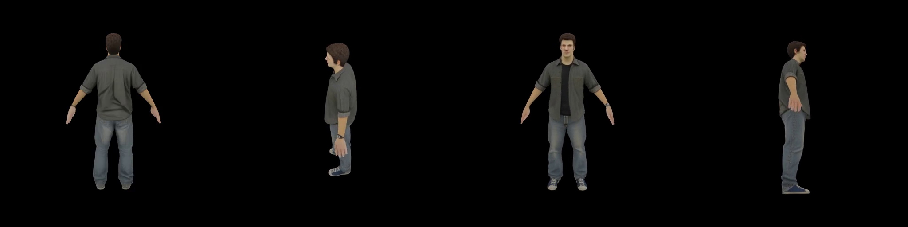
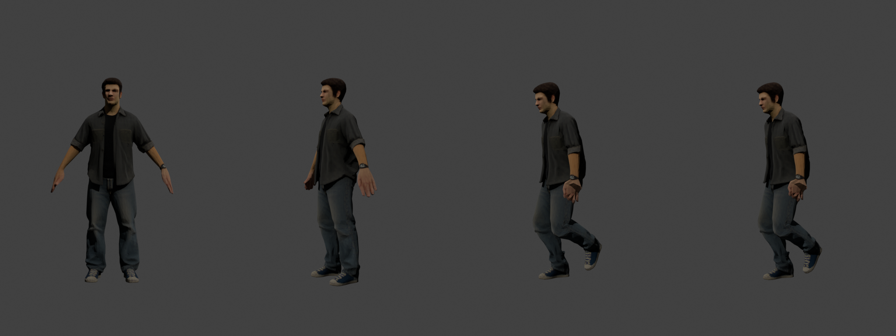

# Protagonist character prototype

**Status (2026-11-10):** prototype skeletal mesh imported into UE 5.8.3 on the template mannequin skeleton. It is the player's body in third person, animated by the template's `ABP_Unarmed` (ADR-023). Not owner-playtested, and not a final hero asset.





## Files

| Path | What it is |
| --- | --- |
| `SourceArt/Characters/Protagonist/concept.png` | Input concept, 1024×1536, full-body A-pose on a grey background |
| `SourceArt/Characters/Protagonist/protagonist_trellis.glb` | TRELLIS image-to-3D output: about 4.5k vertices, one 1024² baked texture |
| `SourceArt/Characters/Protagonist/SKM_Protagonist.fbx` | The GLB skinned to the UE5 mannequin skeleton in Blender 5.2.3; centimetres, Z-up, identity node transforms |
| `Content/Characters/Protagonist/SKM_Protagonist` | Imported skeletal mesh on `/Game/Characters/Mannequins/Meshes/SK_Mannequin`; 180.5 cm tall, bounds extent (55.2, 18.7, 90.3) |
| `Content/Characters/Protagonist/SKM_Protagonist_PhysicsAsset`, `Material_0`, `Image_0` | Generated physics asset, material and texture |
| `Content/Characters/Mannequins/` | Epic's UE5 template mannequin (skeleton, Manny/Quinn meshes, rigs, materials, animations), byte-identical to the engine's `Templates/TemplateResources/High/Characters/Content/Mannequins` |

SHA-256 of the source files:

```text
a45317dbc8578e8f7a185f1b4dbd070a70c7ad247688420b34e1b54de0c8e957  concept.png
d4200ac4f613ae759f9d24926f8a2e9d3617187a6949353076db538d2c1b3fe0  protagonist_trellis.glb
7bfbe9db60512991526f1a9285a70fe1e67bb9ec7000ee632c60ae7a1c319774  SKM_Protagonist.fbx
```

## Provenance and rights

- **Concept image:** supplied by the owner, who states it was generated from a text prompt with no reference images (2026-11-10). The generator and prompt were not recorded.
- **Mesh and texture:** [microsoft/TRELLIS](https://github.com/microsoft/TRELLIS) with the `TRELLIS-image-large` weights, both MIT-licensed, run locally. The textured bake uses [nvdiffrast](https://github.com/NVlabs/nvdiffrast) and Inria's differentiable rasterizer, whose licences cover research and evaluation use only. **Open:** whether those licences reach the baked texture in a commercial game is not cleared. TRELLIS's vertex-colour mode avoids both rasterizers and is the fallback if the answer is no.
- **Skeleton and mannequin:** Epic Games' UE5 mannequin, used under the Unreal Engine EULA. `SKM_Protagonist.fbx` contains the mannequin bone hierarchy and bind pose.

## Pipeline

The pipeline runs outside this repository because its steps are Blender and Unreal editor Python, which ADR-018 keeps out of the tree:

1. TRELLIS turns `concept.png` into a textured GLB.
2. Blender imports `SKM_Manny_Simple` and `MF_Unarmed_Walk_Fwd` (exported from this project's mannequin) and fits the GLB to the mannequin. It straightens Manny's elbows and aims each arm at the generated hand, so the wrist and finger joints sit inside it; Manny's bind pose bends the elbows and holds the hands about 16 cm forward. It transfers Manny's skin weights, replaces the hands with Manny's, and renders rest, walk, open-hand and fist previews.
3. Blender exports the FBX with the data physically in centimetres (`scale_length` 0.01, `FBX_SCALE_NONE`, Z-up, `axis_forward` Y), because UE's FBX importer ignores `UnitScaleFactor`. The raw FBX is checked for unit scale 1, Z-up, about 180 cm of geometry and the pelvis at (0, −2.28, 95.90), as in Manny.
4. The UE 5.8.3 editor imports the FBX with the legacy importer onto `SK_Mannequin`, creating the physics asset, material and texture.

**Verification:** with `PythonScriptPlugin` enabled for that run only, the editor loaded all 132 assets under `/Game/Characters` with no load failures. The protagonist resolves to `SK_Mannequin`, `Material_0` and its physics asset. Twelve editor-only references in Epic's mannequin animations point to assets that the engine template itself does not ship: `SKM_Manny`, `Heroes/Mannequin/Meshes/SKM_Quinn` and `Animations/EditableAnimations/LS_*`. They are inherited unchanged and do not affect loading.

## Known limits

- **Hands (ADR-028):** TRELLIS fuses the fingers, so its hands are replaced with the template mannequin's hands, which are already weighted to every finger bone. Cut at the wrist joint, the mannequin wrist is centred on and widened over the generated forearm, and the hand takes one forearm-skin texel of the generated texture, so it stays one material. They are smooth and untextured next to the baked body, and a small step is visible at the wrist up close. [Rig check: open, left fist, right fist](Captures/character-protagonist/hands_rig_preview.jpg); [in game](Captures/character-protagonist/lent-hands-500x500.jpg).
- **Detail:** about 8.4k vertices (4.2k generated body, 4.2k mannequin hands) with a 1024² texture is enough for a prototype. A hero asset needs retopology and a proper texture bake.
- **Bind pose:** on import, UE warns about the bind pose and recalculates it. This is harmless.
- **In the game:** `AMarburgumCharacter` uses the mesh with `ABP_Unarmed` and a third-person camera (ADR-023). [Walking](Captures/character-protagonist/lent-winded-walking-1920x1080.jpg) and [running](Captures/character-protagonist/lent-running-1920x1080.jpg) on the Lent promenade are frames from the packaged client in the condition smoke; the smoke runs east while the camera still faces the spawn direction, so he runs toward the camera.
- **Blend-space speeds:** the template blend space was authored for the template's walk and run speeds, not 2.2 and 4.4 m/s, so the feet may slide; this has not been measured.
