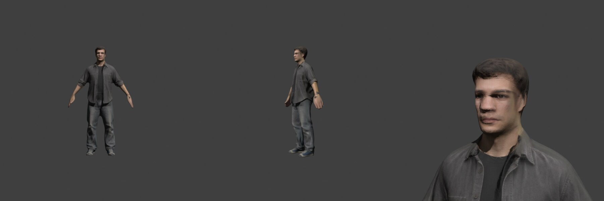
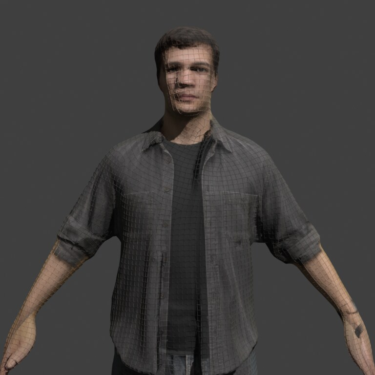
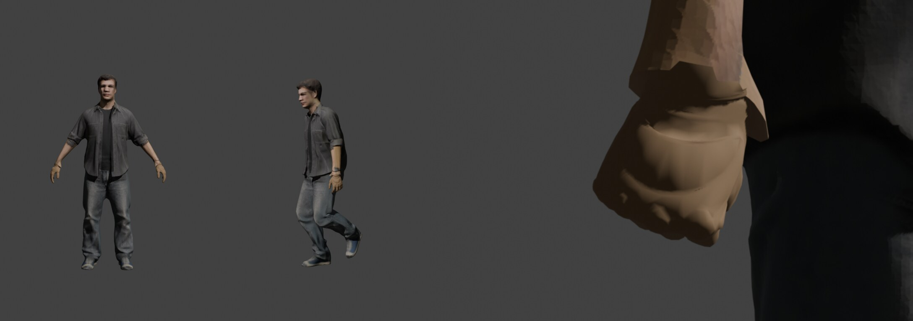
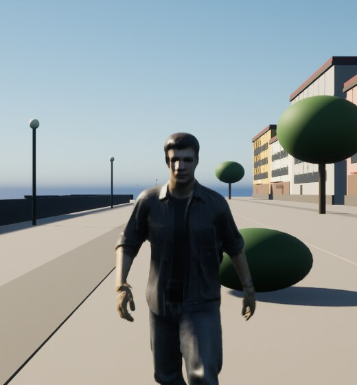

# Protagonist character prototype

**Status (2026-11-10):** retopologised and rebaked (ADR-031): about 11.8k quads, with 2048² colour and normal maps baked without any research-licensed rasterizer. Imported into UE 5.8.3 on the template mannequin skeleton. It is the player's body in third person, animated by the template's `ABP_Unarmed` (ADR-023). Not owner-playtested.









The first prototype (before ADR-031) is kept for comparison: [TRELLIS turntable](Captures/character-protagonist/trellis_turntable.png), [rig check](Captures/character-protagonist/rig_preview.png).

## Files

| Path | What it is |
| --- | --- |
| `SourceArt/Characters/Protagonist/concept.png` | Input concept, 1024×1536, full-body A-pose on a grey background |
| `SourceArt/Characters/Protagonist/protagonist_trellis_vc.glb` | TRELLIS image-to-3D output in vertex-colour mode: the dense source, about 121k vertices and 241k triangles, colour per vertex, no texture bake |
| `SourceArt/Characters/Protagonist/protagonist_retopo.glb` | The retopologised body: 11,822 quads (23,644 triangles), one UV set, embedded 2048² base colour and tangent-space normal maps |
| `SourceArt/Characters/Protagonist/SKM_Protagonist.fbx` | The retopologised body skinned to the UE5 mannequin skeleton in Blender 5.2.3, with the mannequin's hands (ADR-028); 15,530 vertices; centimetres, Z-up, identity node transforms |
| `Content/Characters/Protagonist/SKM_Protagonist` | Imported skeletal mesh on `/Game/Characters/Mannequins/Meshes/SK_Mannequin`; 180.5 cm tall, bounds extent (54.7, 18.6, 90.3) |
| `Content/Characters/Protagonist/M_Protagonist`, `Protagonist_BaseColor`, `Protagonist_Normal`, `SKM_Protagonist_PhysicsAsset` | Imported material (base colour and normal map wired), its two textures (the normal map with `flip_green_channel`, because Blender bakes OpenGL-style normals) and the generated physics asset |
| `Content/Characters/Mannequins/` | Epic's UE5 template mannequin (skeleton, Manny/Quinn meshes, rigs, materials, animations), byte-identical to the engine's `Templates/TemplateResources/High/Characters/Content/Mannequins` |

SHA-256 of the source files:

```text
a45317dbc8578e8f7a185f1b4dbd070a70c7ad247688420b34e1b54de0c8e957  concept.png
a5e5b2c09f72b3f7953d48305e2bddcde5b857707e8f4c32d3e0d8a3242f60eb  protagonist_trellis_vc.glb
dfca688d7f597fb00873816546d322e1b29f184b44c5e1dbd14f7c6c85c11359  protagonist_retopo.glb
99991f192464ed27e0ba6a10e91d7c18341d83aa6536e96b855684759ea9f430  SKM_Protagonist.fbx
```

## Provenance and rights

- **Concept image:** supplied by the owner, who states it was generated from a text prompt with no reference images (2026-11-10). The generator and prompt were not recorded.
- **Mesh and texture:** [microsoft/TRELLIS](https://github.com/microsoft/TRELLIS) with the `TRELLIS-image-large` weights, both MIT-licensed, run locally. The textured bake uses [nvdiffrast](https://github.com/NVlabs/nvdiffrast) and Inria's differentiable rasterizer, whose licences cover research and evaluation use only. **Open:** whether those licences reach the baked texture in a commercial game is not cleared. TRELLIS's vertex-colour mode avoids both rasterizers and is the fallback if the answer is no.
- **Skeleton and mannequin:** Epic Games' UE5 mannequin, used under the Unreal Engine EULA. `SKM_Protagonist.fbx` contains the mannequin bone hierarchy and bind pose.

## Pipeline

The pipeline runs outside this repository because its steps are Blender and Unreal editor Python, which ADR-018 keeps out of the tree:

1. TRELLIS turns `concept.png` into a dense vertex-coloured GLB (`generate.py --vertex-colors`, seed 1, the same geometry as the first prototype).
2. `retopo_bake.py` (Blender) builds a watertight shell from it (voxel remesh with a 2.2 cm morphological close, so pocket mouths and cuffs do not become pits into the hollow cloth), retopologises it with Instant Meshes to about 12k quads, closes any holes, shrinkwraps it onto the shell and UV-unwraps it into u < 0.96, leaving a strip for flat patches. Cycles then bakes, from the dense mesh, the vertex colours (raw: TRELLIS writes display values into glTF's linear `COLOR_0`) and a tangent-space normal map at 2048². Front-facing texels the front view can see take the concept's colour instead, through an orthographic projection fitted to the concept (scale and shift for the body, refined for the head); vertex colours are too coarse for the face, shirt pockets and stitching. Near-black texels where bake rays entered the hollow inside are filled from their neighbours.
3. Blender imports `SKM_Manny_Simple` and `MF_Unarmed_Walk_Fwd` (exported from this project's mannequin) and fits the GLB to the mannequin. It straightens Manny's elbows and aims each arm at the generated hand, so the wrist and finger joints sit inside it; Manny's bind pose bends the elbows and holds the hands about 16 cm forward. It transfers Manny's skin weights, replaces the hands with Manny's, and renders rest, walk, open-hand and fist previews.
4. Blender exports the FBX with the data physically in centimetres (`scale_length` 0.01, `FBX_SCALE_NONE`, Z-up, `axis_forward` Y), because UE's FBX importer ignores `UnitScaleFactor`. The raw FBX is checked for unit scale 1, Z-up, about 180 cm of geometry and the pelvis at (0, −2.28, 95.90), as in Manny.
5. The UE 5.8.3 editor imports the FBX with the legacy importer onto `SK_Mannequin`, creating the physics asset, material and both textures, and sets `flip_green_channel` on the normal map.

**Verification:** with `PythonScriptPlugin` enabled for that run only, the editor loaded all 133 assets under `/Game/Characters` with no load failures. The protagonist resolves to `SK_Mannequin`, `M_Protagonist` and its physics asset; the material samples `Protagonist_BaseColor` (sRGB) as base colour and `Protagonist_Normal` (normal-map compression) as normal. Twelve editor-only references in Epic's mannequin animations point to assets that the engine template itself does not ship: `SKM_Manny`, `Heroes/Mannequin/Meshes/SKM_Quinn` and `Animations/EditableAnimations/LS_*`. They are inherited unchanged and do not affect loading.

## Known limits

- **Hands (ADR-028):** TRELLIS fuses the fingers, so its hands are replaced with the template mannequin's hands, which are already weighted to every finger bone. Cut at the wrist joint, the mannequin wrist is centred on and widened over the generated forearm, and the hand is coloured from a skin patch the rig step paints into the texture's reserved strip (flat in the normal map), so it stays one material. They are smooth and a little lighter than the forearm, and a small step is visible at the wrist up close. [Rig check: open, left fist, right fist](Captures/character-protagonist/hands_rig_preview.jpg); [in game](Captures/character-protagonist/lent-hands-500x500.jpg).
- **Detail:** 15.5k vertices (11.4k body, 4.2k mannequin hands) with 2048² colour and normal maps. The concept covers only the front: the back, sides and the head beyond about 70° from the front carry the coarser vertex colours, and the cheeks show some smearing where the projection grazes. The UV layout is Smart UV Project (many small islands, about 85% of the square used).
- **Bind pose:** on import, UE warns about the bind pose and recalculates it. This is harmless.
- **In the game:** `AMarburgumCharacter` uses the mesh with `ABP_Unarmed` and a third-person camera (ADR-023). [Walking](Captures/character-protagonist/lent-winded-walking-1920x1080.jpg) and [running](Captures/character-protagonist/lent-running-1920x1080.jpg) on the Lent promenade are frames from the packaged client in the condition smoke; the smoke runs east while the camera still faces the spawn direction, so he runs toward the camera.
- **Blend-space speeds:** the template blend space was authored for the template's walk and run speeds, not 2.2 and 4.4 m/s, so the feet may slide; this has not been measured.
