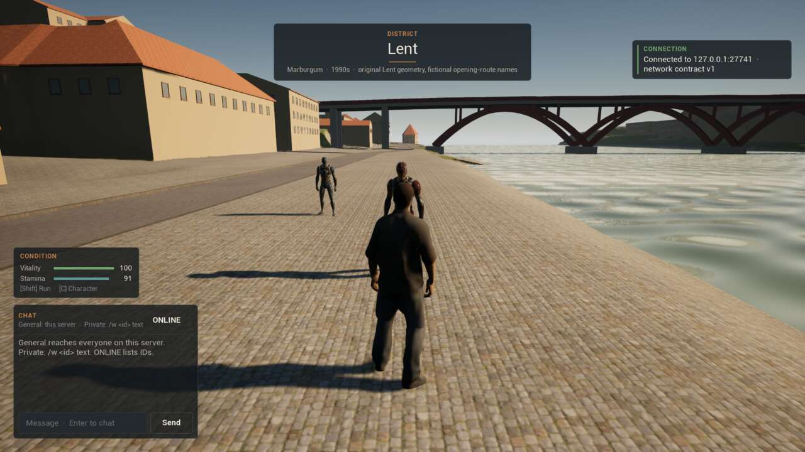
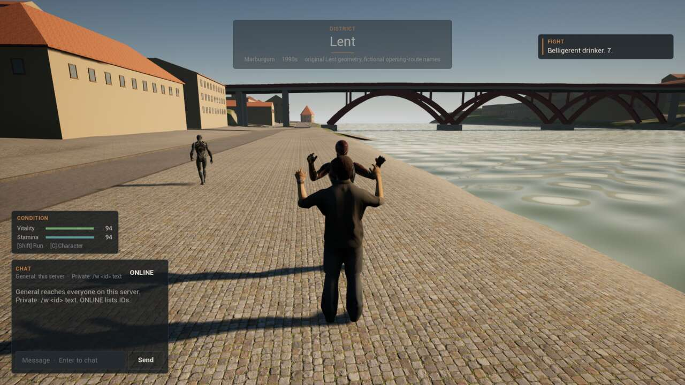
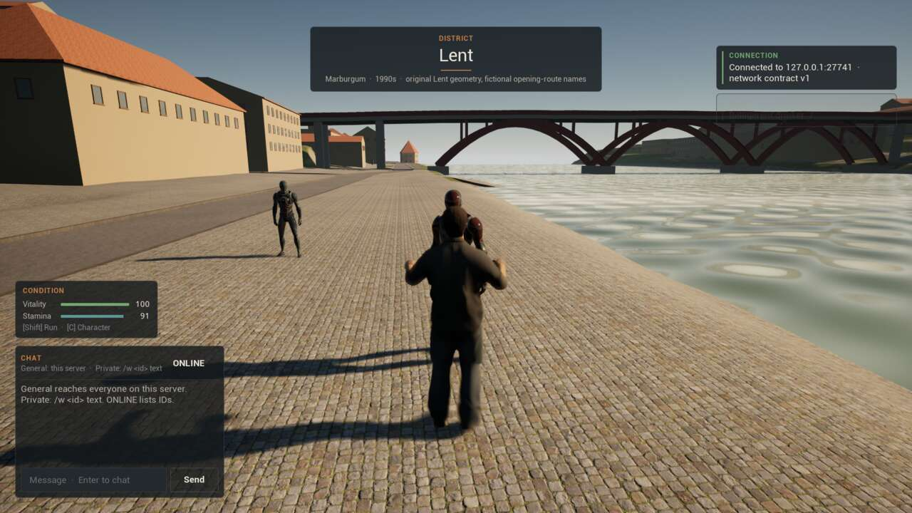
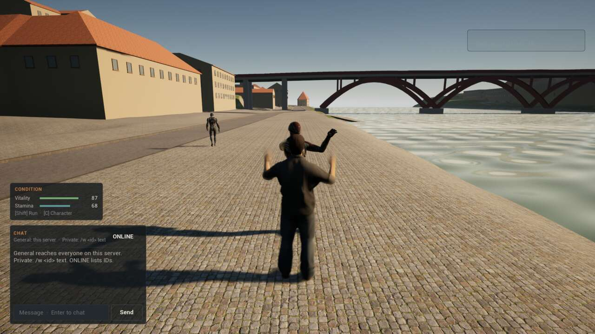
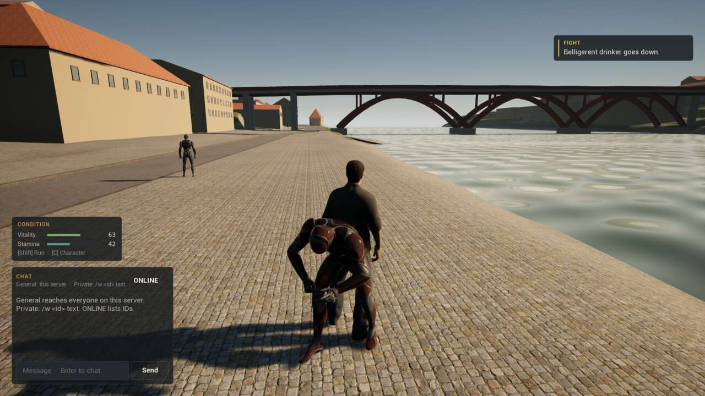

# Stage 1 evidence — unarmed fighting, Linux, 2026-11-11

**Result:** fighting **passes an automated two-client test** on a packaged dedicated server with packaged clients, on the launch map `/Game/World/lent`.

- **The people:** the server spawns the original's Lent fight cast at their original positions: the Belligerent drinker and the Evening walker on the promenade beside the hatchback, and the Newspaper reader on the square.
- **Swings:** a jab out of reach misses, and he is left alone. In reach, a jab lands for 7. A second at once is refused as too soon, and a committed swing lands for 14.7. Every swing costs its stamina, and the server picks every target.
- **He fights back:** a hit turns the drinker on whoever threw it, and he strikes every attack interval. The walker steps away from the fight.
- **Guard:** a raised guard (its clip showing) takes a quarter of his blow, 1.5 instead of 6, and pays 14 stamina. With the hands down, his next blow lands in full.
- **Down:** the rendered client puts the drinker on the floor (his fall plays, `incapacitated`), and a jab at him there reaches nobody. The other client is beaten down: it shows the fall, cannot swing from the ground, and he gives up on it.
- **Sounds:** each landed jab, committed swing, blocked blow and fall picks its CC0 impact; a miss is silent.

Per [ADR-008](DECISIONS.md) the status is `implemented_awaiting_owner_playtest`. The rules, people and fight clips are the original game's ([ADR-041](DECISIONS.md)); the sounds are Kenney Impact Sounds (CC0), because the original's were GTA placeholders.

## Environment

| Item | Value |
| --- | --- |
| Source | The commit that adds this line, on `b2493ed` (ADR-041) and `330163b` (ADR-040, the rebuilt Lent ground) |
| Engine / host | UE **5.8.3** source build; CachyOS Linux 6.18.60 x86_64; NVIDIA GeForce RTX 5080 |
| Processes | Packaged headless `MarburgumIIServer` on a fresh world store; client B (`-nullrhi`) and then client A (rendered offscreen at 1920×1080), both packaged `MarburgumIIClient` sessions joined with `?MB2Start=fight_lent_drunk` |
| Command | `scripts/combat-smoke-linux.sh staged`, port 27741. Run `Saved/CombatSmoke/20261111T140129Z`; `20261111T140343Z` passed staged too. In editor mode it passed three times on `b2493ed` and five times in a row before the rebase onto ADR-040 |
| Other checks | `mb2 validate all` (including `Combat contract OK: 26 rules and 3 people (1 hostile)`); automation tests `Marburgum.*` (7, including `Marburgum.Gameplay.CombatRules`) |

## What runs

- **Rules and people** (`Data/Gameplay/combat.v0.1.json`, `MarburgumCombatContract.h`, kept in step by `mb2 validate combat`): the original's `combat.h` numbers, the fight rules of its `world_simulation.cpp` as pure functions, and the three people with their positions, facings, vitality, damage and colours.
- **Player** (`UMarburgumCharacterMovement`, `AMarburgumCharacter`): F, R and G as in the original. The guard is a held move flag. A swing is a request count carried in every move, so stamina and cooldowns are predicted where the move runs. The server rules each swing and answers with `FMarburgumCombatResult`. Blows on the player go through `ReceiveBlowAuthority`.
- **People** (`AMarburgumFighter`): replicated mannequin characters in the person's colours, run on the server by the original's NPC tick at 10 Hz. The game mode spawns them on Lent's ground, with a `fight_<id>` player start in front of each.
- **Content** (`-run=MarburgumCombatContent`, `scripts/create-combat-content.sh`): `A_FightGuard`, `A_FightJab` and `A_FightHeavy` from the original's procedural clips, and twenty impacts in `/Game/Audio/Combat`.
- **Driver** (`UMarburgumCombatSmokeSubsystem`, `-MB2CombatSmoke`): asks through the same calls F, R and G use. It reads its own condition and clip, the people's replicated state and clips, and the impact sounds the client picks.

## Results ([summary](Captures/stage1-combat/summary.txt))

| Case | Observed | Result |
| --- | --- | --- |
| The people | Server `npc_spawned` and `npc_ready` for all 3: drinker at 6200,−11800 (hostile), walker at 6450,−11200, reader at 18800,−1200 on the square; no unknown NPC | PASS |
| B in reach jabs | Hit `lent_drunk` for 7.0 (85 → 78); the drinker staggers, then turns hostile | PASS |
| B is beaten down | Hands down, B falls after 17.7 s: vitality 0, `down`, its clip the fall; server `beaten` once; a swing from the floor is refused `incapacitated` | PASS |
| He gives up on B | The drinker goes back to idle once B is down | PASS |
| A out of reach | 3.00 m away, a jab is a miss; the drinker stays idle | PASS |
| A in reach | 1.40 m: a jab lands for 7.0 (78 → 71); a second at once is `too_soon` | PASS |
| He turns on A | `hostile`, intent `strike`; the walker's intent `avoid`, and he steps from 6.1 m to 12.0 m away | PASS |
| Guard | Guard up, clip `guard`: his blow is `blocked`, 1.5 damage, 14 stamina paid (server `struck outcome=blocked damage=1.5`) | PASS |
| No guard | Hands down: his next blow lands in full, 6.0 | PASS |
| Committed swing | Lands for 14.7, the clip `heavy`; swings thrown inside the cooldown are refused `too_soon` (7 in the run) | PASS |
| The drinker goes down | The fifth heavy swing takes him from 13 to 0: `incapacitated`, his clip the fall; feed "Belligerent drinker goes down." | PASS |
| After | A jab at him on the floor is a miss | PASS |
| Sounds | 12 landed-blow impacts (`impactPunch_medium_*` for jabs, `impactPunch_heavy_*` for swings), 1 blocked (`impactSoft_medium_*`), falls `impactSoft_heavy_*`; no sound for a miss | PASS |
| Server | 17 swings ruled, 24 strikes by the drinker, 1 blocked by the guard, 1 player beaten, the drinker down once | PASS |

The fight clips were also checked against the original's own numbers. The shoulder-to-hand direction of each arm, read back from the saved mannequin clip at every key, matches the same direction computed from the original's skeleton (`player_male_a.glb`) and keys to within 0.06 per axis. For example, the guard's left arm is (0.70, 0.33, −0.63) against (0.71, 0.28, −0.64).

## Found and fixed by this test

- **A swing could be lost.** A swing first rode on one move's flag. The engine skips a move whose time comes out zero (time-discrepancy resolution and forced-update resync), so at high client frame rates the first swing sometimes never reached the server. Swings are now a request count carried in every move, and the server throws one for each new count.
- **Wire words came out with the wrong case in the packaged build.** An FName compares without case but prints with the casing its name was first registered with, and the cooked game already holds `Hit` and `bLocked`; the first staged run logged `outcome=Hit`, while the game itself behaved correctly. Outcomes and refusals are now written from the contract's words (`Combat::WireWord`).
- **A blow that was already on its way was taken for a failed guard.** The drinker answers a hit at once, as in the original. That unguarded blow's replicated condition could arrive after the guard went up. The driver (not the game) was wrong, and it now waits for blows in flight before it raises the guard.

## Captures

| | |
| --- | --- |
|  |  |
| A in front of the drinker; the walker behind on the left; the condition card at full | Guard up, elbows out and fists high as the original's; the drinker's guard too. Feed "Belligerent drinker. 7." |
|  |  |
| A's jab | A winds up a committed swing while the drinker strikes |
|  | |
| The drinker falls; feed "Belligerent drinker goes down."; A at 63 vitality, 41 stamina | |

**The drawn legs (ADR-043).** The captures above are from the packaged run, before ADR-043. Then the template's foot IK held the fight clips' feet at a standing stance whatever the clip drew. A now also reads its drawn feet, after the whole animation graph, while its committed swing plays: the right foot steps through to 53 cm ahead of the left (the clip puts it 50 cm ahead of the pelvis), and the check wants more than 20 cm. With the old clips the same check found 0 cm (`scripts/combat-smoke-linux.sh editor`, run `20261111T150719Z`, FAIL on that check only); with the regenerated clips the run passes (`20261111T151010Z`). The jab's step (21 cm in the clip) and the guard's bent knees are not checked.

## Not covered

The owner playtest. Fighting other players (the original had none). Weapons. Perception: NPCs do not notice a fight at a distance. Arrests, or any other consequence of violence beyond the fight itself. Hit reactions on the struck body (the original's were GTA placeholders). Closed fists: the original keyed no fingers, so the mannequin's hands stay open. NPC pathfinding: fighters steer straight and sidestep. NPC condition is not saved across a server restart. A downed NPC getting up after 60 s is in the code but not in this test.
