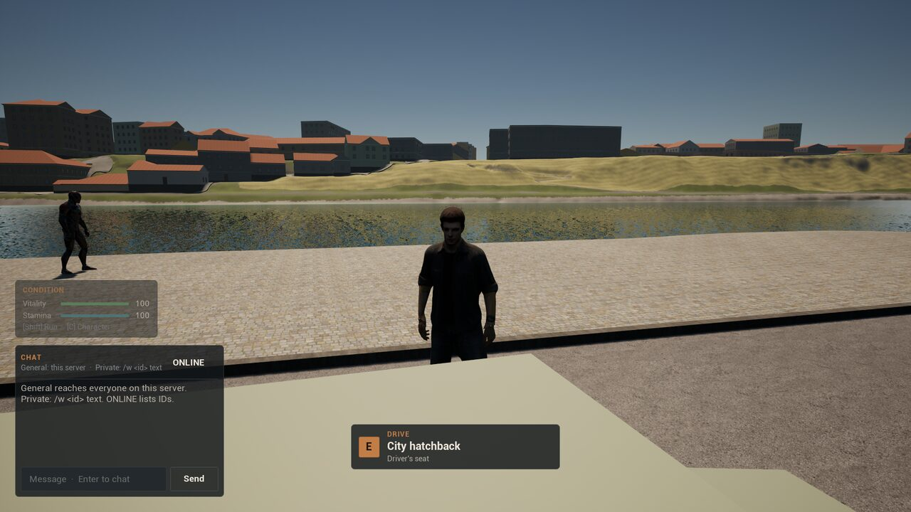
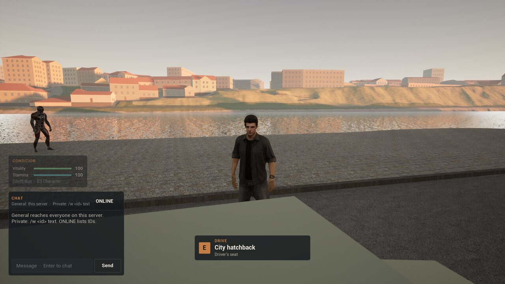
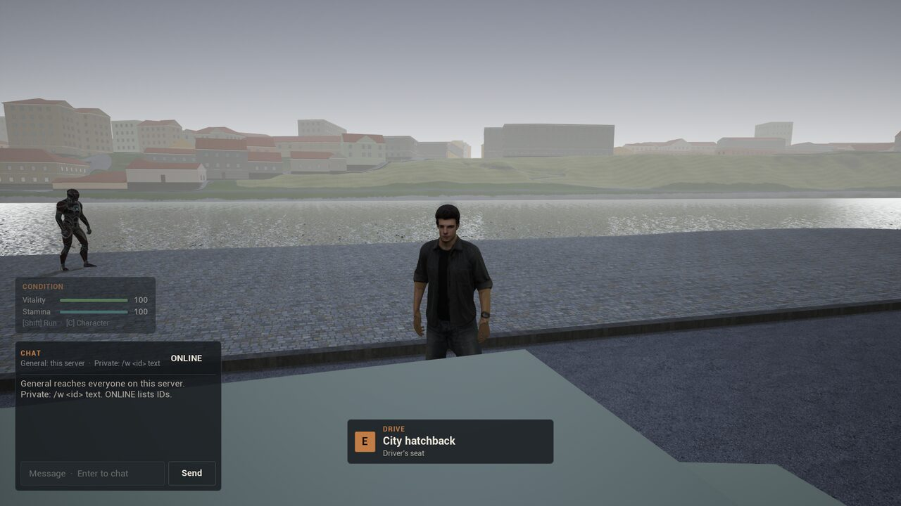
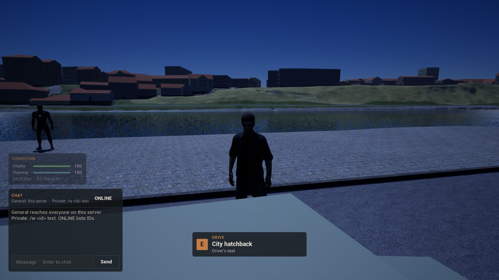
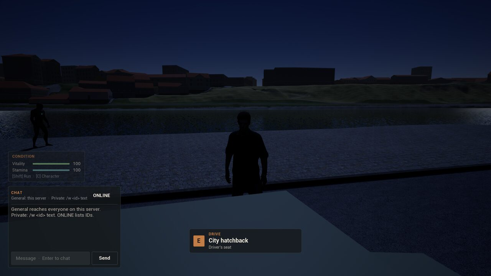
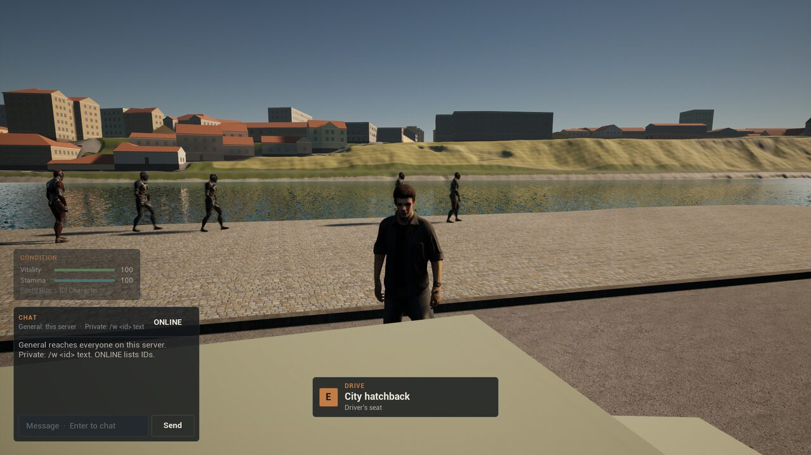

# Stage 1 evidence — the world clock, day and night, Linux, 2026-11-13

**Result:** the world clock and its day and night **pass an automated one-client test** against an editor-mode dedicated server on the launch map `/Game/World/lent`, in six runs under a clear sky: solstice noon, a June sunset, November dusk, a full-moon night, a moonless night, and a dawn at a day a minute.

- **The clock:** the server's Europe/Ljubljana time with the date mirrored into the 1990s. Each client works it out from the replicated anchor and shows it on the location banner ("Fri 21 Jun 1996 · 12:57").
- **The sun** is where it is over Maribor at that instant, and Lent's sky colours it; it fades out after sunset.
- **The night** is lit by the moon where it is up and by a faint skyglow, with the eye held back so night reads as night: noon measures 131 of 255 on the promenade, a full moon 70, a moonless night 26.

Per [ADR-008](DECISIONS.md) the status is `implemented_awaiting_owner_playtest`. The clock is the original's 9 October 2026 decision, which the original never built ([ADR-064](DECISIONS.md)).

## Environment

| Item | Value |
| --- | --- |
| Source | branch `feat/world-clock` on `e3f9eb3` (ADR-063), working tree before the ADR-064 commit |
| Engine / host | UE **5.8.3** source build; CachyOS Linux 6.18.60 x86_64; NVIDIA GeForce RTX 5080 |
| Processes | Editor-mode dedicated server (`UnrealEditor -server`) with `-MB2Weather=clear_dry` and a review clock per run; one editor-mode client (`-game`) at `lent_hatchback`, rendering offscreen at 1920×1080, `-nosound` |
| Command | `scripts/daylight-smoke-linux.sh editor` (run `Saved/DaylightSmoke/20261113T200043Z`); the same six phases again in the full `scripts/weather-smoke-linux.sh editor` (`Saved/WeatherSmoke/20261113T200436Z`) |
| Reference sky | PyEphem 4.2.1 for 46.5567 N, 15.6457 E, 270 m |
| Other checks | Automation `Marburgum.*` 27/27, including `Marburgum.Shared.WorldClock.Calendar`, `.Sky` and `.Daylight`; the full weather smoke (15 phases), Kiosk 67's and the place smoke; Editor, Server and Client target builds |

## Results ([summary](Captures/stage1-daylight/summary.txt))

Every run checks that the client has a clock, that the level's sun is drawn within 0.5° of where the clock puts it, and that the banner's clock line reads the expected 1990s date and time. The night light is in lux against Lent's 8-lux sun. The eye's floor is the factor on the level's adaptation floor. The promenade grey is the mean of the promenade and river right of the player (0..255, alpha ignored).

| Run | Server clock (UTC) | Banner | Sun | Sun drawn | Moon | Night light | Eye floor | Haze glow | Promenade grey |
| --- | --- | --- | --- | --- | --- | --- | --- | --- | --- |
| noon | 2026-06-21 10:57 | Fri 21 Jun 1996 · 12:57 | 66.9° up, 179° (south) | full | 3° up, 45 % lit | none | 1 × | 1.0 | **131** |
| evening | 2026-06-21 18:30 | Fri 21 Jun 1996 · 20:30 | 2.8° up, 302° (north-west) | full, low and red | 36° up, 49 % | none | 1 × | 1.0 | 99 |
| dusk | 2026-11-13 15:50 | Wed 13 Nov 1996 · 16:50 | 4.5° under | out | 12° up, 17 % | 0.10 lux, skyglow | 2.6 × | 0.70 | 102 |
| moonlit | 2026-12-24 23:00 | Wed 25 Dec 1996 · 00:00 | 67° under | out | **66° up, 99 % lit** | **0.41 lux, the moon** | 6 × | 0.04 | **70** |
| moonless | 2026-11-13 21:00 | Wed 13 Nov 1996 · 22:00 | 55° under | out | 26° under | 0.11 lux, skyglow | 6 × | 0.04 | **26** |
| clockrun | 2026-06-21 02:00 ×1440 | (09:01 when read) | 37.7° up in the east, then 32.8° up in the west | full | — | none | 1 × | 1.0 | — |

At a day a minute the client's clock covered 30,165 clock seconds in 20.00 s of its own time: a rate of 1,508 against the server's 1,440 (the check allows a tenth). The server re-sent the clock once, 30.5 s after start, when its world time had fallen half a second behind the wall clock during startup, and that re-send fell inside the client's window. In those 20 s the sun moved 109° across the sky. The full weather smoke's run gave the same rate.

The first run (`20261113T194955Z`) passed every check but drew the night brighter than noon: the moonlit promenade measured 179 and the moonless one 169, because Lent's auto exposure adapted all the way. Calibration runs with the eye's floor at 1, 6 and 30 times the level's (`Saved/DaylightCal/`) gave a full moon 108, 86 and 22 and a moonless night 94, 26 and 3. Six was kept, and the full moon was dimmed from 0.06 to 0.04 of the sun.

### Captures

| Solstice noon | June sunset | November dusk |
| --- | --- | --- |
|  |  |  |

| Full moon, Christmas night | Moonless November night | A day a minute, the afternoon |
| --- | --- | --- |
|  |  |  |

## Not covered

Street lamps and lit windows (Lent's launch map has none), stars and a drawn moon disc. The original design's day/night gameplay. Weather at night, which has not been captured. The night light's shadow cost on lower settings. A packaged run and the owner's look.
