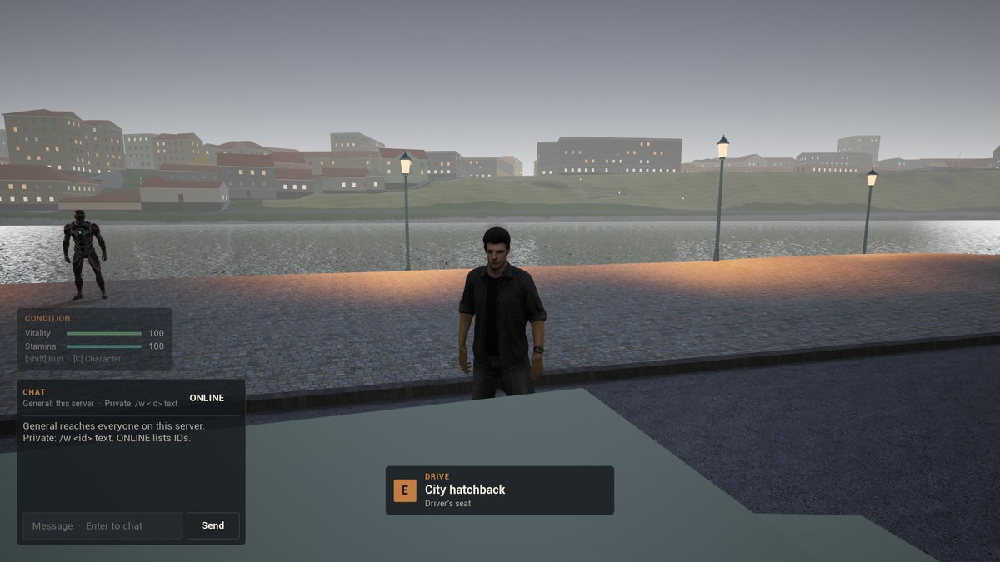
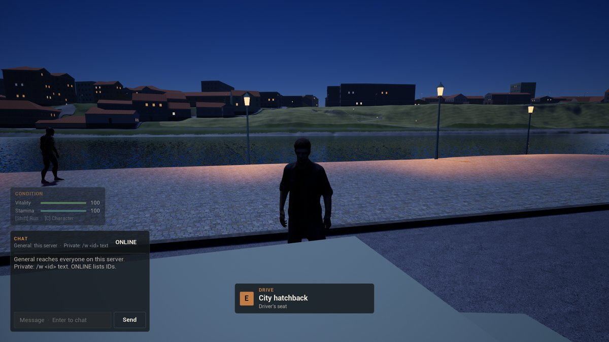
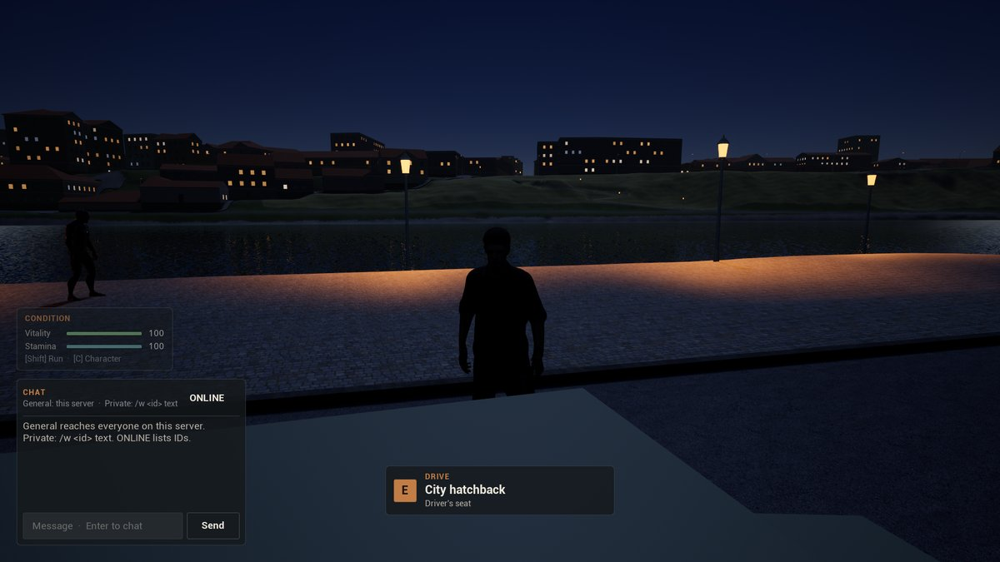
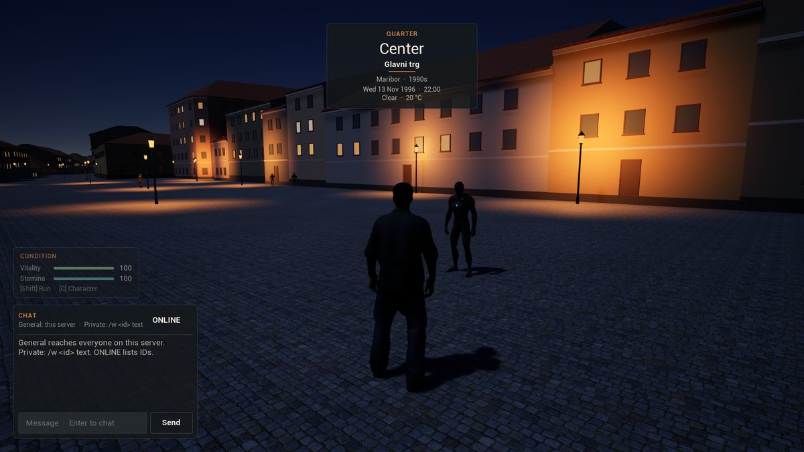
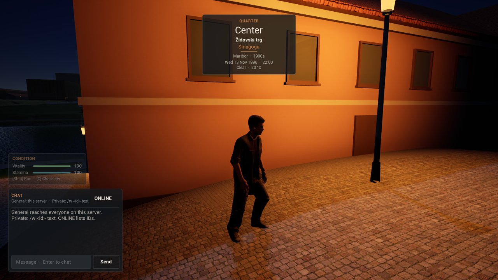
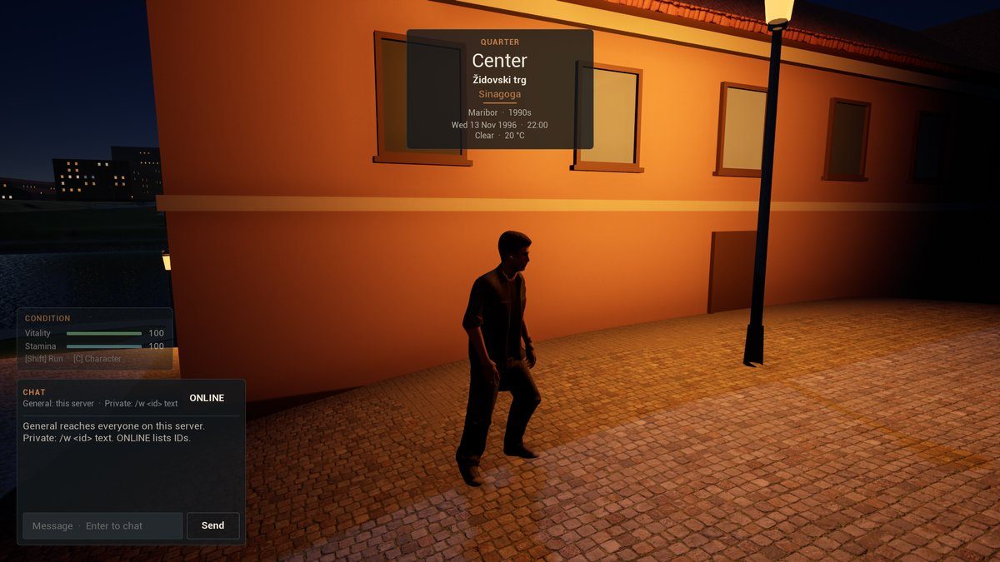
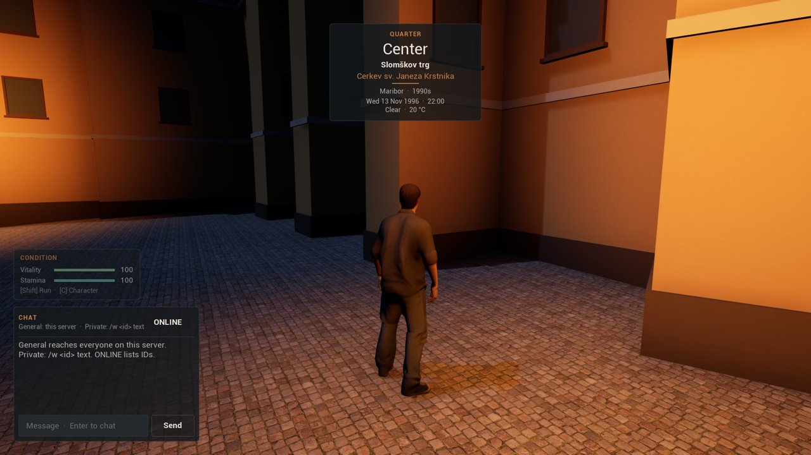
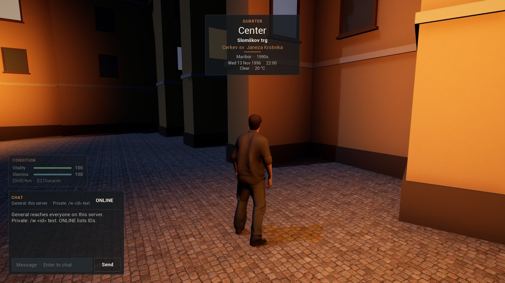
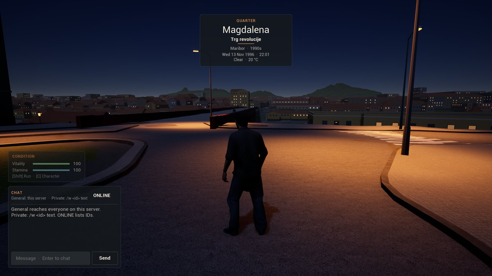

# Stage 1 evidence — lit windows, Linux, 2026-11-17

**Result:** the lit windows **pass an automated one-client test** against an editor-mode dedicated server on the launch map `/Game/World/lent`, in the six day-and-night runs of ADR-064 and on a night walk through Lent and the old town.

- **Households:** the façade rebuild gives each of the 52,326 window panes of the 870 buildings (733 of them have windows) a household. That makes 27,193 households, two or three panes to a flat on one storey, with fixed ranks in the glass's texture coordinates. Every building rebuilds closed, with the same triangles as before.
- **By day:** no window is lit at solstice noon, at the June sunset (the sun 2.8° up) or through the sped-up day, and the full weather smoke's daytime captures measure the same as before the change.
- **By night:** on a Wednesday at 16:50 in November, 39 % of upstairs panes are lit and 85 % of the shops'. At 22:00 it is 46 % upstairs, with the shops down to their night lights. At midnight on Christmas morning (the evening of a Tuesday) 11 % are still up.

Per [ADR-008](DECISIONS.md) the status is `implemented_awaiting_owner_playtest`. The original designed lit windows and never built them ([ADR-066](DECISIONS.md)).

## Environment

| Item | Value |
| --- | --- |
| Source | branch `feat/lit-windows` on `69f5c84` (ADR-065), working tree before the ADR-066 commit |
| Engine / host | UE **5.8.3** source build; CachyOS Linux 6.18.60 x86_64; NVIDIA GeForce RTX 5080 |
| Processes | Editor-mode dedicated server (`UnrealEditor -server`) with `-MB2Weather=clear_dry` and a review clock per run; one editor-mode client (`-game`) rendering offscreen at 1920×1080, `-nosound` |
| Content | `scripts/create-weather-content.sh windows` → `M_WindowGlass`, `MPC_LitWindows`; then `-run=MarburgumRebuildFacades` (`MB2FACADE done rebuilt=870 open=0 failed=0 dropped=62 triangles=3168858`), which writes the households and makes `MI_facade_glass` a child of `M_WindowGlass` |
| Commands | `scripts/daylight-smoke-linux.sh editor` (`Saved/DaylightSmoke/20261117T160143Z`); `MB2_PLACE_CLOCK=2026-11-13T21:00:00Z scripts/place-smoke-linux.sh editor` (`Saved/PlaceSmoke/20261117T160423Z`); the full `scripts/weather-smoke-linux.sh editor` (`Saved/WeatherSmoke/20261117T155405Z`) |
| Other checks | Automation `Marburgum.*` 31/31, including the new `Marburgum.Shared.LitWindows.Households` and `.Schedule`, and `Marburgum.Editor.BuildingMesher`, which now also checks the panes. Editor, Server and Client targets build |

## Day and night ([windows](Captures/stage1-lit-windows/windows.txt), [summary](Captures/stage1-lit-windows/summary.txt))

"Upstairs" is the share of panes above the ground floor that are lit. The client counts it from the façade meshes' own texture coordinates, by the same rule the glass uses, so it is what is drawn. The promenade grey is the weather smoke's measure (0..255), against ADR-065's run (`Saved/DaylightSmoke/20261117T144025Z`).

| Run | Marburgum clock | Evening share | Dusk | Upstairs lit | Shops lit | Promenade grey | Before |
| --- | --- | --- | --- | --- | --- | --- | --- |
| noon | Fri 21 Jun 1996 12:57 | 7 % | 0 | 0 | 0 | 131 | 131 |
| evening | Fri 21 Jun 1996 20:30 | 71 % | 0 | 0 | 0 | 99 | 99 |
| dusk | Wed 13 Nov 1996 16:50 | 39 % | 1 | 38.9 % | 10,066 of 11,806 | 96 | 96 |
| moonlit | Wed 25 Dec 1996 00:00 | 11 % | 1 | 10.9 % | 740 | 72 | 72 |
| moonless | Wed 13 Nov 1996 22:00 | 46 % | 1 | 46.4 % | 740 | 37 | 37 |
| clockrun | a day a minute from 04:00 | — | 0 | 0 | 0 | — | — |

The June evening has most households up, but its sun is 2.8° up, above where a room's light begins to show (4° over the street lamps' threshold of −1.9°), so nothing is lit. The promenade view's mean does not move, since the lit windows are a small part of the far bank. The windows are what changes in the captures.

| November dusk | Full moon, Christmas night | Moonless November night |
| --- | --- | --- |
|  |  |  |

## A night walk ([summary](Captures/stage1-lit-windows/night-walk-summary.txt))

The place smoke's ten stops with the server's clock at 13 November 2026 21:00 UTC (Wednesday 22:00 in Maribor, the moonless night), as in ADR-065. Every stop matched. Each pair shows the same stop before (ADR-065) and now. The mean grey of the scene right of the HUD column barely moves (Glavni trg 39 before and after, the synagogue 74 and 75, the cathedral 74 and 74), since the windows are small and the eye does not change.

| | Before | Now |
| --- | --- | --- |
| Glavni trg |  |  |
| Židovski trg |  |  |
| Slomškov trg |  |  |
| Trg revolucije |  |  |

### How the glow was settled

The first cut glowed at 1.1 times the screen's mid-grey. On Glavni trg a bulb-lit pane then measured (223, 179, 118) and read cream-white, brighter than the lamp-lit wall round it. At 0.75 the same pane measures (207, 157, 99) and reads amber, and the synagogue's lit panes went from (222, 173, 91) to (213, 156, 75). Both runs passed the same checks.

## Daytime unchanged

The glass is now a child of `M_WindowGlass` instead of the original's `M_Building`. The full weather smoke, run with the new glass, measures clear 128.7, overcast 95.4, rain 71.3, snow 130.8, fog 91.9 and storm 69.5. ADR-065's run (`Saved/WeatherSmoke/20261117T143019Z`) measured 128.7, 95.3, 71.2, 130.8, 91.9 and 69.5. Wet braking is 4.60 against 5.29 m/s² dry. All 15 phases pass.

## Not covered

Every ground floor is a shop, including Magdalena's residential streets. The panes glow flat, with no interior behind them, and televisions do not flicker. No window casts light. Holidays are ordinary days. No packaged run, and no owner look yet.
