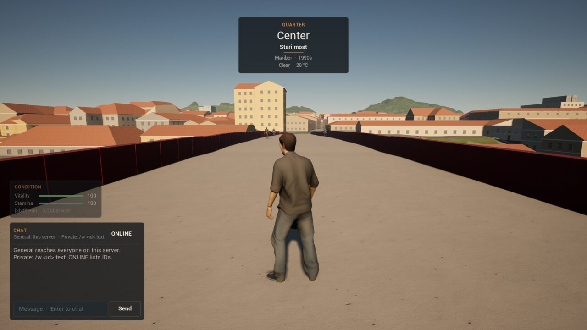
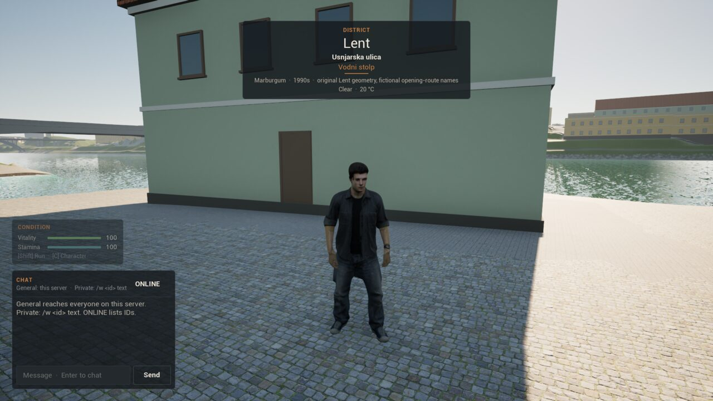
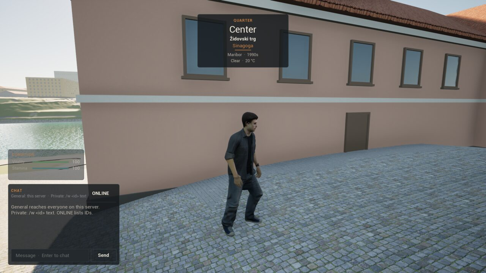
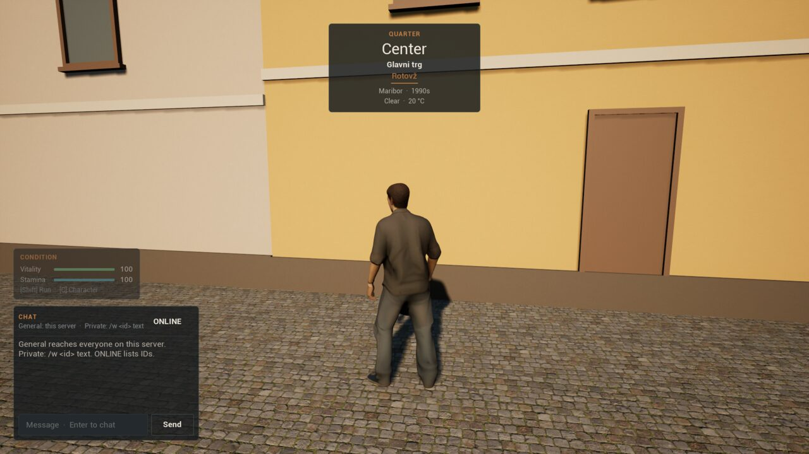
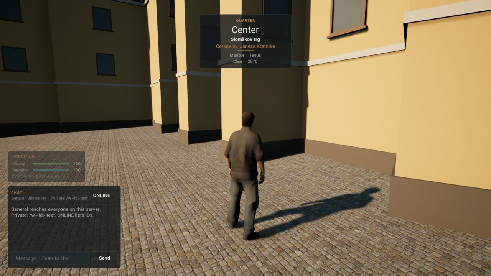
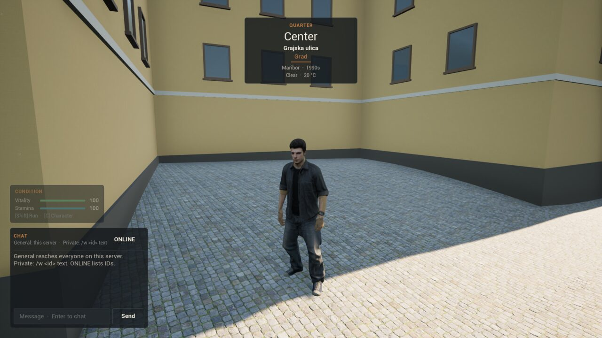
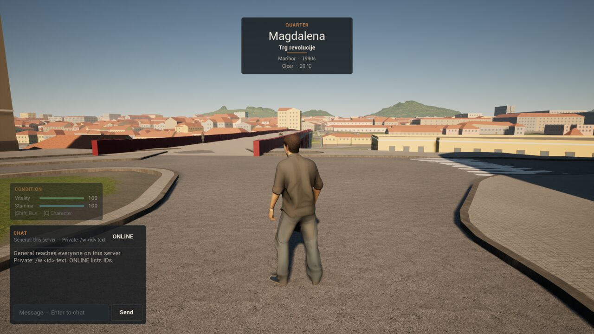
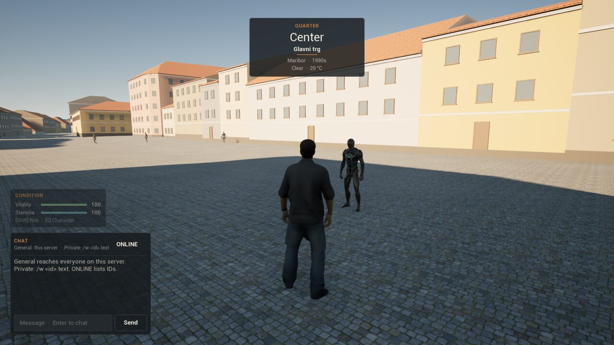
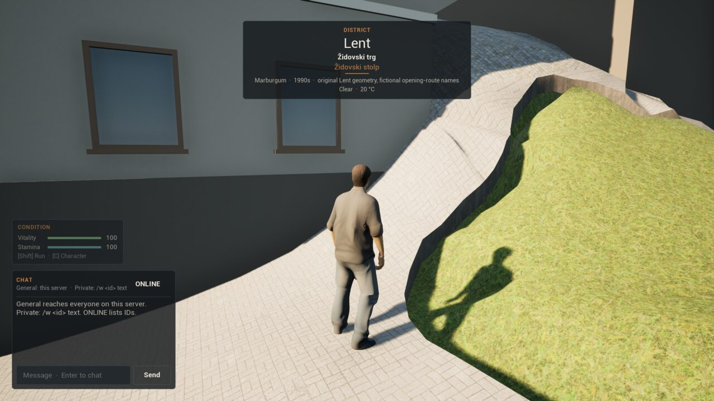

# Stage 1 evidence — place names on the location banner, Linux, 2026-11-12

**Result:** the location banner's place names **pass an automated one-client test** against an editor-mode dedicated server on the launch map `/Game/World/lent`. The server sets the player down at ten stops through Lent and the old town, and at each one the banner shows the expected place, street or square and landmark, and comes up.

- **Place:** the named area (Lent, now the original's promenade strip again) or else the register's quarter or village: "Center" on Stari most and in the old town, "Magdalena" across the river.
- **Street or square:** today's OpenStreetMap names, now including the pedestrian streets and squares the original left out: Glavni trg, Židovski trg, Slomškov trg, Trg revolucije.
- **Landmark:** the heritage register's bespoke tier: Vodni stolp, Židovski stolp, Sinagoga, Rotovž, the cathedral (Cerkev sv. Janeza Krstnika), Grad.

Per [ADR-008](DECISIONS.md) the status is `implemented_awaiting_owner_playtest`. The queries and the hold-at-the-border rules are the original's ([ADR-063](DECISIONS.md)). Every name is today's, not yet checked against 1990s Maribor.

## Environment

| Item | Value |
| --- | --- |
| Source | branch `feat/place-names` on `a0bb9c9` (ADR-062), working tree before the ADR-063 commit |
| Engine / host | UE **5.8.3** source build; CachyOS Linux 6.18.60 x86_64; NVIDIA GeForce RTX 5080 |
| Processes | Editor-mode dedicated server (`UnrealEditor -server`); one editor-mode client (`-game`) rendering offscreen at 1920×1080, `-nosound` |
| Command | `scripts/place-smoke-linux.sh editor` (run `Saved/PlaceSmoke/20261112T180459Z`) |
| Content | `lent-ground places` → `Content/Marburgum/Places/lent_places.json` (27 districts, 141 street and square names on 551 ways, 25 squares, 58 landmarks; none left out on load); `-run=MarburgumCreateMaps -LentArea` |
| Other checks | Automation `Marburgum.*` 24/24, including `Marburgum.Shared.Places.Parse`, `.Lent` and `Marburgum.Client.LocationBanner`; `cargo test` `tools/lent-ground` 32 and `tools/mb2` 32; Lent smoke (`Saved/LentSmoke/20261112T180628Z`) and a dry weather run on the launch map (`Saved/WeatherSmoke/20261112T180745Z`) pass; Editor, Server and Client target builds |

## Results ([summary](Captures/stage1-places/summary.txt))

The server logs the area box it finds on the map: `lent` centred 78 m north of the bridge's middle, 54 × 420 m, the original's `areas.json` strip. At each stop the server moves the player onto the ground, waits six seconds, and the client reads the banner's three lines as drawn.

| Stop | Place | Street or square | Landmark | Banner up |
| --- | --- | --- | --- | --- |
| Stari most | Center | Stari most | — | yes |
| Vodni stolp | Lent | Usnjarska ulica | Vodni stolp | yes |
| Židovski stolp | Lent | Židovski trg | Židovski stolp | yes |
| Sinagoga | Center | Židovski trg | Sinagoga | yes |
| Glavni trg | Center | Glavni trg | — | yes |
| Rotovž | Center | Glavni trg | Rotovž | yes |
| Cathedral | Center | Slomškov trg | Cerkev sv. Janeza Krstnika | yes |
| Grad | Center | Grajska ulica | Grad | yes |
| Magdalena | Magdalena | Trg revolucije | — | yes |
| Stari most again | Center | Stari most | — | yes |

The banner came up eleven times in the run: on arrival and once at each stop. On Glavni trg it came up for the square and again for the Rotovž.

The first run (`20261112T175737Z`) matched every street and landmark, but the place line failed at six stops: the launch map's old `lent` box (537 × 550 m round the bridge) reached Glavni trg and the Magdalena bank, so "Lent" won over the quarter almost everywhere. After the box was set back to the original's strip, every stop passed.

### Captures

| Stari most | Vodni stolp (in Lent) | Židovski trg, the synagogue |
| --- | --- | --- |
|  |  |  |

| Glavni trg, the Rotovž | Slomškov trg, the cathedral | Grajska ulica, Grad |
| --- | --- | --- |
|  |  |  |

| Magdalena, Trg revolucije | Glavni trg | Židovski stolp |
| --- | --- | --- |
|  |  |  |

## Not covered

1990s names and boundaries. Walking between stops: the player is set down at each one, so holding a name at a border, a junction or a shared wall is unit-tested only. The facade and generated landmark tiers. Names on a map or minimap, and street signs. A packaged run and the owner playtest.
