# Stage 1 evidence — districts on the street, Linux, 2026-11-19

**Result:** the street population **passes an automated one-client test** against an editor-mode dedicated server on the launch map `/Game/World/lent`. A route of six stops, each in one of the original's zones, is walked at four moments of the 1990s week.

- **By district:** on Tuesday 18 June 1996 at 10:00 the server keeps 20 people round the player on Trubarjeva ulica in the old town, 18 on Partizanska cesta, 12 among the Magdalena blocks, 8 on a street of houses, 7 at the works off Pobreška cesta and 16 by a school. The client sees exactly those numbers within 70 m.
- **Their own people:** 401 of the 404 people sent out at the 24 stops stand on the stop's own zone. They are mostly workers at the works (10 of 13), students by the school (22 of 28), shoppers on the shopping street (17 of 27) and residents among the blocks in the evening (24 of 29). In the evening the street of houses has people out walking (7 of 29).
- **By the hour:** at 19:00 the blocks are fuller than by day (16 against 12) and the school emptier (7 against 16). At 03:00 the six stops keep 3, 2, 2, 1, 1 and 1, and nobody of the day (commuters, shoppers, pensioners) is sent out anywhere.
- **On a Sunday:** the shopping street keeps its 18 but sends out no shoppers or commuters (26 of its 35 are residents). The school keeps its 16 but has no students: all 24 are residents. The works keep their workers (10 of 12).

Per [ADR-008](DECISIONS.md) the status is `implemented_awaiting_owner_playtest`. The zones, their weekday tables, the workers and out-walking groups, each player's number from their own street and busy streets filling first are the original's ([ADR-068](DECISIONS.md)). The weekend, including the school's, is Marburgum II's own.

## Environment

| Item | Value |
| --- | --- |
| Source | branch `feat/street-districts` on `04650bc` (ADR-067), working tree before the ADR-068 commit |
| Engine / host | UE **5.8.3** source build; CachyOS Linux 6.18.60 x86_64; NVIDIA GeForce RTX 5080 |
| Walk graph | `Content/Marburgum/Street/lent_walk_graph.json` after `lent-ground street-zones` against the original's `project/data/road_graph.json` (magna-raedarum-marburgum `30dd64c7`). Nearest original node: median 5.1 m, 99th percentile 50.6 m, farthest 85 m; none farther than 100 m. Loaded in the level: 12,941 of 13,098 nodes, all zoned (old town 1,553, commercial 2,520, blocks 3,249, houses 3,644, works 193, school 1,030, park 7, countryside 745) |
| Processes | Per phase, an editor-mode dedicated server (`UnrealEditor -server`) with `-MB2StreetSeed=1990 -MB2StreetRoute`, a pinned clock and `clear_dry`, and one editor-mode client (`-game`) rendering offscreen at 1920×1080, `-nosound`, counting the people within 70 m every second (`-MB2StreetSmoke -MB2StreetCount=390 -MB2StreetShotAfterMove=50`) |
| Commands | `scripts/street-district-smoke-linux.sh editor` (`Saved/StreetDistrictSmoke/20261119T111631Z`); regressions `scripts/street-hours-smoke-linux.sh editor` (`Saved/StreetHoursSmoke/20261119T114403Z`) and `scripts/street-smoke-linux.sh editor` (`Saved/StreetSmoke/20261119T115611Z`, `20261119T115735Z`, `20261119T115859Z`) |
| Other checks | Automation `Marburgum.*` 31/31, including the extended `Marburgum.Gameplay.StreetRules`; `mb2 validate all` (street: 8 groups, 28 looks, 8 zones' hours, every walk node zoned), and it caught each of four mismatches planted to test it (a zone's density in the data, a mix row in the contract, the spawn-activity floor in the server, a node without a zone); mb2 tests 33/33; lent-ground tests 40/40 (four new for the zones); .NET manifest check. Editor, Server and Client targets build |

## The route

`MarburgumStreetRoute.h`: six places where every walk node from 22 to 60 m out, the band where people appear, is on one zone (the works': 93% by spawn weight). The server sets the player down at each a minute apart, 6 s after the body appears, and turns the view along the street.

| Stop | Plan (m east, m south of Stari most) | Nearest named street | Zone the street reads there |
| --- | --- | --- | --- |
| old_town | −122.3, −628.9 | Trubarjeva ulica | old_town |
| commercial | 405.5, −505.1 | Partizanska cesta | commercial |
| residential_blocks | −44.2, 216.8 | Trg revolucije (13 m), Magdalena | residential_blocks |
| residential | −669.1, 673.9 | Ulica heroja Zidanška | residential |
| industrial | 359.8, 530.3 | Pobreška cesta (25 m) | industrial |
| school | −476.9, −349.1 | Smetanova ulica (46 m) | school |

## The phases ([summary](Captures/stage1-street-districts/summary.txt))

"Kept" is the server's number for the player at the stop: twenty times its zone's density for the hour. "Seen" is the client's mean count within 70 m between 30 and 58 s after it was moved there. "Sent out" counts the server's spawns at the stop, by group, of those on the stop's own zone (after the slash, all spawns there).

| Phase | Stop | Kept | Seen | Sent out |
| --- | --- | --- | --- | --- |
| Tue 18 Jun 1996 10:00 | old town | 20 | 20.0 | commuters 2, shoppers 8, pensioners 8, students 4, residents 2 (24/24) |
| | shopping street | 18 | 18.0 | commuters 2, shoppers 17, pensioners 4, students 4 (27/27) |
| | blocks | 12 | 12.0 | shoppers 2, pensioners 5, students 3, residents 7 (17/18) |
| | houses | 8 | 8.0 | shoppers 2, pensioners 5, residents 9 (16/16) |
| | works | 7 | 7.0 | commuters 3, workers 10 (13/13) |
| | school | 16 | 16.0 | commuters 1, students 22, residents 5 (28/28) |
| Tue 19:00 | old town | 18 | 18.0 | shoppers 6, students 13, residents 6, night owls 4 (29/29) |
| | shopping street | 14 | 14.0 | commuters 4, shoppers 10, students 2, night owls 2 (18/18) |
| | blocks | 16 | 16.0 | commuters 2, students 3, residents 24 (29/31) |
| | houses | 11 | 11.0 | commuters 6, residents 16, out walking 7 (29/29) |
| | works | 5 | 5.0 | residents 2, workers 6 (8/8) |
| | school | 7 | 7.0 | students 8, residents 4 (12/12) |
| Wed 19 Jun 03:00 | old town | 3 | 3.0 | residents 1, night owls 3 (4/4) |
| | shopping street | 2 | 2.0 | night owls 3 (3/3) |
| | blocks | 2 | 2.0 | night owls 3 (3/3) |
| | houses | 1 | 1.0 | residents 1, night owls 1 (2/2) |
| | works | 1 | 1.0 | night owls 1, workers 1 (2/2) |
| | school | 1 | 1.0 | night owls 1 (1/1) |
| Sun 23 Jun 12:00 | old town | 20 | 20.0 | pensioners 5, students 11, residents 10 (26/26) |
| | shopping street | 18 | 18.0 | pensioners 6, students 3, residents 26 (35/35) |
| | blocks | 12 | 12.0 | pensioners 9, students 1, residents 11 (21/21) |
| | houses | 8 | 8.0 | pensioners 6, residents 12 (18/18) |
| | works | 7 | 7.0 | residents 2, workers 10 (12/12) |
| | school | 16 | 16.0 | residents 24 (24/24) |

The three people sent out off their stop's zone were all among the blocks, where a few nodes of the band belong to the next street. Everyone the server keeps for the player is within 65 m, so the client sees exactly the server's number at every stop.

| Tuesday 10:00, old town | shopping street | blocks |
| --- | --- | --- |
| 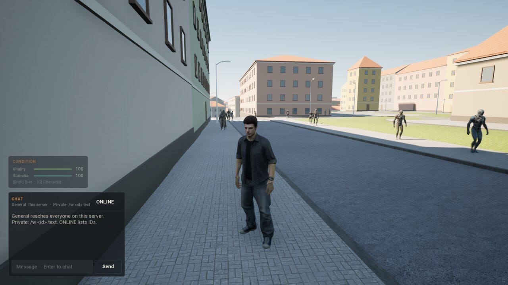 | 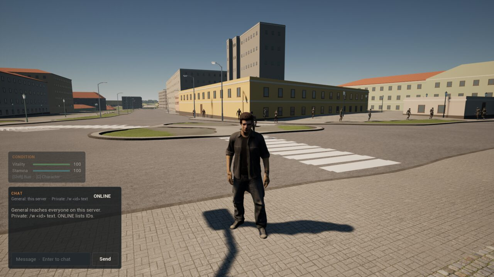 | 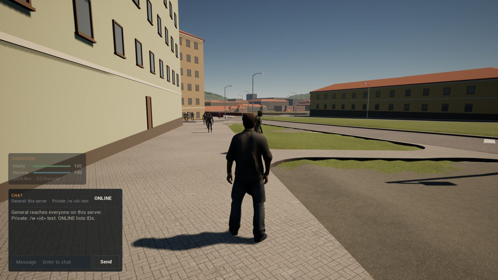 |

| houses | works | school |
| --- | --- | --- |
| 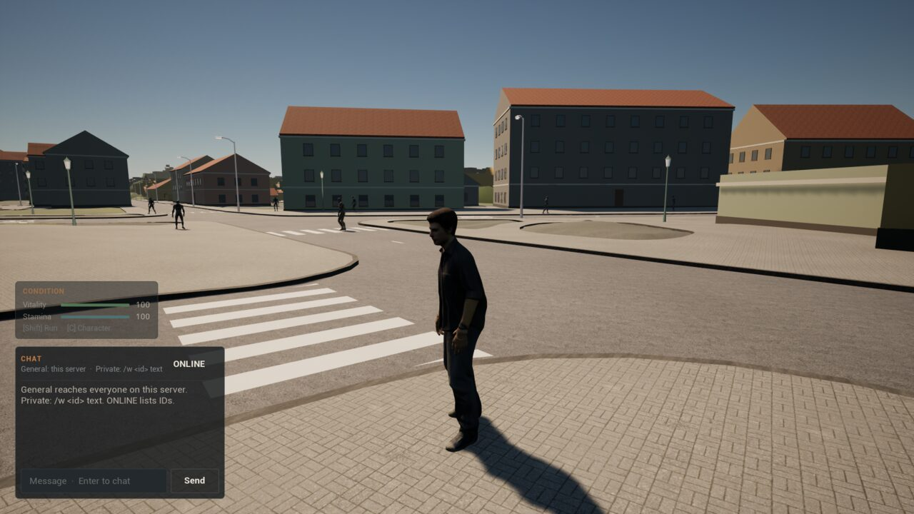 | 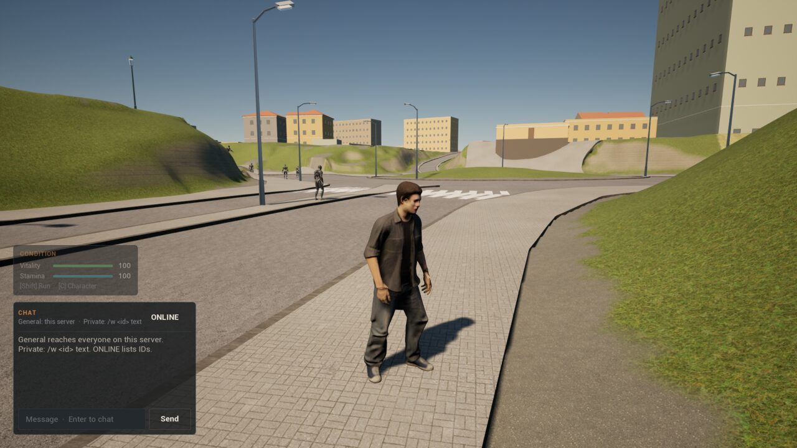 | 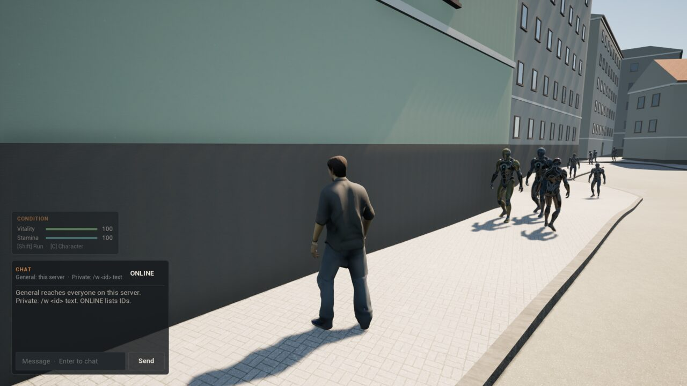 |

| Tuesday 19:00, blocks | Tuesday 19:00, houses | Wednesday 03:00, old town |
| --- | --- | --- |
| 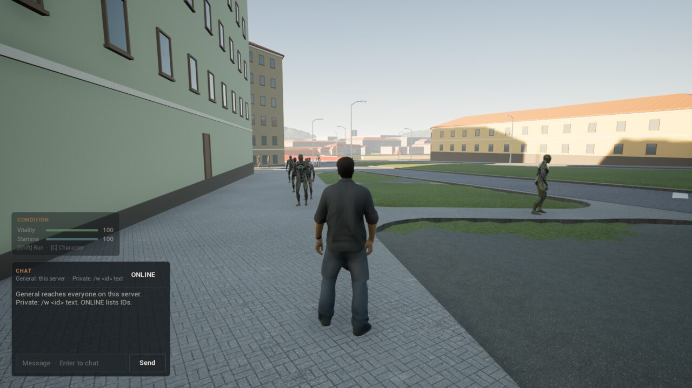 | 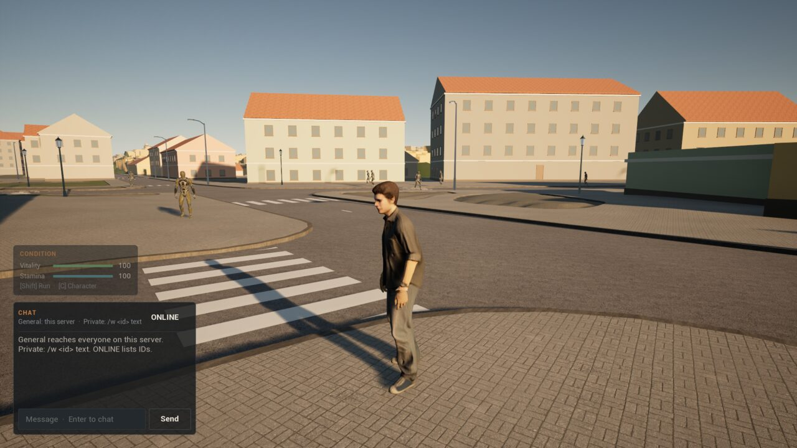 | 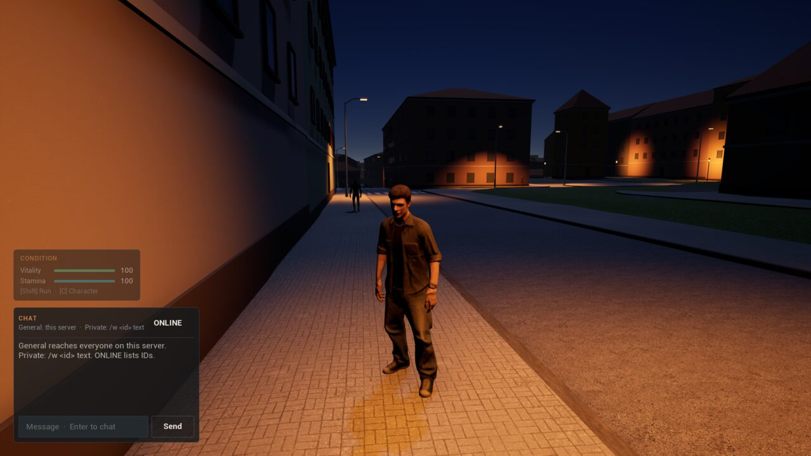 |

| Wednesday 03:00, shopping street | Sunday 12:00, shopping street | Sunday 12:00, school |
| --- | --- | --- |
| 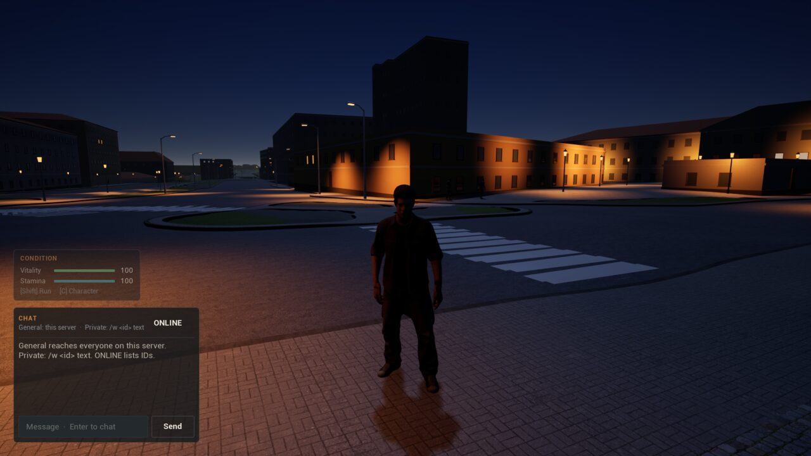 | 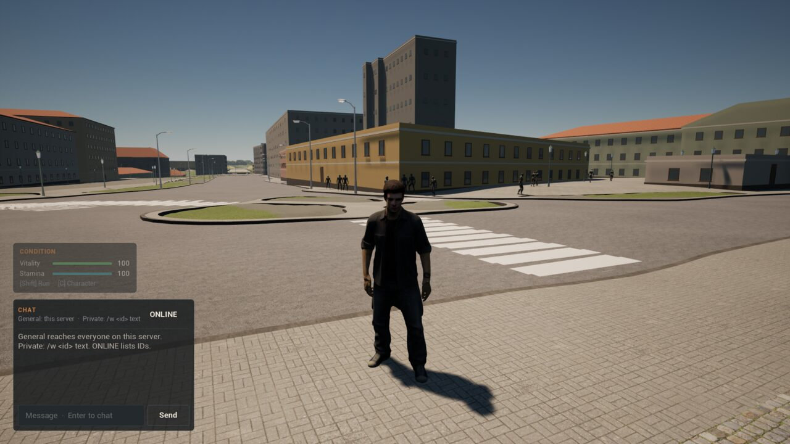 | 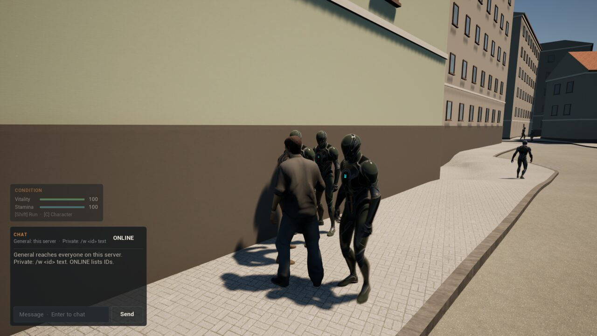 |

## Not as first written

- The first run (`Saved/StreetDistrictSmoke/20261119T110916Z`, day only) behaved as the full run did, with every stop at its number. Its summary reads FAIL on four lines, because of two mistakes in the script's reading of the server log. The first stop logs no new hour line, since its number matched the hatchback's; the script now carries the hour in force into each stop. The last hour line, logged as the client left, was read as the school's; lines with no player are now skipped.

## Regression

ADR-067's hours smoke passes every check on this code (`Saved/StreetHoursSmoke/20261119T114403Z`). The hatchback's nearest walk node is on the old town, so its numbers are ADR-067's. It counted 20 at Tuesday 10:00, 18 at 19:00, 9 at 22:30 and 3 at 03:00, 18 on Friday at 21:30, 20 on Sunday at noon with no commuters or shoppers sent out, and 10 in the rain. With the clock at ×20, five people went home after 21:00, none within 22 m, and the street settled at 9. The people sent out round the hatchback now come from the zones of the nodes they appear on: old town, shopping street and blocks.

ADR-044's street smoke passes in `Saved/StreetSmoke/20261119T115859Z`: 11 spawned at once round the player and 20 within 8 s, none closer than 23.6 m; reactions to the fight; the probe run over and one dodge; answers to the run-over; two answers to the body; nobody in the water; the water probe ran along the bank. Two runs before it (`20261119T115611Z`, `20261119T115735Z`) passed every check but `answered_body`: nobody answered the body. [Its evidence](STAGE1_STREET_EVIDENCE.md) records that check as marginal, because only people already within 20 m of the body can answer it and the run-over has alarmed most of them. It failed 2 of 6 runs on 11 November and 2 of 4 on 17 November (ADR-065). Here it failed 2 of 3.

## Not covered

One client, standing still at each stop. The zones are the original's, from present-day sources, not checked against the 1990s. Walking along a border between zones can change a player's number from step to step. Parks have only seven nodes. Attractors, traffic, holidays and the Lent cast's own hours. A packaged run and the owner's look.
