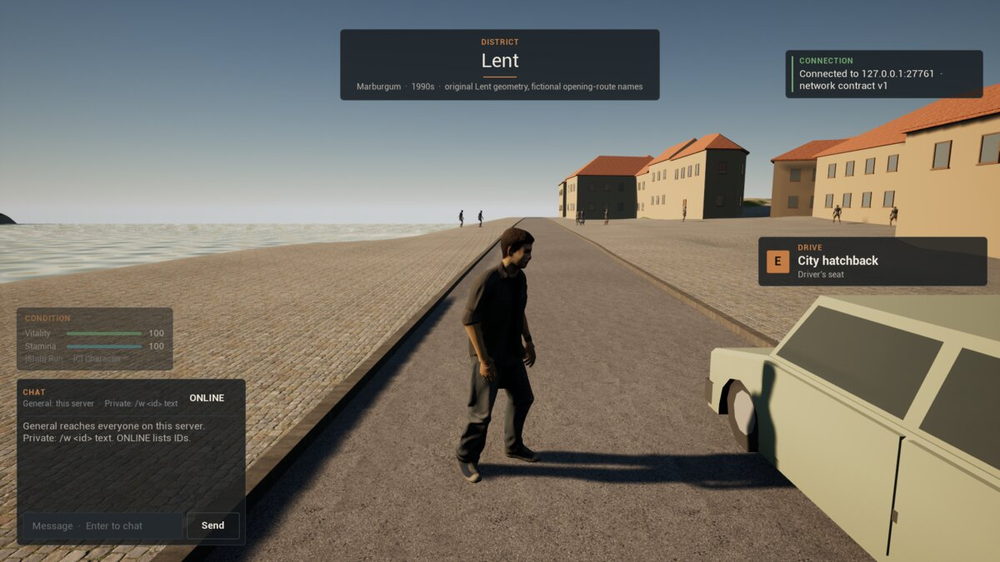
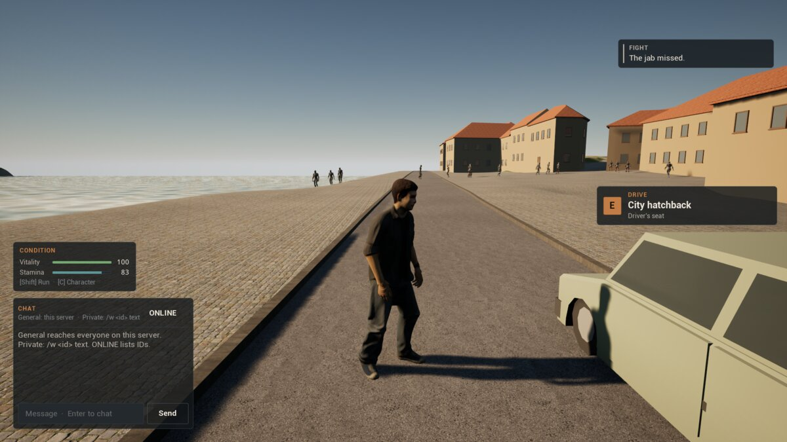
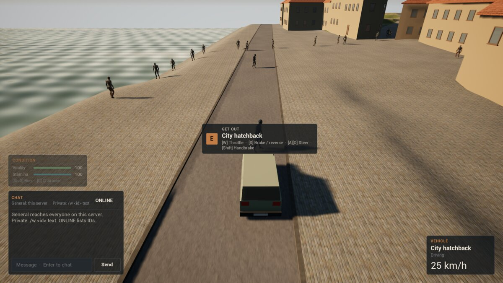

# Stage 1 evidence — street people, Linux, 2026-11-11

**Result:** street people **pass an automated one-client test** on a dedicated server (editor binaries), on the launch map `/Game/World/lent`.

- **They appear:** the client has 11 people round it as it joins, and 20 a few seconds later. Each one appears out of sight: 22–27 m behind the player, or 40–55 m ahead, and never nearer than 22 m (`nearest_appear_m=24.0`).
- **They walk:** they follow the walk graph along the pavements. Of 10 people tracked for 8 s, all 10 walked and none fell off the ground.
- **A fight:** the player throws punches at the air. People near by flee or stop to watch from a few metres off (7 reactions in the run, up to 3 watching), then walk on once it is over.
- **A run-over:** the player drives off in the hatchback. The first probe stays put; the car takes her at 7.2 m/s (72 damage) and she is out. The second jumps clear, and so do two passers-by further on. Sixteen people react to the run-over, nine of them because they saw others running (`spread=1`). One walks over and stands by the body.
- **The body stays:** the person the car put out is never culled like a walker.

Per [ADR-008](DECISIONS.md) the status is `implemented_awaiting_owner_playtest`. The groups, looks and the original author's own reaction tables are copied from the original's ambient population ([ADR-044](DECISIONS.md)). Everything the original took from San Andreas or GTA III was replaced with Marburgum II's own numbers.

## Environment

| Item | Value |
| --- | --- |
| Source | The commit that adds this page, on `9c2caab` (ADR-043) |
| Engine / host | UE **5.8.3** source build; CachyOS Linux 6.18.60 x86_64; NVIDIA GeForce RTX 5080 |
| Processes | `UnrealEditor -server` (headless) with `-MB2StreetProbe -MB2StreetSeed=1990` on a fresh world store; one `UnrealEditor -game` client rendered offscreen at 1920×1080, joined with `?MB2Start=lent_hatchback` |
| Command | `scripts/street-smoke-linux.sh editor`, port 27761. Run `Saved/StreetSmoke/20261111T193633Z`; the three earlier runs that day (`192810Z`, `193050Z`, `193425Z`) also passed, before the spawn fixes listed under ADR-044 |
| Other checks | `mb2 validate all` (including `Street contract OK: 48 rules, 15 decision tables, 5 groups and 19 looks`); `cargo test` for `tools/mb2` (26) and `tools/lent-ground` (15); automation tests `Marburgum.Gameplay.*` (`CombatRules`, `StreetRules`) |

## What runs

- **Rules, groups and tables** (`Data/Gameplay/street.v0.1.json`, `MarburgumStreetContract.h`, kept in step by `mb2 validate street`). The JSON's `provenance` block lists what was copied unchanged, what is Marburgum II's own, and what was left out.
- **Walk graph** (`tools/lent-ground --walk-graph`, `walk.rs`): lines along Lent's paved meshes, at least 0.5 m clear of walls, carriageway and river. Written to `Content/Marburgum/Street/lent_walk_graph.json` (1582 nodes) and staged as a loose file. In this run the server placed 1543 of the 1582 nodes and 1710 of the 1777 edges on the ground; 907 nodes form its largest connected network.
- **Population** (`UMarburgumStreetSubsystem`, server only): spawn and cull bands round every player, incidents (fights, run-overs, bodies), and the car strike check.
- **People** (`AMarburgumPedestrian`, a `AMarburgumFighter`): the walk, the reactions, the dodge, and fighting back through the ADR-041 rules.
- **Driver** (`UMarburgumStreetSmokeSubsystem`, `-MB2StreetSmoke`): walks the client through the steps below, through the same input paths the keys use, and reports what its replicated people are doing.

## Results ([summary](Captures/stage1-street/summary.txt))

| Case | Observed | Result |
| --- | --- | --- |
| Graph | Server `street_ready`: 1543/1582 nodes, 1710/1777 edges, seed 1990, loaded in 19 ms; no `street_off` | PASS |
| Populated | The client has 11 people replicated at once, 20 after 8 s; 31 spawns in the run, none within 22 m of the player | PASS |
| Walking | 10 of 10 tracked people moved along the graph; none fell | PASS |
| Fight | Server `incident kind=fight player=1`; 7 `react … event=fight response=flee/watch`; at most 2 fleeing and 3 watching | PASS |
| Probe | Two people placed in the car's way (`dodges=0`, vitality 30; `dodges=1`, vitality 70) | PASS |
| Run-over | `run_over npc=street_32 … speed_ms=7.2 damage=72.2 out=1 player_driving=1` | PASS |
| Dodge | 3 `dodge` (the second probe, and two passers-by in the car's path) | PASS |
| Answered | 16 `react … event=run_over` (9 of them `spread=1`), 1 `react … event=body`, 1 person standing by the body | PASS |
| Body kept | The person the car put out is never despawned as `unseen` or `far` | PASS |

## Keeping out of the Drava (ADR-046), 2026-11-11

The owner saw people walk into the river. The same smoke now also checks the walk graph against the water, places a person by the river and scares them from the land side, and counts anyone in the water every 10 s.

| Case | Observed | Result |
| --- | --- | --- |
| Graph | `street_ready … nodes=1529/1582 … water_volumes=91 wet=14 edges_wet=0`: 14 nodes the graph check used to keep lie in the river and are dropped | PASS |
| River probe | `water_probe npc=street_1 at=6354,-15423,152 straight_away_wet=1 player_m=31.2`, then `water_probe_done … swam=0 moved_m=21.8 mood=flee`: running straight away would be into the Drava; they ran 21.8 m along the bank instead | PASS |
| Nobody swims | Every `street_summary` has `swimming=0` | PASS |
| Negative control | The same run with the step check switched off (a local build, not committed): `water_probe_done … swam=1`, and a `street_summary` with `swimming=1` | FAIL, as intended |

Runs: `Saved/StreetSmoke/20261111T200710Z` and `20261111T201119Z` ([summary](Captures/stage1-street/water-summary.txt)) passed in full. `20261111T201216Z` passed every water check but failed `answered_body` (nobody reacted to the body); see below. Negative control: `20261111T200947Z`. Editor binaries, `scripts/street-smoke-linux.sh editor`. The automation tests (`Marburgum.*`, 8 of 8, including the water footprint cases in `StreetRules`) pass.

`answered_body` is marginal. The car drives on, and new people appear round the player, about 57 m past the body. Only people already within 20 m of it can answer it, and the run-over has already alarmed most of them. Every earlier run had exactly one such answer. With these changes, 2 of 6 runs had none. The ADR-044 build (the `feat/street-people` worktree, unchanged) had none in 3 of 4 runs the same evening (`20261111T201412Z`, `201534Z`, `201645Z`; `201755Z` passed), so the water changes do not cause it. Keeping the car near the body, or the driver waiting there, would make the check reliable; that is left for the street work.

## Not covered

- An owner playtest, and a staged (packaged) run.
- More than one player.
- Load beyond 48 people.
- Gunshots, traffic, the time of day (ADR-044, *Not covered*).
