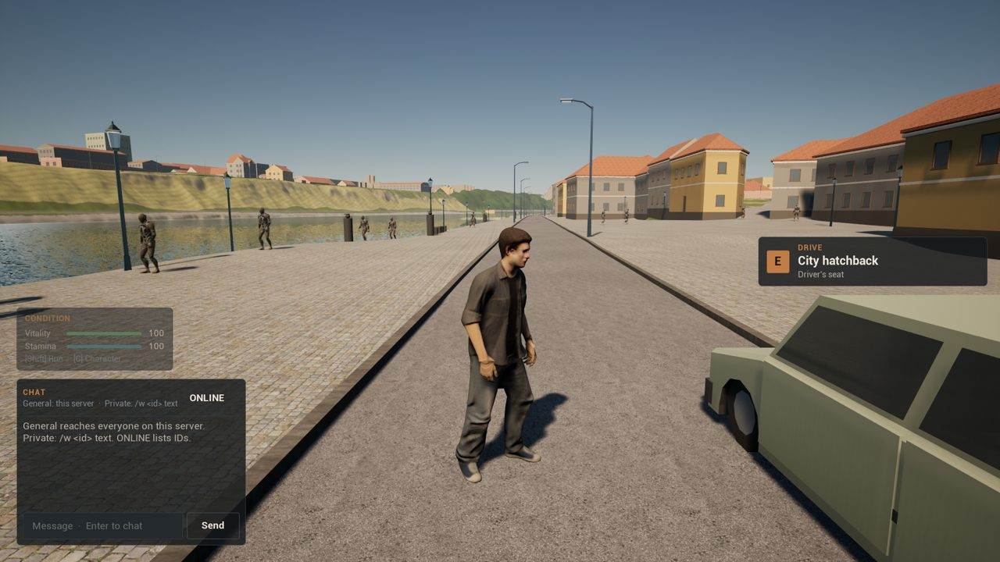
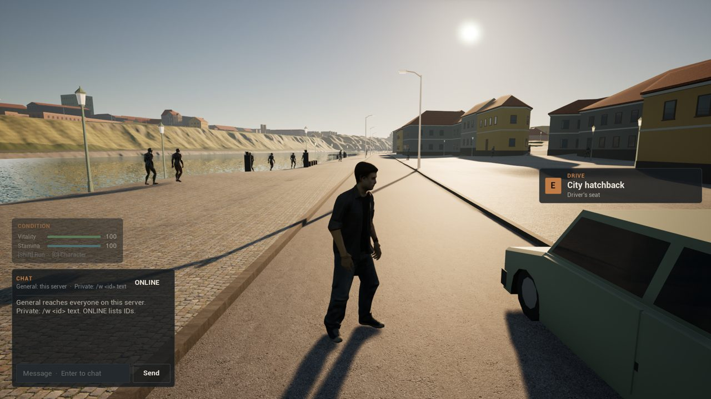
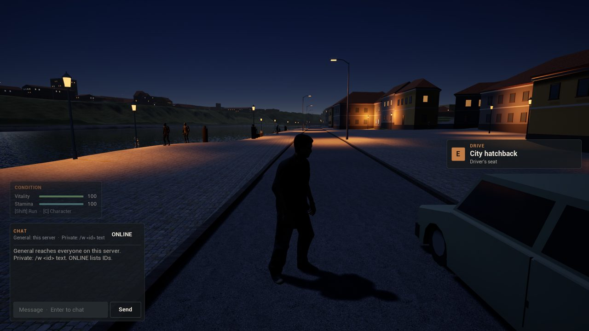
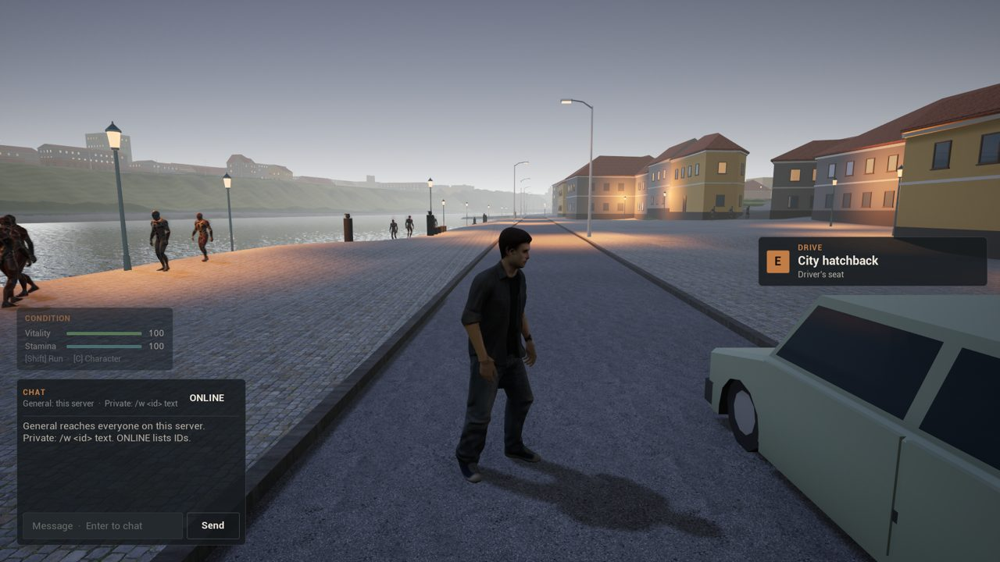
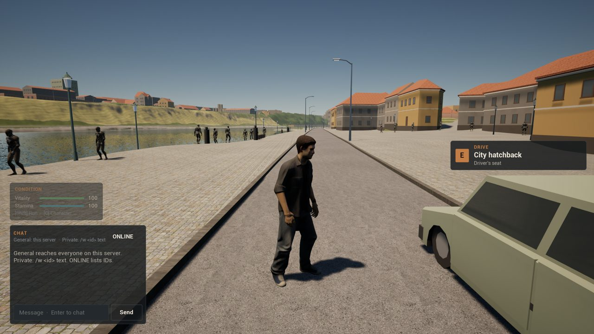
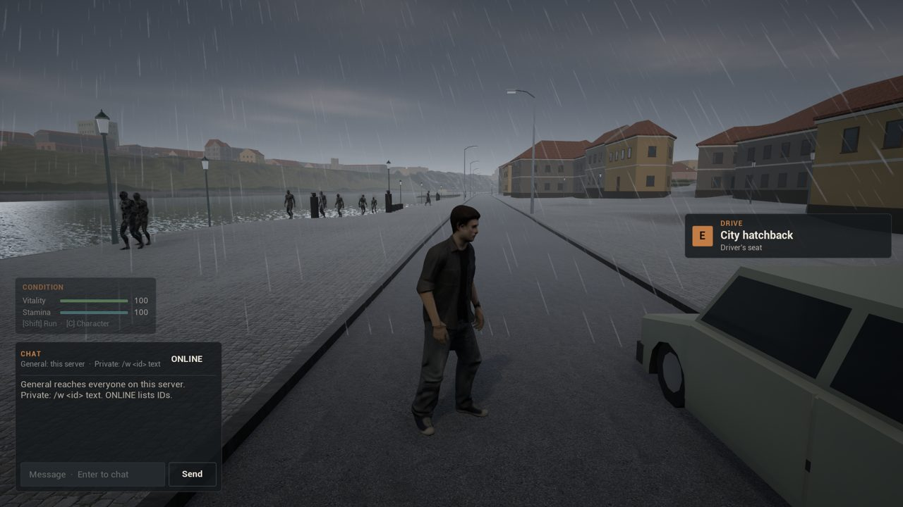
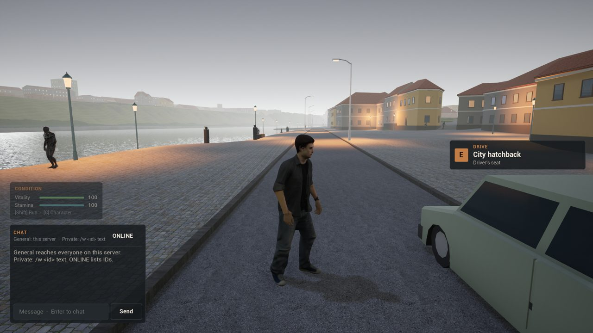

# Stage 1 evidence — streets by the hour, Linux, 2026-11-17

**Result:** the street population **passes an automated one-client test** against an editor-mode dedicated server on the launch map `/Game/World/lent`, at eight moments of the 1990s week and with the clock running past 21:00.

- **By the hour:** on Tuesday 18 June 1996 the client counts 20 people round it at 10:00, 18 at 19:00, 9 at 22:30 and, on Wednesday at 03:00, 3, all of them night owls or residents.
- **By the weekday:** on Friday at 21:30 the street still holds the evening's 18, where a Tuesday has 9. On Sunday at noon it holds 20, none of them commuters or shoppers.
- **By the weather:** in the rain_wet profile (precipitation 0.7) the day holds 10.
- **Going home:** with the clock at ×20, the street falls from 18 to 9 within 11 s of 21:00. Only people nobody had seen for 5 s go home, all of them more than 22 m from the player.

Per [ADR-008](DECISIONS.md) the status is `implemented_awaiting_owner_playtest`. The weekday tables and the night-people group are the original's ([ADR-067](DECISIONS.md)); the weekend and the rain are Marburgum II's own.

## Environment

| Item | Value |
| --- | --- |
| Source | branch `feat/street-hours` on `c88f9cf` (ADR-066), working tree before the ADR-067 commit |
| Engine / host | UE **5.8.3** source build; CachyOS Linux 6.18.60 x86_64; NVIDIA GeForce RTX 5080 |
| Processes | Per phase, an editor-mode dedicated server (`UnrealEditor -server`) with `-MB2StreetSeed=1990` and a review clock, and one editor-mode client (`-game`) rendering offscreen at 1920×1080, `-nosound`, standing at the hatchback's driver door and looking along the promenade (`-MB2StreetSmoke -MB2StreetCount=<s>`) |
| Commands | `scripts/street-hours-smoke-linux.sh editor` (`Saved/StreetHoursSmoke/20261117T165709Z`); `MB2_STREET_PHASES=home scripts/street-hours-smoke-linux.sh editor` (`Saved/StreetHoursSmoke/20261117T171024Z`); `scripts/street-smoke-linux.sh editor` (`Saved/StreetSmoke/20261117T170926Z`) |
| Other checks | Automation `Marburgum.*` 31/31, including the extended `Marburgum.Gameplay.StreetRules`; `mb2 validate street` (6 groups, 22 looks, 5 hours of the day). Editor, Server and Client targets build |

## The phases ([summary](Captures/stage1-street-hours/summary.txt), [going home](Captures/stage1-street-hours/home-summary.txt))

"Kept" is the server's number for one player: twenty times the hour's density times the weather's share. "Seen" is the client's mean count within 70 m over the second half of a 50 s count. "Sent out" counts the server's spawns by group over the whole phase, including those that replace people walking off.

| Phase | Server clock (UTC) | Marburgum clock | Period | Kept | Seen | Sent out |
| --- | --- | --- | --- | --- | --- | --- |
| day | 2026-06-18 08:00 | Tue 18 Jun 1996 10:00 | day | 20 | 20.0 | commuters 8, shoppers 20, pensioners 9, students 6, residents 2 |
| evening | 2026-06-18 17:00 | Tue 19:00 | evening | 18 | 18.0 | shoppers 15, students 7, residents 6, night owls 8 |
| late | 2026-06-18 20:30 | Tue 22:30 | late | 9 | 9.0 | students 4, residents 3, night owls 9 |
| night | 2026-06-19 01:00 | Wed 19 Jun 03:00 | night | 3 | 3.0 | residents 3, night owls 3 |
| friday | 2026-06-21 19:30 | Fri 21 Jun 21:30 | evening | 18 | 18.0 | shoppers 11, students 12, residents 8, night owls 10 |
| sunday | 2026-06-23 10:00 | Sun 23 Jun 12:00 | day | 20 | 20.0 | pensioners 8, students 2, residents 30 |
| rain | 2026-06-18 08:00, rain_wet | Tue 10:00 | day | 10 | 10.0 | commuters 2, shoppers 9, pensioners 3, students 7, residents 1 |

The client sees exactly the server's number in every phase, because everyone the server keeps for one player is within 65 m of them.

| Tuesday 10:00 | Tuesday 19:00 | Tuesday 22:30 | Wednesday 03:00 |
| --- | --- | --- | --- |
|  |  |  |  |

| Friday 21:30 | Sunday 12:00 | Tuesday 10:00 in the rain |
| --- | --- | --- |
|  |  |  |

## Going home ([summary](Captures/stage1-street-hours/home-summary.txt))

The server's clock starts at 20:00 on Tuesday and runs twenty times real time. The client joined at 20:02, saw the evening's 18 and stood for 210 s.

| Server time | Marburgum clock | Event |
| --- | --- | --- |
| 17:13:21 | 20:57 | 18 people, 18 kept |
| 17:13:30 | 21:00 | the late evening: 9 kept; a shopper 27.5 m off goes home |
| 17:13:32–17:13:38 | 21:01–21:03 | a student (24.7 m), two residents (25.8 m, 22.8 m) and a night owl (22.7 m) go home; others walk out of the kept band and are not replaced |
| 17:13:41 | 21:04 | 9 people, 9 kept, and so to the end of the count |

## Not as first written

- The first run of the going-home phase (`Saved/StreetHoursSmoke/20261117T164635Z`) sent a person home 11 m behind the player. Going home now needs at least 22 m from every player, as far as anybody appears.
- The full run's going-home check wanted at least five sent home. Four went, and the street settled to its nine all the same, so `20261117T165709Z/summary.txt` reads FAIL on that one line only. The check now asks for somebody sent home, nobody within 22 m and the street settled at no more than 11. The phase passes it in `20261117T171024Z`.

## Regression

ADR-044's street smoke passes on this code (`Saved/StreetSmoke/20261117T170926Z`). Its server clock is Tuesday 10:00, so its street is the day's twenty, as before. 32 spawned, none too close; 8 reactions to the fight; the probe run over and two dodges; 12 answers to the run-over; the body never culled as a walker; nobody in the water; the water probe ran along the bank.

## Not covered

One client. District zones (every node walks as the old town), attractors, holidays and the Lent cast's own hours. Nothing remembers a fight seen at night, and no Reputation changes. A packaged run and the owner's look.
