# Stage 1 evidence — street lamps, Linux, 2026-11-17

**Result:** the street lamps **pass an automated one-client test** against an editor-mode dedicated server on the launch map `/Game/World/lent`, in the six day-and-night runs of ADR-064 and on a night walk through Lent and the old town.

- **Where:** 1,479 lamps over Lent and its eight neighbouring windows, placed by `lent-ground --mode lamps` from the map's OpenStreetMap extract. 792 are 8 m masts along the car roads; 687 are lanterns along pedestrian streets, lit paths and round squares. Every mapped lamp in the square is among them.
- **Standing:** the server and the client each put up the same 1,479 lamps from the staged file and ground them where they stand (1,478 found ground; one lantern on the square by Židovski stolp found none and is not put up). The posts block.
- **When:** none burn at solstice noon or at a June sunset with the sun 2.8° up. All burn at November dusk (the sun 4.5° under, 18 minutes past the street's threshold), on a full-moon night and on a moonless night. They are warm, and the 48 nearest the eye cast light.

Per [ADR-008](DECISIONS.md) the status is `implemented_awaiting_owner_playtest`. The original designed street lighting and never placed a lamp ([ADR-065](DECISIONS.md)).

## Environment

| Item | Value |
| --- | --- |
| Source | branch `feat/street-lights` on `23b1657` (ADR-064), working tree before the ADR-065 commit |
| Engine / host | UE **5.8.3** source build; CachyOS Linux 6.18.60 x86_64; NVIDIA GeForce RTX 5080 |
| Processes | Editor-mode dedicated server (`UnrealEditor -server`) with `-MB2Weather=clear_dry` and a review clock per run; one editor-mode client (`-game`) rendering offscreen at 1920×1080, `-nosound` |
| Content | `lent-ground --mode lamps` → `Content/Marburgum/Lights/lent_street_lights.json`; `scripts/create-weather-content.sh lamps` → `SM_StreetLampMast` (216 triangles), `SM_StreetLampLantern` (336), `M_StreetLampMetal`, `M_StreetLampGlass` |
| Commands | `scripts/daylight-smoke-linux.sh editor` (`Saved/DaylightSmoke/20261117T144025Z`); `MB2_PLACE_CLOCK=2026-11-13T21:00:00Z scripts/place-smoke-linux.sh editor` (`Saved/PlaceSmoke/20261117T142547Z`) |
| Other checks | Automation `Marburgum.*` 29/29, including `Marburgum.Shared.StreetLights.Switch`, `.File` and `.WorldClock.Daylight`; `cargo test` `tools/lent-ground` 36 and `tools/mb2` 33; `mb2 validate all` with the new `lights` check; `MarburgumII.Tools verify`. The full 15-phase weather smoke (`Saved/WeatherSmoke/20261117T143019Z`), the vehicle (`Saved/VehicleSmoke/20261117T142848Z`), Kiosk 67 (`Saved/ShopSmoke/20261117T142929Z`) and place (`Saved/PlaceSmoke/20261117T140039Z`) smokes pass. The street smoke passed 2 of 4 runs and failed only `answered_body` in the others (below). Editor, Server and Client targets build |

## Where the lamps stand ([plan](Captures/stage1-street-lights/placement.jpg))

The plan is the 1,536 m square, north up, Stari most in the middle. Red marks mapped lamps, blue road masts, green lanterns along paths and pedestrian streets, and purple lanterns round squares. Each tick points the way the head reaches, and the grey lines are the walk graph.

| | Count |
| --- | --- |
| Lamps | **1,479**: 792 masts, 687 lanterns |
| By source | 14 mapped (all 14 in the square; 2 moved off the kerb line, none refused), 789 along roads, 501 along paths and pedestrian streets, 175 round 40 squares |
| Roads | 403 tagged `lit`, 90 untagged and lit as a town's streets are, 6 tagged `lit=no` and left dark |
| Paths | 287 lit; 334 run beside a lit road and are lit by its masts |
| Dropped | 360 too close to an earlier lamp; 261 refused (114 only carriageway, 91 building or water, 50 the walk graph, 6 a bridge); 497 beyond the square |
| Left | 15 lit bridge ways, whose lamps belong to the bridges |

## Day and night ([summary](Captures/stage1-street-lights/summary.txt))

The promenade grey is the weather smoke's measure, the mean of the promenade and the river right of the player (0..255). The "before" column is ADR-064's run without lamps (`Saved/DaylightSmoke/20261113T200043Z`).

| Run | Sun | Threshold | Burning | Casting | Nearest lamp | Promenade grey | Before |
| --- | --- | --- | --- | --- | --- | --- | --- |
| noon | 66.9° up | −1.9° | 0 | 0 | mast, 13 m, off | 131 | 131 |
| evening | 2.8° up | −1.9° | 0 | 0 | off | 99 | 99 |
| dusk | 4.5° under | −1.9° | 1,479 | 48 | warm (struck 18 min before), 2,050 K | 96 | 102 |
| moonlit | 67° under, full moon 66° up | −1.9° | 1,479 | 48 | warm | 72 | 70 |
| moonless | 55° under | −1.9° | 1,479 | 48 | warm | 37 | 26 |

The threshold is −2° moved 0.09° earlier by the run's 15 % cloud, before each lamp's own ±0.6°. Dusk is darker than before because it is a lit scene: twilight, and now the lamps, keep it above the night eye's floor, so the night's exposure bias applies (a third of the way in at dusk; see below).

| Solstice noon | June sunset | November dusk |
| --- | --- | --- |
| 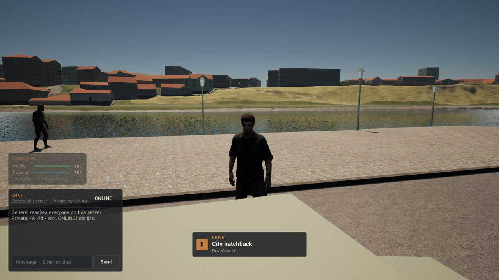 | 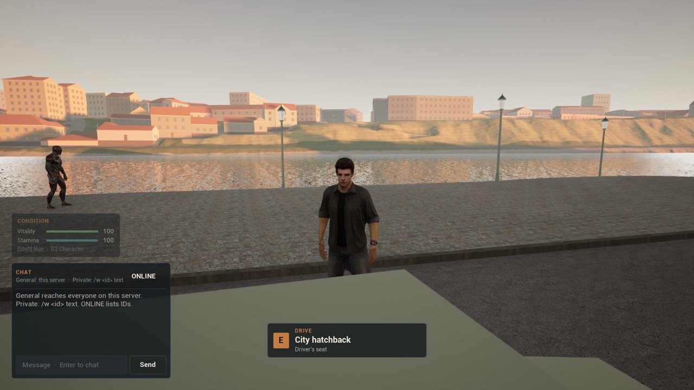 | 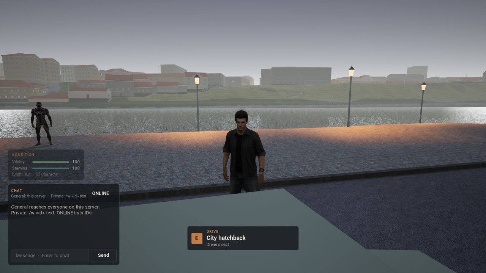 |

| Full moon, Christmas night | Moonless November night |
| --- | --- |
| 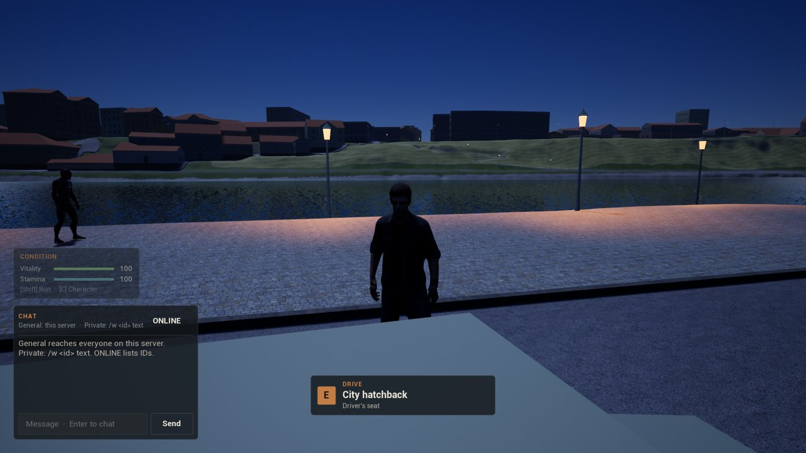 | 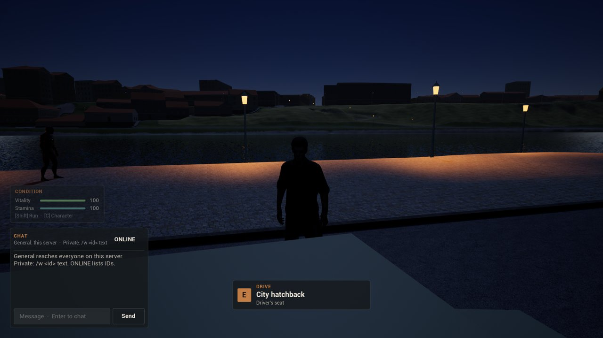 |

## A night walk ([summary](Captures/stage1-street-lights/night-walk-summary.txt))

The place smoke's ten stops, with the server's clock at 13 November 2026 21:00 UTC (22:00 in Maribor, the moonless night). Every stop matched its place, street or square and landmark. The table gives each view's mean grey (the scene right of the HUD column, 0..255), against the same stops on the June morning of the regression run (`Saved/PlaceSmoke/20261117T140039Z`).

| Stop | Night | Day | |
| --- | --- | --- | --- |
| Glavni trg | 42 | 120 | masts round the square, lit façades across it |
| Rotovž | 81 | 107 | a mast at the wall |
| Židovski trg, the synagogue | 76 | 122 | a lantern on the square |
| Slomškov trg, the cathedral | 78 | 117 | |
| Grajska ulica, the castle | 56 | 124 | |
| Trg revolucije, Magdalena | 49 | 112 | masts round the junction |
| Stari most, both ways | 27, 29 | 125, 119 | the bridge is unlit |
| Vodni stolp, Židovski stolp | 18, 11 | 114, 119 | the promenade's east footways are not tagged lit |

| Glavni trg | Rotovž | Židovski trg |
| --- | --- | --- |
| 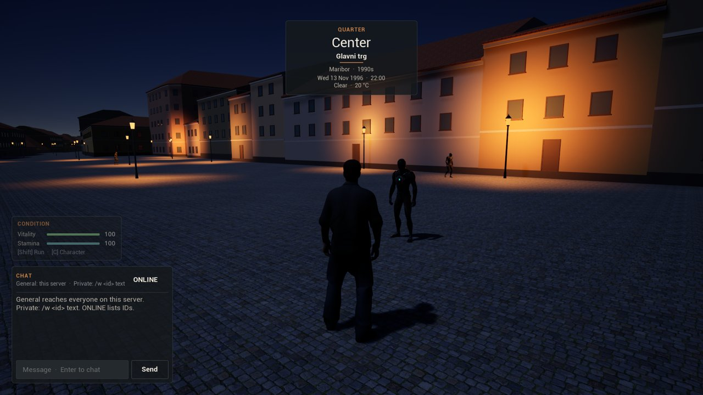 | 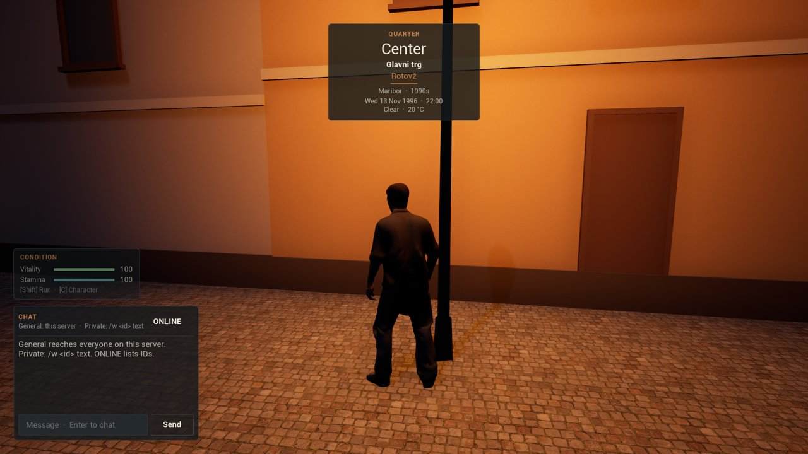 | 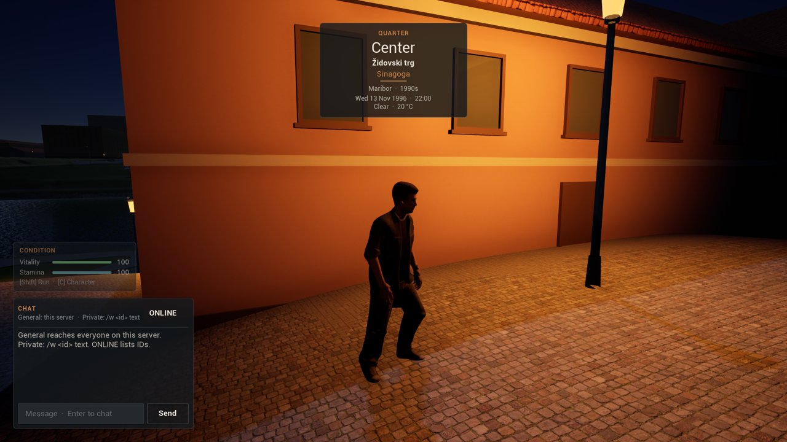 |

| Slomškov trg | Grajska ulica | Trg revolucije |
| --- | --- | --- |
| 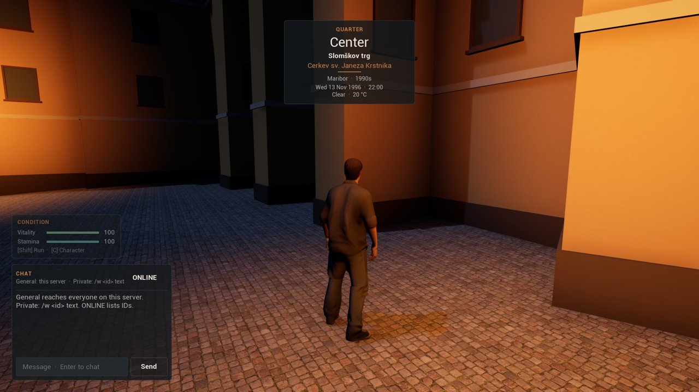 | 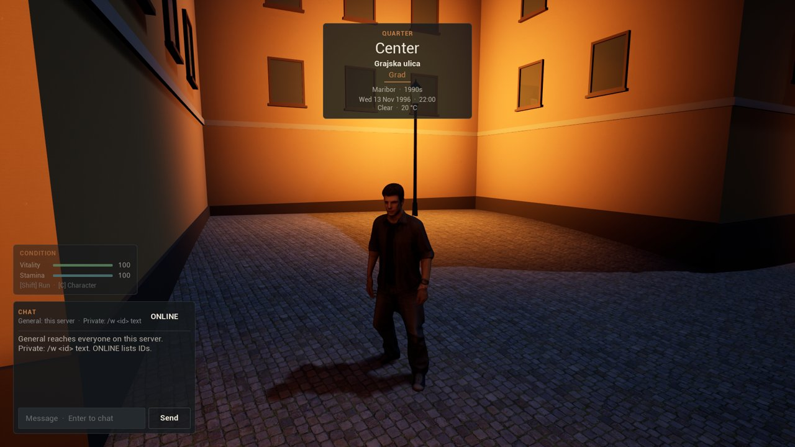 | 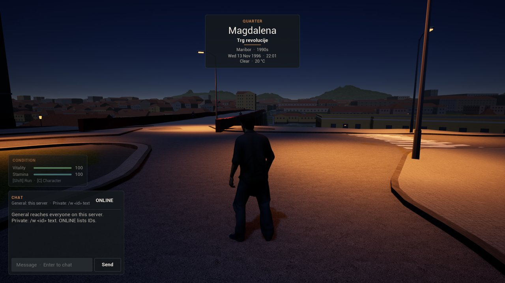 |

### How the light was settled

Three walks came before this one; each changed one thing.

1. **Inverse-square light** (masts 64 cd with a 72° cone, lanterns 12 cd; `20261117T140735Z`). Walls a metre or two from a lamp in the narrow streets came out nearly white. Židovski trg and the pedestrian old town were dark, because their ways carry no `lit` tag and the first rule lit pedestrian streets only when tagged. That rule changed: a pedestrian street or square is a street.
2. **Weaker inverse-square light** (40 and 8 cd, a 60° cone; `20261117T141322Z`). The walls were still too bright, so the light changed to a smooth, non-physical falloff (ADR-065).
3. **Compressed falloff** (`20261117T141921Z`: Rotovž 111, Židovski trg 92). The lamps were no longer the cause. A lamp-lit wall filling the view sits above the night eye's floor, so Lent's histogram exposure brought it to the grey of a sunny wall. The night eye gained a −1 EV bias for lit scenes, with the floor lowered to match, so moonlit and moonless views keep ADR-064's exposure. Rotovž went to 81 and Židovski trg to 76; the moonless promenade held at 37.

## Street people

The street smoke (`scripts/street-smoke-linux.sh editor`) passed in `Saved/StreetSmoke/20261117T140459Z` and `20261117T140622Z`. It failed in `20261117T135928Z` and `20261117T142726Z`, each time only on `answered_body`: nobody answered the body of the run-over. [Its evidence](STAGE1_STREET_EVIDENCE.md) records that check as marginal; it failed in 3 of 4 runs of the ADR-044 build. The lamps take nothing from the street people. In all four runs the server loaded the walk graph exactly as the last runs without lamps did (`marburgum-weather` and `marburgum-wide` worktrees, 12 November): `nodes=12941/13098 edges=14336/14660 no_ground=7 no_room=111 edges_blocked=83`.

## Not covered

Lit windows. Lamps on the bridges. The east promenade's footways, which OpenStreetMap does not tag as lit. Shadows from the lamps, fog halos, flicker and failed lamps. The posts are clear of the walk graph, but the street people do not yet steer round them. The 1990s layout of the lighting and the lamp designs, which are plausible rather than surveyed. A packaged run, the light pool's cost on lower settings, and the owner's look.
