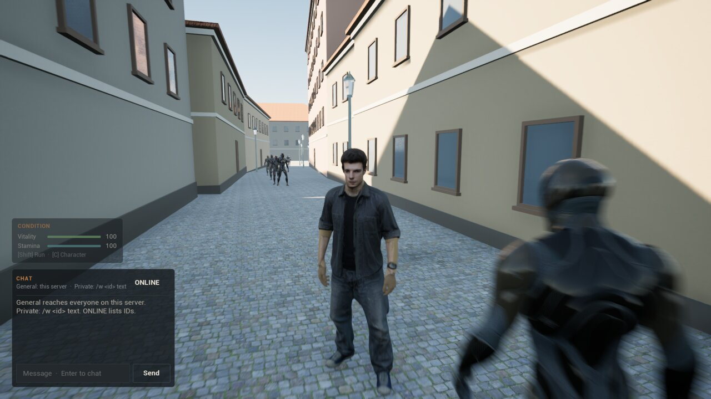
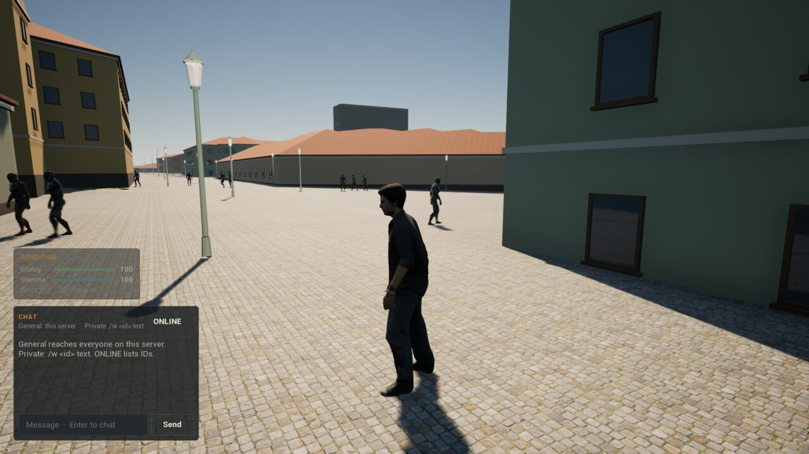
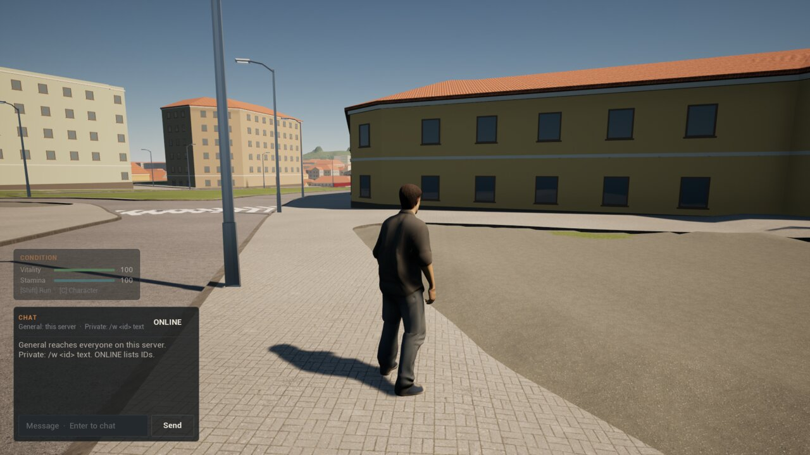
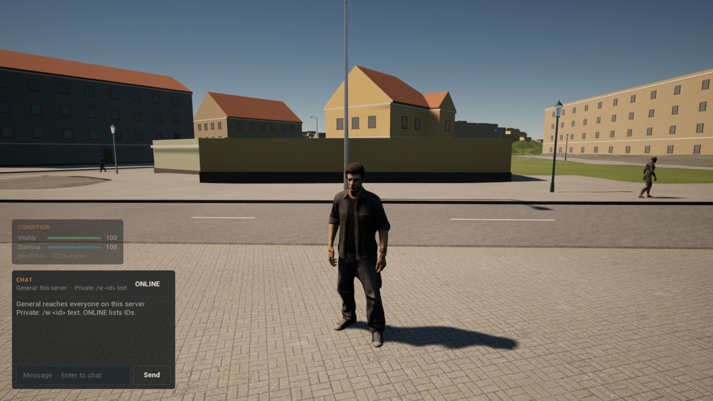
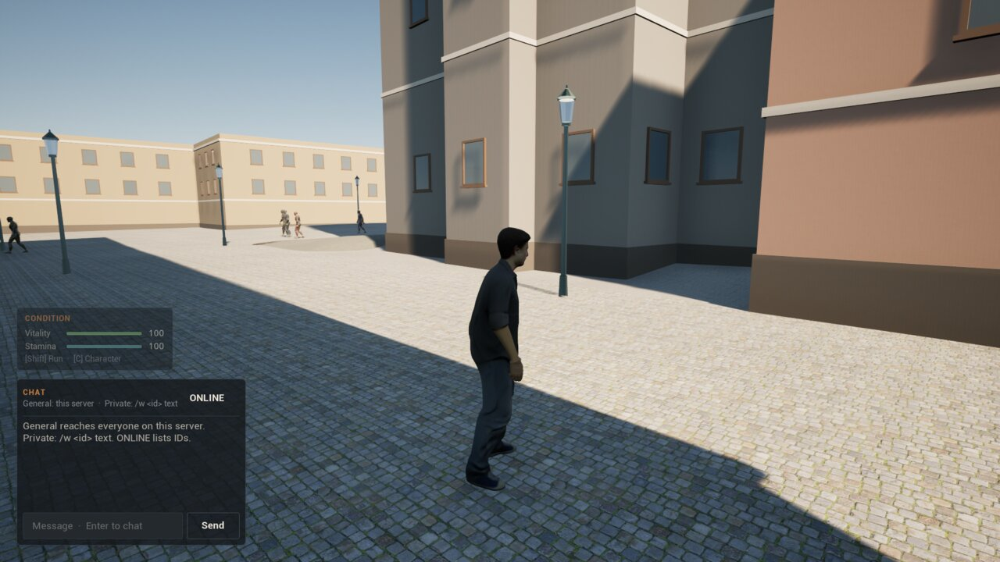
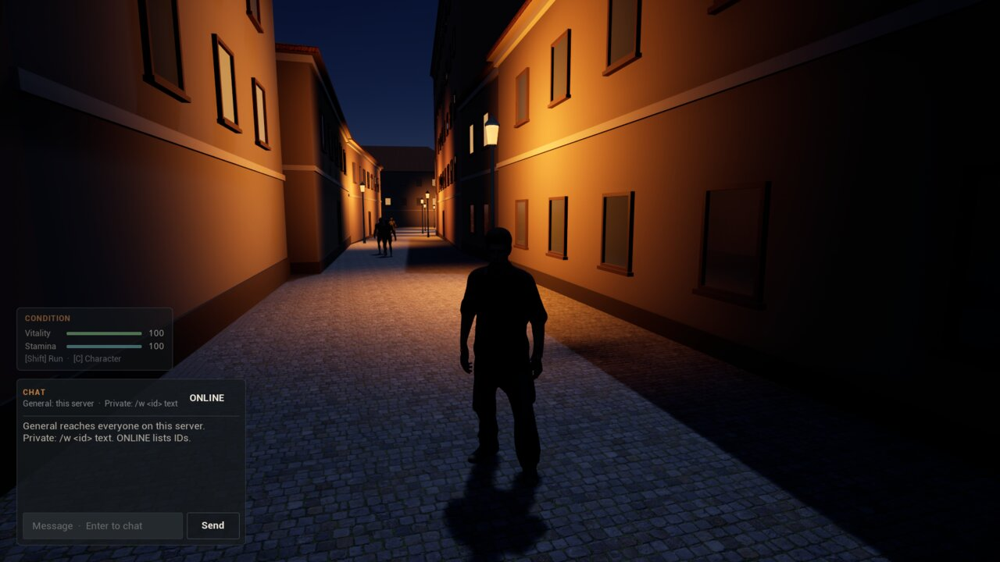
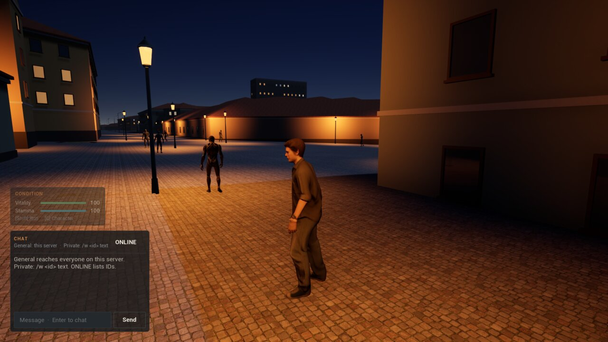
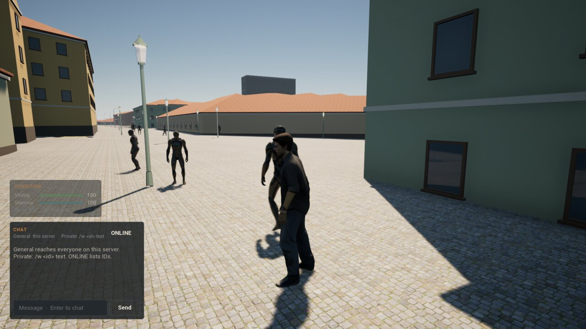
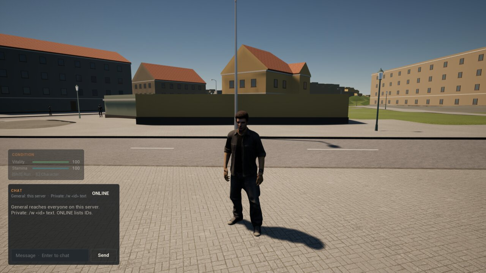

# Stage 1 evidence — places that draw people in, Linux, 2026-11-19

**Result:** the street population **passes an automated one-client test** against an editor-mode dedicated server on the launch map `/Game/World/lent`. A route of five stops, each by a cluster of the original's bus stops, cafés, shops or sights, is walked at three moments of the 1990s week.

- **Tuesday 18 June 1996, 10:00:** 72 people turn off to a place in ten minutes: 49 to cafés and restaurants, 10 to sights, 7 to shops, 3 to bus stops and the rest to fast food and a bar. 54 go in at a door and leave the street, 7 come out of one, 13 stand at a stop or look at a sight, and 2 are found already waiting at a stop. Shoppers make most of the café visits (25 of 44) and four of the seven shop visits, and residents and a pensioner wait at the stops.
- **Tuesday 22:30:** with the shops shut and the cafés at a fifth, 17 of the 21 visits are to bars and fast food, mostly by night owls (10) and students (5). Nobody goes to a shop, and nobody comes out of one.
- **Sunday 23 June 1996, 11:00:** the shops are shut by the 1990s shop hours, and nobody goes to or comes out of one. Residents fill the cafés (18 of 30 café visits), and pensioners wait at the stops.
- **Throughout:** nobody gives up on reaching their spot (0 of 135 visits), nobody ends up in the Drava, and at every stop the client counts exactly the number the street keeps, though dozens go indoors.

Per [ADR-008](DECISIONS.md) the status is `implemented_awaiting_owner_playtest`. The places, their kinds, actions, stays and hours, and each group's visit chances are the original's ([ADR-069](DECISIONS.md)). Pinning them to this walk graph, the 1990s shop hours, people found waiting at any open hour, never straight back, and giving up are Marburgum II's own.

## Environment

| Item | Value |
| --- | --- |
| Source | branch `feat/street-attractors` on `55f8236` (ADR-068), working tree before the ADR-069 commit; rebased onto `2316b91` and rerun once (`Saved/StreetSmoke/20261119T194400Z`, PASS) |
| Engine / host | UE **5.8.3** source build; CachyOS Linux 6.18.60 x86_64; NVIDIA GeForce RTX 5080 |
| Walk graph | `Content/Marburgum/Street/lent_walk_graph.json` after `lent-ground --mode attractors` against the original's `project/data/road_graph.json` (magna-raedarum-marburgum `e3b2dd48`). Of the original's 756 places, 256 lie inside the square; 242 are pinned (bus stops 50, cafés 74, restaurants 50, bars 15, fast food 24, shops 14, sights 15). Left out: 11 with no clear way from any pavement within 40 m, 2 whose spot would be over 1.5 m from the door, 1 with no pavement within 40 m. 92 venues take a door on Marburgum II's joined footprints. Nearest node: median 4.1 m, farthest 27.8 m; spot from the place: median 0.5 m, farthest 6.1 m |
| In the level | `street_ready ... attractors=239/242 attractor_no_spot=3 attractor_spots=366 attractor_spots_pulled=7`: 3 places have no spot the level allows within 1.5 m of the one written, 7 spots stand up to 1.5 m nearer their node, and 366 spots in all (up to three at a stop or a sight) |
| Processes | Per phase, an editor-mode dedicated server (`UnrealEditor -server`) with `-MB2StreetSeed=1990 -MB2StreetRoute -MB2StreetRouteName=places`, a pinned clock and `clear_dry`, and one editor-mode client (`-game`) rendering offscreen at 1920×1080, `-nosound`, counting the people within 70 m every second and those at a place (`-MB2StreetSmoke -MB2StreetCount=640 -MB2StreetShotAfterMove=90`) |
| Commands | `scripts/street-places-smoke-linux.sh editor` (`Saved/StreetPlacesSmoke/20261119T135530Z`); regressions in [Regression](#regression) |
| Other checks | Automation `Marburgum.*` 31/31, including the extended `Marburgum.Gameplay.StreetRules` (every kind's hours on a Tuesday, the 1990s shop hours on a weekday, a Saturday and a Sunday, the weekend's later evening, visit chances, every kind visited and every group going somewhere, the spots along the kerb, a place drawing at its node and the next within 40 m but not 50 m, a place at a dropped node dropped); `mb2 validate all` (street: 7 kinds of place, 242 places on the graph), and it caught each of four mismatches planted to test it (a café's hours in the data, a group's visit row in the contract, an unknown kind in a group's visits, the door share in the contract); lent-ground tests 47/47 (seven new for the places); mb2 tests 33/33; .NET manifest check. Editor, Server and Client targets build, also with `-DisableAdaptiveUnity` (which found a local `Items` shadowing `MarburgumII::Gameplay::Items` in the unity file, renamed) |

## The route

`MarburgumStreetRoute.h` `PlaceStops`: a walk node 8–16 m from a cluster of places and at least 4 m from every spot, looking at the cluster. The server sets the player down at each two minutes apart, 6 s after the body appears.

| Stop | Plan (m east, m south of Stari most) | Zone | Places within 60 m |
| --- | --- | --- | --- |
| venues | −88.55, −269.94 | old town | 2 cafés, 5 restaurants, 2 bars, 1 fast food, 1 shop |
| sights | 145.63, −497.73 | old town | 3 sights, 5 cafés, 2 restaurants |
| shops | 21.65, 252.44 | houses (Magdalena) | 4 shops, 1 fast food |
| bus_stops | −678.5, 670.62 | houses | 3 bus stops, 1 fast food |
| mixed | 356.54, −365.13 | shopping street | 1 sight, 1 restaurant, 1 bar, 2 shops, 1 café, 1 fast food, 1 bus stop |

## The phases ([summary](Captures/stage1-street-places/summary.txt))

How open each kind was, as the server logged it (`street_hour ... open=`):

| Phase | Bus stop | Café | Restaurant | Bar | Fast food | Shop | Sight |
| --- | --- | --- | --- | --- | --- | --- | --- |
| Tue 10:00 (day) | 0.8 | 1.0 | 0.8 | 0.2 | 0.8 | 1.0 | 1.0 |
| Tue 22:30 (late) | 0.4 | 0.2 | 0.3 | 1.0 | 0.8 | **0** (after 19:00) | 0.3 |
| Sun 11:00 (day) | 0.8 | 1.0 | 0.8 | 0.2 | 0.8 | **0** (Sunday) | 1.0 |

What happened at each stop, from the player being set down there until the next: visits started, arrivals at a stop or a sight, people who went in, came out of a door, or were found already waiting. "Kept" is the server's number for the player; "seen" the client's mean count within 70 m between 60 and 118 s after it was moved there; "most at once" the client's most people at or on their way to a place at one time.

| Phase | Stop | Visits (by kind) | Arrived | Went in | Came out | Found waiting | Kept | Seen | Most at once |
| --- | --- | --- | --- | --- | --- | --- | --- | --- | --- |
| Tue 10:00 | venues | café 24, restaurant 2, bar 1, fast food 2, shop 2 | 0 | 28 | 5 | 0 | 20 | 20.0 | 3 |
| | sights | café 18, restaurant 3, sight 7 | 7 | 20 | 2 | 0 | 20 | 20.0 | 6 |
| | shops | shop 3 | 0 | 2 | 0 | 0 | 8 | 8.0 | 1 |
| | bus_stops | bus stop 3 | 3 | 0 | 0 | 2 | 8 | 8.0 | 2 |
| | mixed | café 2, shop 2, sight 3 | 3 | 4 | 0 | 0 | 18 | 18.0 | 2 |
| Tue 22:30 | venues | bar 8, fast food 8 | 0 | 16 | 1 | 0 | 9 | 9.0 | 3 |
| | sights | café 2 | 0 | 2 | 0 | 0 | 9 | 9.0 | 1 |
| | shops | – | 0 | 0 | 0 | 0 | 3 | 3.0 | 0 |
| | bus_stops | bus stop 1 | 1 | 0 | 0 | 0 | 3 | 3.0 | 1 |
| | mixed | café 1, fast food 1 | 0 | 2 | 0 | 0 | 5 | 5.0 | 1 |
| Sun 11:00 | venues | café 13, bar 2, fast food 1 | 0 | 15 | 7 | 0 | 20 | 20.0 | 4 |
| | sights | café 15, sight 1 | 1 | 15 | 10 | 0 | 20 | 20.0 | 3 |
| | shops | – | 0 | 0 | 0 | 0 | 8 | 8.0 | 0 |
| | bus_stops | bus stop 6 | 6 | 0 | 0 | 1 | 8 | 8.0 | 4 |
| | mixed | café 2, sight 2 | 2 | 2 | 0 | 0 | 18 | 18.0 | 2 |

Who went where, over each phase (`event=visit group= ... kind=`):

- **Tuesday 10:00:** shoppers to cafés 25, sights 7, restaurants 5 and shops 4; pensioners to cafés 9 and sights 3; students and commuters to cafés 5 each; residents to shops 2 and bus stops 2; commuters to fast food 2; a pensioner to a shop and one to a bus stop; a student to a bar.
- **Tuesday 22:30:** night owls to fast food 5 and bars 5; students to fast food 3, bars 2 and a café; residents to a café, a bus stop and a bar; commuters (the shopping street's late mix has them) to fast food and a café.
- **Sunday 11:00:** residents to cafés 18, bus stops 2 and a bar; students to cafés 6, fast food and a bar; pensioners to cafés 6, bus stops 4 and sights 3.

Stays at a stop or a sight ran from 9 to 87 s. The few visits with no arrival and nobody going in (two to a shop at the venues stop on Tuesday) were people still on their way when the player moved on and they were culled, not people who gave up: none did. The shops stop in Magdalena keeps eight people by day and three late, so it sees few visits; its four shops drew three on Tuesday morning and nobody on Tuesday night or on Sunday.

Captures, 90 s after the player is set down at each stop. They show the stops and the street round them; at this distance and angle the people at the places are not singled out from the passers-by, and the visits are evidenced by the server's log and the client's count of people at a place.

| Tuesday 10:00, venues | sights | shops |
| --- | --- | --- |
|  |  |  |

| bus stops | shopping street | Tuesday 22:30, venues |
| --- | --- | --- |
|  |  |  |

| Tuesday 22:30, sights | Sunday 11:00, sights | Sunday 11:00, bus stops |
| --- | --- | --- |
|  |  |  |

## Not as first written

- The ground tool's first pass kept 216 of the 256 places: 30 venues had their spot more than 1.5 m from the original's door. The original placed a door on its own per-window building outline, and Marburgum II's joined footprints swallow many of those walls into one block. The tool now takes the door by the original's own rule on the joined footprint (the point of the outline nearest the node), which keeps 242. A test then found a sight behind a building drawn to the street in front of it through the building, so a spot may no longer be pulled into a building and out again.
- The first day run (`Saved/StreetPlacesSmoke/20261119T134357Z`) passed every check of the game but read FAIL on one line, from an awk typo in the script's reading of the client's log (`print n > 0` redirects); the client had seen somebody at a place at all five stops.

## Regression

ADR-067's hours smoke passes every check on this code (`Saved/StreetHoursSmoke/20261119T143057Z`): 20 at Tuesday 10:00, 18 at 19:00, 9 at 22:30 and 3 at 03:00, 18 on Friday at 21:30, 20 on Sunday at noon with no commuters or shoppers sent out, and 10 in the rain. With the clock at ×20, five people went home after 21:00, none within 22 m, and the street settled at 9. ADR-068's districts smoke passes in all four phases, every stop reading its zone (`Saved/StreetDistrictSmoke/20261119T144342Z`).

ADR-044's street smoke failed only `answered_body` on this code, 7 runs of 7 with its seed 1990 (`Saved/StreetSmoke/20261119T142930Z` to `20261119T151847Z`). [Its evidence](STAGE1_STREET_EVIDENCE.md) records that check as marginal, and it failed 2 of 3 on ADR-068 this morning. To tell the places from luck, the script took the street's seed (`MB2_STREET_SEED`, default 1990) and a switch that leaves the places out (`MB2_STREET_PLACES=0`, the server's `-MB2StreetPlaces=0`: no door or stop for newcomers, no visits). With the places, 1 of 7 seeds passed (1990–1996, `20261119T152018Z` to `152647Z`); without them, none of 6 (`20261119T191705Z` onwards). So the places do not cause it. The probe's witnesses answer the run-over, the louder of the two, and the run-over lasts 3 s; after that only somebody who happens within 20 m of the body can answer it.

The probe now sends one passer-by along the pavement to it. Once the run-over has faded (3 s and 1 s more), the street puts one person on the nearest pavement node 8–15 m from the body (`event=probe_finder`), and the smoke checks for them. With that, every run passes: seeds 1990 (twice), 1991, 1992, 1993, 1994 and 1995 with the places and 1990 without (`Saved/StreetSmoke/20261119T193026Z` to `193746Z`). The finder stood 13.7–13.8 m from the body each time and answered it, by watching or fleeing; in three runs somebody else answered it as well. One further start (`20261119T193128Z`) never ran: the editor server crashed in the engine's memory tracker before loading the map (`LLM check failed: Stripe.Map`), and the same seed passed when run again. Automation `Marburgum.*` is 31/31 on this build.

## Not covered

One client, standing still at each stop. The places are today's, not checked against the 1990s, and several venues in a large block share one door. Nobody sits, queues in order, boards a bus or is seen through a door: whoever goes in simply goes, even in sight of the player, and whoever comes out is somebody new. Bars and cafés keep the original's hours, not 1990s licensing hours, and a holiday is a weekday. A packaged run and the owner's look.
