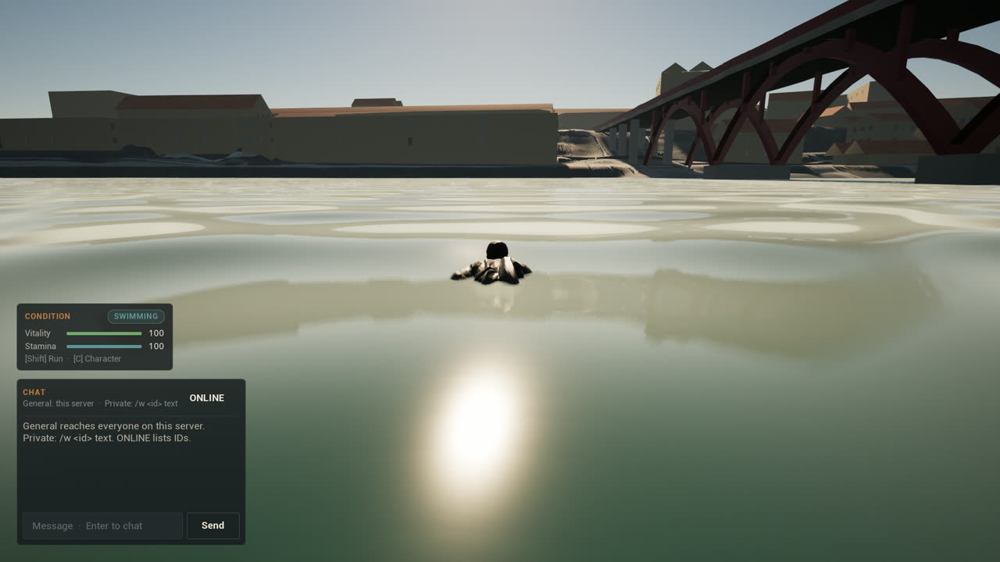
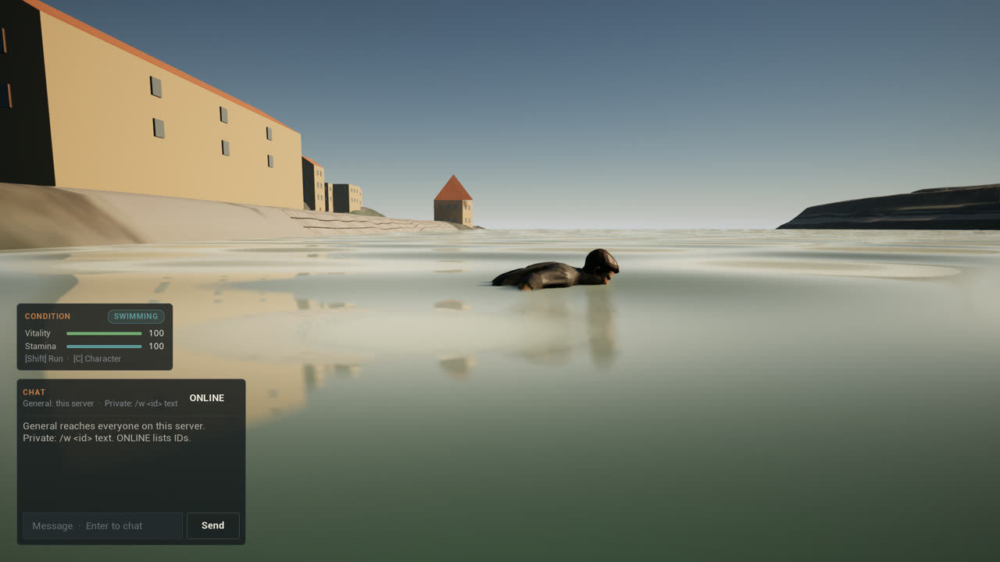
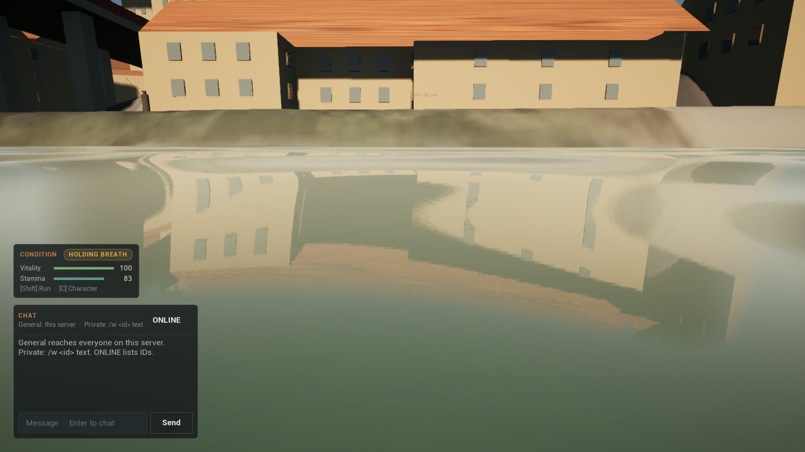
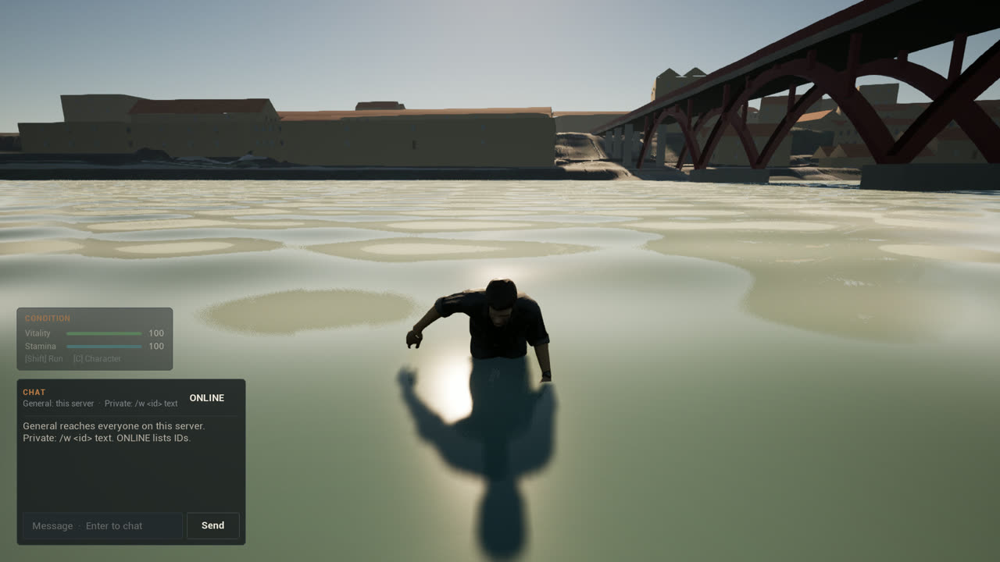
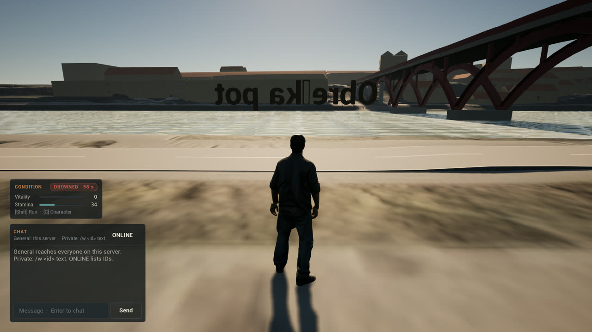
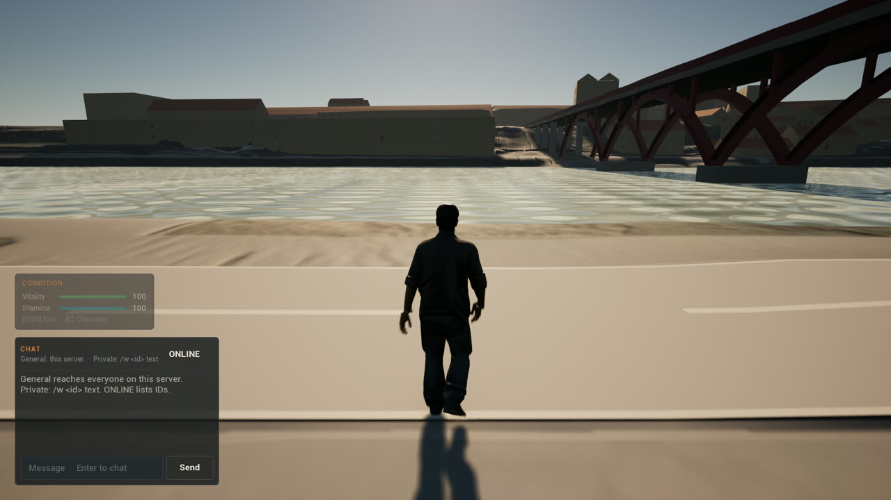

# Stage 1 evidence — swimming, held breath and drowning, Linux, 2026-11-10

**Result:** swimming **passes an automated two-phase test** on a packaged dedicated server with packaged clients, on the launch map `/Game/World/lent`.

- **Swimming:** walking west off the Lent promenade, the body is in the Drava after about 20 m. Holding a direction swims at 1.1 m/s with the mouth above the surface, and the original's swim cycle plays. Another player sees the same body in the water, playing the same clip.
- **Held breath:** letting go, the body slips under. Ten seconds under cost 16 points of stamina, which is a minute for a full bar. Swimming again brings the mouth back up within a third of a second.
- **Out of the water:** swimming back east, the body wades up the bank and walks.
- **Drowning:** under with no breath left, the body drowns after 60.4 s. The server takes it to the recovery point, and it cannot move there.
- **Saved:** leaving while down saves the rest of the wait. After a server restart the character is still down with that wait, recovers with full vitality and breath, and walks again. Saved rested, it is no entry in the store.
- **On screen:** the condition card's pill shows SWIMMING, HOLDING BREATH and DROWNED · N s.

Per [ADR-008](DECISIONS.md) the status is `implemented_awaiting_owner_playtest`. The rules and the swim cycle are the original game's ([ADR-032](DECISIONS.md)). Swimming makes no sound yet: the original had none of its own to carry over.

## Environment

| Item | Value |
| --- | --- |
| Source | Staged run: `cbdf6b2`; its tree is identical to `fd6a67a`, which the Editor, Client and Server were built from (only the commit message was reworded), on `c24a5a1` (ADR-028). Clean `Source`/`Config`/`Content`. The change was then rebased onto `f7e1328` (ADR-029–031, which touch rendering and the protagonist mesh, not movement or the store) and renumbered ADR-032; on that tree the Editor builds, `mb2 validate all` passes, every automation test passes, and `scripts/swim-smoke-linux.sh` (editor mode, run `Saved/SwimSmoke/20261110T210124Z`) passes for W, O and W2. The rebased tree has not been repackaged. |
| Engine / host | UE **5.8.3** source build; CachyOS Linux 6.18.60 x86_64; NVIDIA GeForce RTX 5080 |
| Processes | Packaged headless `MarburgumIIServer`, started twice on one world-store file; three packaged `MarburgumIIClient` sessions. W and W2 render offscreen at 1920×1080, one at a time; O runs `-nullrhi` |
| Command | `scripts/swim-smoke-linux.sh staged` (run `Saved/SwimSmoke/20261110T205238Z`); the same staged package also passed the condition, Lent, interaction, net and chat smokes |

## What runs

- **Water** (`-run=MarburgumSwimContent -Steps=water`, `scripts/create-swim-content.sh`): 82 water physics volumes over the Drava in `/Game/World/lent`. Every 1 m cell under the level's `Drava` sheet with ground at least 5 cm under it is water; the boxes' tops are the drawn surface, Z = 6 cm. 65,000 m² of water, bed down to −2.5 m.
- **Rule** (`MarburgumGameplayContract.h`, checked against `Data/Gameplay/gameplay.v0.1.json` and its provenance by `mb2 validate gameplay`): swim 1.1 m/s; mouth 1.55 m above the feet, held 15 cm over the surface while steering and rising at 1.2 m/s; sinking at 0.45 m/s to 35 cm under when not; a fall puts the mouth 40 cm under; 45 m of fall into water is lethal; held breath drains the bar in 60 s; recovery after 60 s.
- **Movement** (`UMarburgumCharacterMovement::PhysSwimming`, client-predicted, server-checked like ADR-020): the original `tick_water` in place of the engine's buoyancy; climbing out onto a low bank; drowning; a correction also carries the down state; a body that is down takes no input.
- **Recovery** (server): to the start tagged `recovery`, else the arrival start (this map), for 60 s; `recovery_s` is saved with a down body only.
- **Client:** `A_Swim` through `ABP_Unarmed`'s `DefaultSlot`, paced by speed as the original paced it, the body drawn 20 cm higher while it swims. The `player_condition` pill shows the most urgent state.
- **Driver** (`UMarburgumSwimSmokeSubsystem`, `-MB2SwimSmoke`): holds a world direction like WASD, measures speed from the client's own pawn, reads the server's condition from the owner-only player state, and reads the HUD pill.

## Results ([summary](Captures/stage1-swim/summary.txt), store after [phase 1](Captures/stage1-swim/world-store-after-phase-1.json) and [phase 2](Captures/stage1-swim/world-store-after-phase-2.json))

### Phase 1: fresh store

| Case | Observed | Result |
| --- | --- | --- |
| W walks west into the Drava | In the water after 10.3 s at 2.20 m/s, centre at the surface (Z 6); server `in_water` | PASS |
| W swims | 1.10 m/s over 2 s; feet 1.40 m under, so the mouth is 15 cm over the surface; prediction and server agree: swimming, not under; clip playing; HUD SWIMMING | PASS |
| O sees W | O's copy of W is swimming and plays the swim clip | PASS |
| W lets go | Under after 0.93 s (server `under`); HUD HOLDING BREATH | PASS |
| Held breath | After 10 s under: stamina 100 → 84 on the server (83.2 predicted); not drifting (0.00 m/s); feet 1.90 m under, so the mouth is 35 cm under | PASS |
| W swims again | Mouth back up after 0.31 s (server `surfaced`) | PASS |
| Back to the bank | Waded out at X 48.0 m after 7.1 s (server `left_water`); walking | PASS |
| W lets go again | Drowned 60.41 s after letting go from a full bar (server `drowned`); HUD DROWNED · 60 s | PASS |
| Recovery point | At the arrival start the next frame (server `recovery_point`); pushing west for 3 s moves it 0.00 m/s; HUD DROWNED · 58 s | PASS |
| W leaves while down | Saved at logout: `vitality=0 stamina=88 winded=0 revision=1 recovery_s=52` | PASS |

### Phase 2: same store, server restarted

| Case | Observed | Result |
| --- | --- | --- |
| W2 (W's character) arrives | Server restores `source=store vitality=0`; taken to the recovery point; HUD DROWNED · 50 s | PASS |
| Still down | Pushing west for 3 s: 0.00 m/s | PASS |
| Recovers | 46.4 s later (server `recovered`): vitality 100, stamina 100; HUD pill gone | PASS |
| Walks again | 2.20 m/s | PASS |
| Saved rested | `vitality=100 stamina=100 winded=0 revision=2 recovery_s=0`; the store's `conditions` is empty | PASS |

## Captures

| | |
| --- | --- |
|  |  |
| Swimming west, mouth up, SWIMMING | The same stroke from the side |
|  |  |
| Under, camera at the surface, HOLDING BREATH, stamina 83 | Wading out, the clip blending out |
|  |  |
| Drowned, at the recovery point, DROWNED · 58 s | Phase 2, recovered and walking |

## The swim clip

`-Steps=animation` generates `/Game/Characters/Animations/A_Swim` (30 fps, 1.2 s, 12 tracks) from the original's `_swim_animation` keys. Read back from the saved asset, limb directions in the original's model axes match the same clip evaluated on the original `player_male_a.glb` at its four key times:

| t | arm L, original → A_Swim | arm R | leg L | torso |
| --- | --- | --- | --- | --- |
| 0.0 | (0.48,−0.83,−0.28) → (0.48,−0.83,−0.28) | (−0.58,−0.23,0.78) → (−0.58,−0.24,0.78) | (0.01,−0.73,0.68) → (0.01,−0.72,0.70) | (−0.04,0.44,−0.90) → (−0.04,0.41,−0.91) |
| 0.3 | (0.27,−0.94,0.23) → (0.27,−0.94,0.21) | (−0.73,−0.55,0.41) → (−0.73,−0.55,0.41) | (−0.03,−0.48,0.88) → (−0.03,−0.48,0.88) | (0.00,0.44,−0.90) → (0.00,0.41,−0.91) |
| 0.6 | (0.58,−0.23,0.78) → (0.58,−0.24,0.78) | (−0.48,−0.83,−0.28) → (−0.48,−0.83,−0.28) | (−0.07,−0.73,0.68) → (−0.07,−0.72,0.69) | (0.04,0.44,−0.90) → (0.04,0.41,−0.91) |
| 0.9 | (0.73,−0.55,0.41) → (0.73,−0.55,0.41) | (−0.27,−0.94,0.23) → (−0.27,−0.94,0.21) | (−0.03,−0.48,0.88) → (−0.03,−0.48,0.88) | (0.00,0.44,−0.90) → (0.00,0.41,−0.91) |

The torso differs slightly because Manny's spine is curved and the original's was straight.

## Regression

The same package passes the existing condition, Lent, interaction, network and chat smokes. `mb2 validate all` passes, and the editor automation tests pass: `Marburgum.Chat.TextPolicy`, `Marburgum.Server.MissionRules` and `Marburgum.Server.WorldStoreCondition`, which now includes the saved wait.

## Not covered

- Owner playtest.
- The climb-out rule: Lent's bank here is a slope, and the swimmer waded out before the rule was needed (`climbed_out` 0). It has not run in a test.
- A plunge from a height (mouth forced under, lethal impact): nothing on this map is a drop into deep water that the driver can walk off.
- Wading at the volume top: a body walking on the bed with its centre at the surface can alternate between wading and swimming. It did not in this run, and it has not been looked for.
- Remote swimmers' clip is checked as playing on a `-nullrhi` observer, not rendered.
- A river current, an underwater view, a down pose, and sounds.
