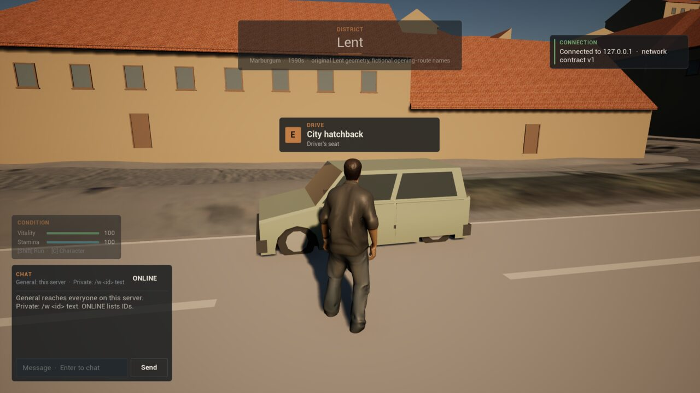
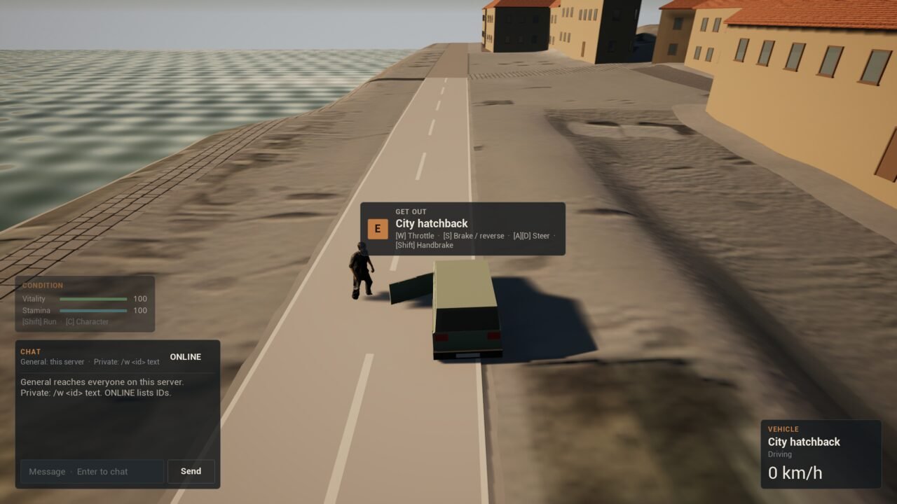
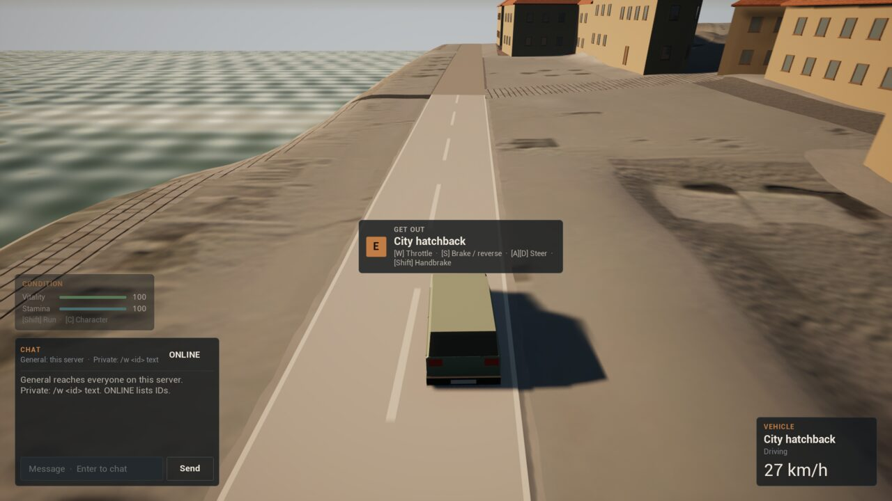
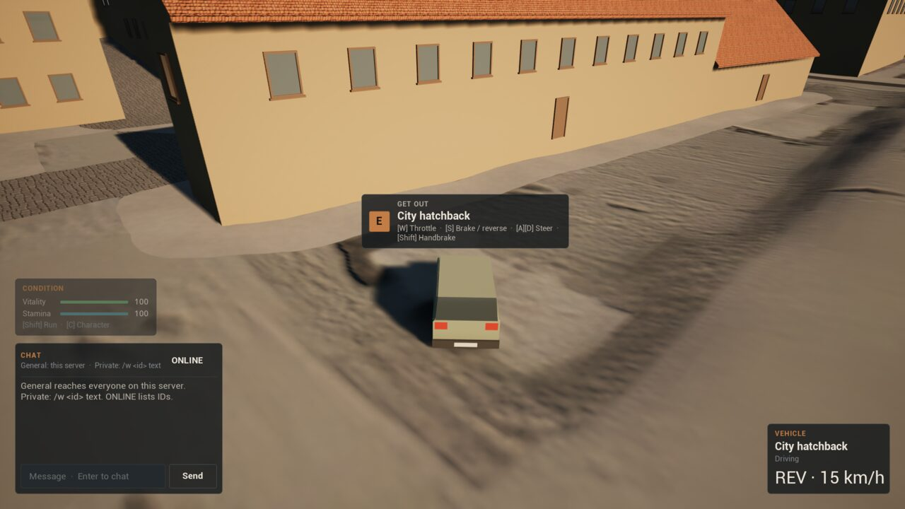
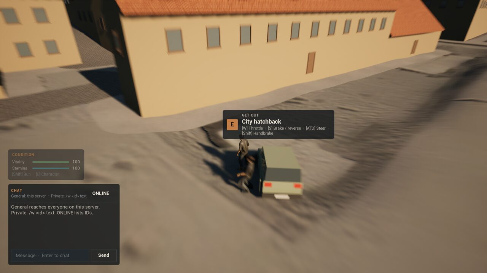

# Stage 1 evidence — cars and driving, Linux, 2026-11-10

**Result:** driving **passes an automated two-client test** on a packaged dedicated server with packaged clients, on the launch map `/Game/World/lent`.

- **The parked car:** the original's city hatchback stands where the original put it, about 160 m west of the arrival start. It settles on its springs, on four wheels, and stays put on Lent's 1.4° cross-fall.
- **Getting in:** at the driver's door, E puts the driver in its seat. The body plays the original's enter clip at the door, then is hidden in the seat, and the vehicle card shows the car at 0 km/h.
- **Seats:** a second player asking for the driver's seat is refused (`seat_taken`) and gets into a rear seat instead.
- **Driving:** the throttle takes the car to 27 km/h in 3.5 s and 13 m; the wheel turns it; the brake stops it; back reverses it, with REV on the card; and it stops again. The passenger's body travels with the car. No crash is detected.
- **Getting out:** the passenger, then the driver, get out at their own doors and stay there; the driver walks away and the car stays where it was left.

Per [ADR-008](DECISIONS.md) the status is `implemented_awaiting_owner_playtest`. The rules, catalogue, bodywork and door clips are the original game's ([ADR-039](DECISIONS.md)). Cars make no sound yet: the original's engine sounds were San Andreas placeholders.

## Environment

| Item | Value |
| --- | --- |
| Source | `ff72085` on `c8b5fa9` (ADR-038). The staged run was built from the same change on `6633500` (ADR-037), whose `Source`/`Config`/`Content` differ only by ADR-038's protagonist material and comments renumbering this ADR; its `git_sha` line names the evidence commit then on top of it. |
| Engine / host | UE **5.8.3** source build; CachyOS Linux 6.18.60 x86_64; NVIDIA GeForce RTX 5080 |
| Processes | Packaged headless `MarburgumIIServer` on a fresh world store; two packaged `MarburgumIIClient` sessions joined with `?MB2Start=lent_hatchback`. D renders offscreen at 1920×1080; P runs `-nullrhi` and joins 6 s after D |
| Command | `scripts/vehicle-smoke-linux.sh staged` (run `Saved/VehicleSmoke/20261110T223834Z`). Before rebasing onto ADR-033–037 the same test passed staged and in editor mode (runs `20261110T222619Z`, `20261110T222233Z`) |
| Other checks | `mb2 validate all`; automation tests `Marburgum.*` (5, including `Marburgum.Vehicles.Dynamics`); the swim, condition, interaction, Lent and net smokes on the same staged build |

## What runs

- **Catalogue** (`Data/Gameplay/vehicles.v0.1.json`, `MarburgumVehicleContract.h`, kept in step by `mb2 validate vehicles`): the original five definitions and the authored `lent_hatchback`.
- **Content** (`-run=MarburgumVehicleContent`, `scripts/create-vehicle-content.sh`): bodywork, wheels and doors for all five cars from the original `vehicle_mesh.cpp` (hatchback body 228 triangles, 4 hinged doors), `M_Vehicle` with one paint instance per car, `A_EnterVehicle`/`A_ExitVehicle` from the original's procedural door clips, and the Lent car with its player start.
- **Server** (`AMarburgumVehicle`): four suspension rays and the original's tyre, engine, brake and drag forces each frame, from the driver's intent (expires after 0.4 s); a stopped, braked car holds on a slope; seats, doors and exit spots; `Motion` replicated at 30 Hz.
- **Client:** the car follows the server's `Motion`; wheels on their own rays, spinning and steering; doors swing while someone gets in or out; the seated body hidden after the enter clip; the driving camera; the `interaction_prompt` (DRIVE / GET OUT, with the controls) and the `vehicle_status` card.
- **Driver** (`UMarburgumVehicleSmokeSubsystem`, `-MB2VehicleSmoke`): asks through the same controller calls E uses, holds the pedals through the controller's test override (the server still decides), reads the car's replicated state, its own body and the HUD.

## Results ([summary](Captures/stage1-vehicle/summary.txt))

| Case | Observed | Result |
| --- | --- | --- |
| The parked car | Spawned 10.5 cm above its rest; settled at Z 262.09 on four wheels, pitch 0.0°, roll −1.5° (the cross-fall); moved 0.0 cm over the next 2 s | PASS |
| D finds the car | 1.18 m from the driver's door; the candidate is `lent_hatchback`, driver's seat; prompt DRIVE · City hatchback | PASS |
| D gets in | Answered after 0.18 s (server `entered seat=driver`); the body drawn while the enter clip plays, hidden 1.02 s later; card City hatchback · Driving · 0 km/h | PASS |
| P asks for the driver's seat | Refused, `seat_taken` (server `enter_refused`) | PASS |
| P gets into a passenger seat | `rear_left`, the nearest free seat from where it stood (server `entered`); not driving | PASS |
| Throttle (0.6) | 3.5 s: 7.54 m/s (card 27 km/h), 13.2 m along the car's forward, no yaw drift | PASS |
| Steer right (0.7, throttle 0.4) | 2.5 s: yaw −90.0° → 23.9°, at 8.3 m/s (card 30 km/h) | PASS |
| Brake | Stopped in 1.78 s | PASS |
| Reverse (−0.6) | 2.5 s: −4.24 m/s, 5.7 m backward along the car's forward; card REV · 15 km/h | PASS |
| Stop | Stopped in 2.11 s, on a 6.7° slope, and held there | PASS |
| P rides along | Its body carried more than 3 m with the car; hidden in its seat | PASS |
| P gets out | Server `exited seat=rear_left`; at its door, drawn, and still there when the driver is out | PASS |
| D gets out | Server `exited seat=driver`; within 2.5 m of its door, drawn, card gone, still there 1 s later | PASS |
| D walks away | 4.3 m in 2 s (walking pace); the car did not move | PASS |
| Server | `vehicle_ready` 1, no `exit_refused`, no `seat_released`, no `impact`, no unknown definition, no expired client moves | PASS |

## Found and fixed by this test

- **A parked car crept.** The first staged run found the hatchback sliding sideways at about 3.5 cm/s: the original's brake and tyre are viscous and balance a slope only while moving. Stopped, braked wheels now hold (`HoldForce`, ADR-039).
- **The bodywork rendered black.** The mesh port wound its triangles against Unreal's front face, so only the inside of the far panels drew. Fixed in the commandlet and regenerated.
- **Getting out could put the owner back where it got in.** Walking moves saved before the seat were replayed after it, and the server rejected them as expired. Prediction is now reset on both ends at every seat change; the driver checks that a body stays at its door.

## Captures

| | |
| --- | --- |
|  |  |
| D at the driver's door: DRIVE · City hatchback · Driver's seat | In the seat, driver's door still open, P standing beside it; GET OUT with the controls; card 0 km/h |
|  |  |
| Driving along the promenade at 27 km/h, camera behind | Reversing: REV · 15 km/h |
|  | |
| Out at the driver's door, the exit clip starting, P beside the car (the prompt still reads GET OUT: it refreshes at 10 Hz) | |

## Not covered

The owner playtest. Sounds. A car is not saved: it returns to its spot when the server restarts. Ownership, keys, fuel, damage and traffic. Client-side prediction of the driver's own car (it sees the server's car about one round trip late, as in the original). Surface semantics and weather. Collisions with other cars and buildings (no impact occurred). Remote players' seated bodies are hidden, not posed. The `interaction_prompt` refreshes at 10 Hz, so a capture in the frame a seat changes can show the previous verb.
