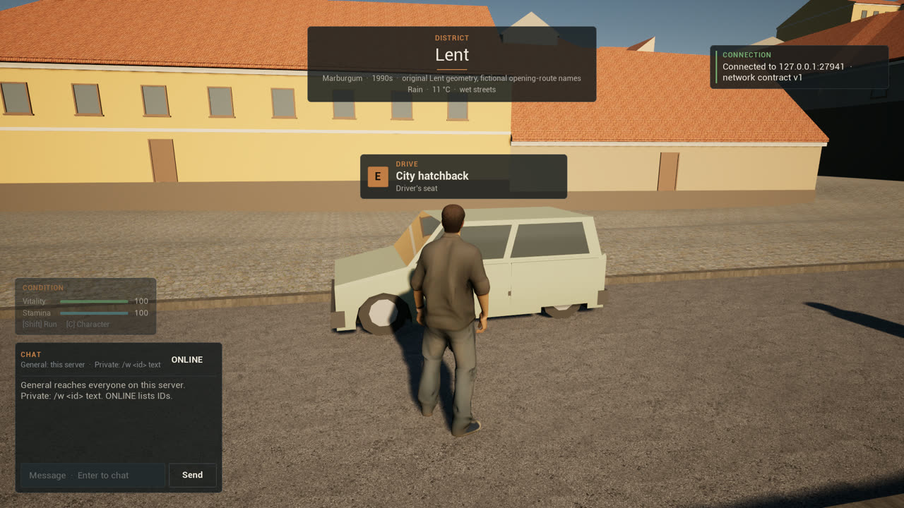
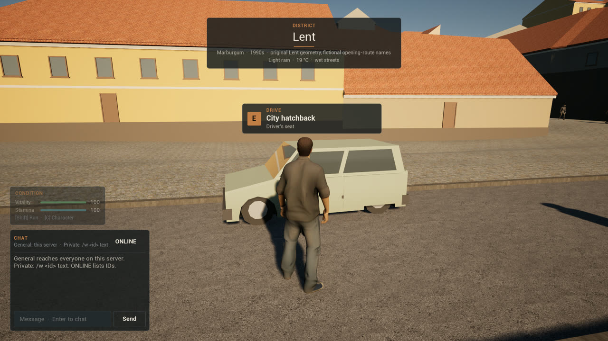

# Stage 1 evidence — weather, wet roads and footsteps, Linux, 2026-11-12

**Result:** the server's weather, wet-road grip and footsteps **pass an automated one-client test** against an editor-mode dedicated server on the launch map `/Game/World/lent`, in three runs: a dry profile, a soaked profile and the live Maribor climate on a fast clock.

- **Weather:** the server runs the original's automatic weather from ARSO's Maribor 1971–2000 normals and replicates it; the location banner shows it as a line such as "Light rain  ·  19 °C  ·  wet streets".
- **Wet roads:** on the same asphalt, the car decelerates from full brake at 5.25 m/s² dry and 4.50 m/s² soaked.
- **Footsteps:** the player's steps on the old town's setts are hard and dry on a dry street and all splash on a wet one.
- **Ground:** the paving reports asphalt, paving, cobblestone and concrete; the landscape reports hard standing, grass, earth and gravel.

Per [ADR-008](DECISIONS.md) the status is `implemented_awaiting_owner_playtest`. The weather rules and climate are the original game's ([ADR-061](DECISIONS.md)). **Nothing of the weather is drawn yet:** the sky stays sunny while the HUD says rain (captures below). The wet-street steps are generated and have not been heard by the owner.

## Environment

| Item | Value |
| --- | --- |
| Source | branch `feat/weather` on `f2a6225` (ADR-060), working tree before the ADR-061 commit |
| Engine / host | UE **5.8.3** source build; CachyOS Linux 6.18.60 x86_64; NVIDIA GeForce RTX 5080 |
| Processes | Editor-mode dedicated server (`UnrealEditor -server`) on a fresh world store per run; one editor-mode client (`-game`) with `?MB2Start=lent_hatchback`, rendering offscreen at 1920×1080 |
| Command | `MB2_WEATHER_PORT=27941 scripts/weather-smoke-linux.sh editor` (run `Saved/WeatherSmoke/20261112T160238Z`). The dry and wet runs alone also passed in `20261112T155947Z` |
| Other checks | Automation `Marburgum.*`, including `Marburgum.Shared.Weather.Climate`, `.Simulation`, `.Profiles` and `Marburgum.Shared.Surface`; `cargo test` for `tools/mb2` and `tools/lent-ground`; `mb2 validate all`; Editor, Server and Client target builds |

## What runs

- **Shared** (`MarburgumWeather.h`, `MarburgumSurface.h`): the original's climate planner and weather simulation, the four fixed profiles, the surface vocabulary, the landscape surface map, footstep sets and the footfall detector.
- **Data:** `Content/Marburgum/Weather/maribor_1971_2000.json` and `weather_states.json` (the original's files, unchanged); `Content/Marburgum/Ground/lent_surface.bin` (`lent-ground surface-kinds` from `Data/World/lent_ground/surface.png`: 768 × 768 cells of 2 m, 62.4% hard standing, 23.0% grass, 5.4% earth, 0.4% gravel, 8.7% river stones).
- **Content** (`scripts/create-weather-content.sh`): `PM_asphalt`, `PM_paving`, `PM_cobblestone`, `PM_concrete` on the six paved materials; the footsteps under `/Game/Audio/Footsteps` (`SourceArt/Audio/Footsteps/README.md`).
- **Server** (`UMarburgumWeatherAuthority`): the weather once a second onto `AMarburgumGameState::Weather`; each wheel of a car reads its surface and the wetness.
- **Client:** `UMarburgumFootstepSubsystem` plays a step when a foot bone of anyone on foot within 30 m comes down; the location banner's weather line.
- **Driver** (`UMarburgumWeatherSmokeSubsystem`, `-MB2WeatherSmoke`): reads the replicated weather and the HUD, traces the ground, gets into the hatchback and holds the pedals through the controller's test override (the server still decides), walks through ordinary movement input and reads the footstep counters.

## Results ([summary](Captures/stage1-weather/summary.txt))

| Case | Observed | Result |
| --- | --- | --- |
| Dry: the weather | `clear_dry` replicated, wetness 0, nothing falling; banner "Clear  ·  20 °C" | PASS |
| Dry: the ground | Under the body and the car: asphalt. 41 × 41 survey at 2 m: paving cobblestone 726, asphalt 99, paving 69, concrete 6; landscape concrete (hard standing) 196, gravel 132, grass 13, soil 1; 439 other (buildings, water, nothing) | PASS |
| Dry: braking | 3 s at 0.8 throttle to 8.42 m/s, full brake: stopped in 6.75 m after 1.36 s, 5.25 m/s², on asphalt | PASS |
| Dry: walking | 8.7 m in 4 s on cobblestone: 10 steps, all `hard`, none wet, every step with a sound | PASS |
| Wet: the weather | `rain_wet` replicated, wetness 1, rain; banner "Rain  ·  11 °C  ·  wet streets" | PASS |
| Wet: braking | The same throttle reaches only 7.16 m/s (less traction), stopped in 5.70 m after 1.38 s, 4.50 m/s², on asphalt: **0.86 × dry** (required ≤ 0.95; the earlier run 0.80 ×) | PASS |
| Wet: walking | 8.7 m: 9 steps, all `hard_wet` | PASS |
| Live: the start | Server clock 18 June 2026 09:00 UTC (10:00 CET) × 60, seed 1996: overcast, wetness 0, drizzle beginning; the client arrives at wetness 0.10 | PASS |
| Live: the weather turns | 09:30 UTC: light rain (server `event=changed ... state=light_rain type=rain`); the client sees it at wetness 0.46, banner "Light rain  ·  19 °C  ·  damp streets", then 0.505 and "… wet streets" | PASS |
| Live: walking | 9 steps, all `hard_wet` | PASS |

### Captures

| Dry | Soaked (`rain_wet`) | Live climate, rain set in |
| --- | --- | --- |
|  |  |  |

The banner's third line is the weather. The sky is the same in all three: rain, clouds and wet surfaces are not drawn yet.

## Not covered

A look for the weather (rain, clouds, fog, wet sheen, lightning) and its sounds. The owner hearing the steps, especially the generated splash. A packaged run. Steps of other bodies are counted (`all_steps`) but not checked one by one. Grip on the landscape's grass and earth is in the unit-tested table only; the smoke drives on asphalt. Buildings, bridges and other meshes are unknown ground. The original's weather effects on fishing and foliage.
