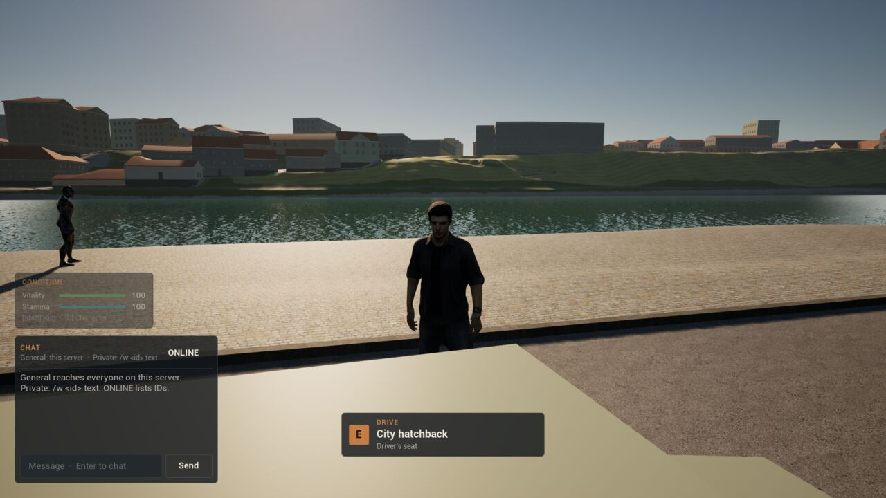
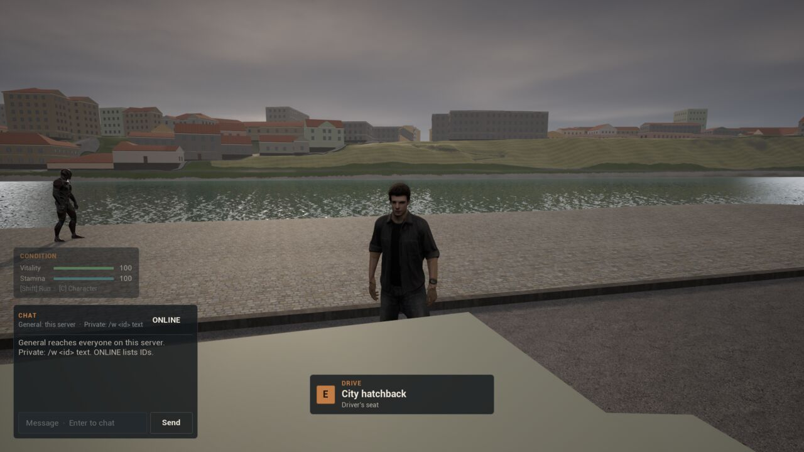
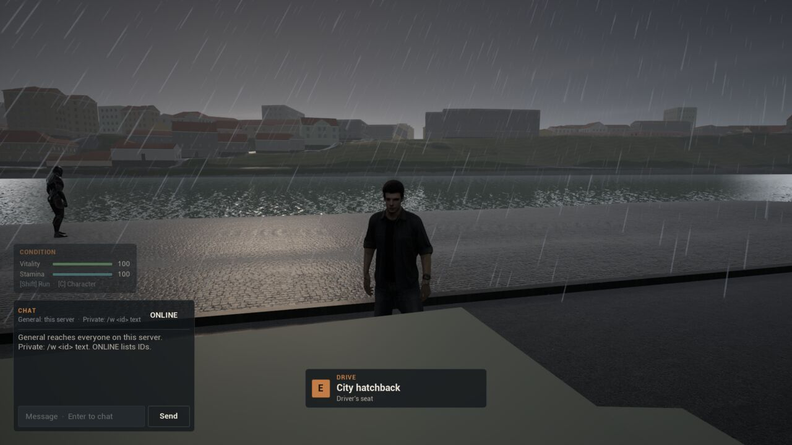
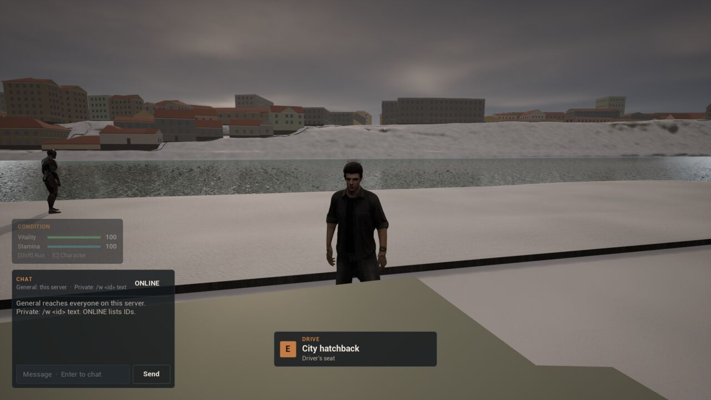
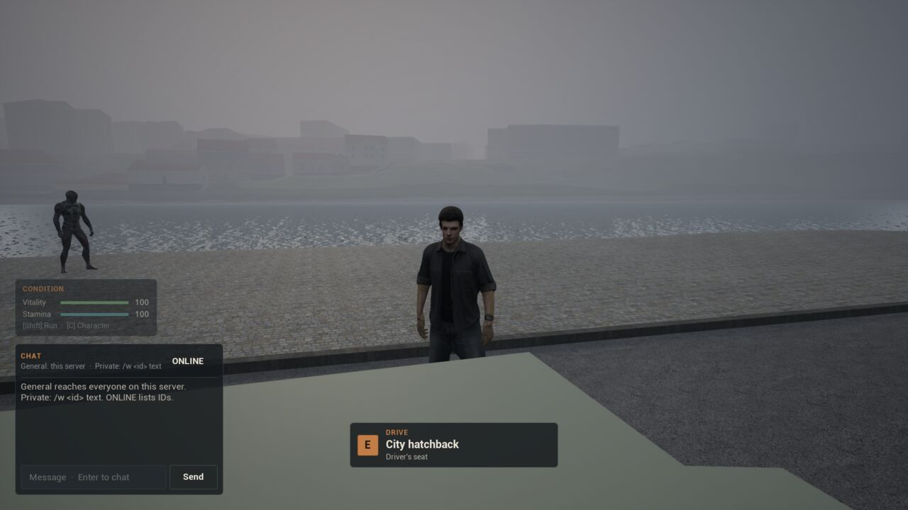
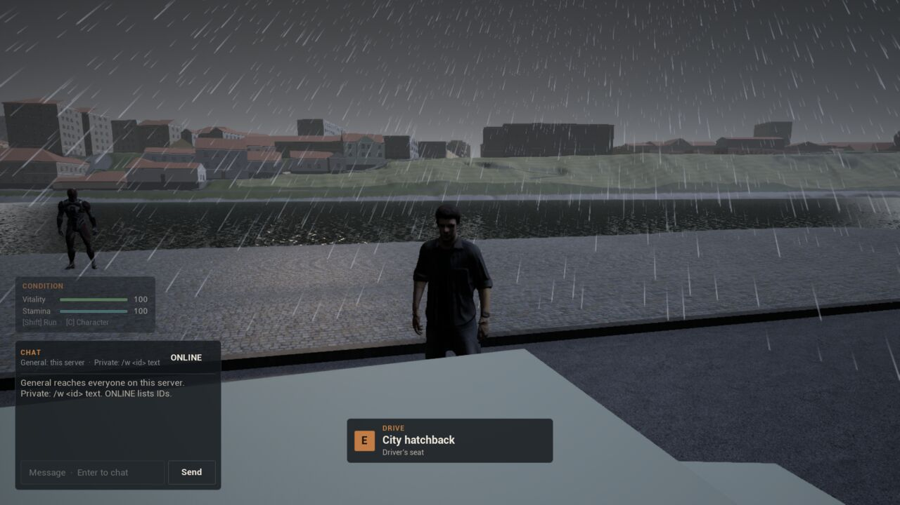
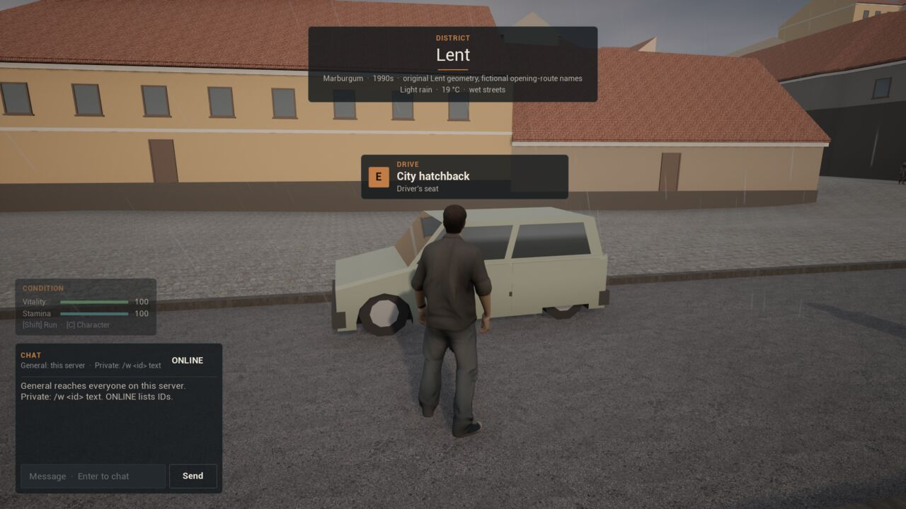

# Stage 1 evidence — the weather drawn and heard, Linux, 2026-11-12

**Result:** the client's weather look **passes an automated one-client test** against an editor-mode dedicated server on the launch map `/Game/World/lent`, in nine runs: ADR-061's dry, soaked and live-climate runs, now also checking what is drawn, and six runs that only look and capture the same view: clear, overcast, steady rain, lying snow, a fog morning and a thunderstorm.

- **Sky and light:** under cover the sun dims and its shadows soften, the volumetric clouds close, the colour drains and the eye closes a little; rain and fog thicken the haze.
- **Rain and snow:** the original's procedural curtain round the camera, leaning downwind (30° in the 5 m/s of `rain_wet`, 43° in the storm's 8 m/s).
- **The ground:** Lent's paving and landscape darken and gloss with the server's wetness, and turn white under lying snow.
- **Lightning:** the storm's own flashes and one held for the capture; thunder follows each at the speed of sound.
- **Sound:** synthesised rain, wind and thunder, measured in the automated tests; the smoke clients run with `-nosound`, so **nobody has heard it in the game yet**.

Per [ADR-008](DECISIONS.md) the status is `implemented_awaiting_owner_playtest`. The look is the original's ([ADR-062](DECISIONS.md)), recalibrated for Lent's exposure and haze.

## Environment

| Item | Value |
| --- | --- |
| Source | branch `feat/weather-look` on `2726f7b` (ADR-061), working tree before the ADR-062 commit |
| Engine / host | UE **5.8.3** source build; CachyOS Linux 6.18.60 x86_64; NVIDIA GeForce RTX 5080 |
| Processes | Editor-mode dedicated server (`UnrealEditor -server`) on a fresh world store per run; one editor-mode client (`-game`) with `?MB2Start=lent_hatchback`, rendering offscreen at 1920×1080, `-nosound` |
| Command | `MB2_WEATHER_PORT=27955 scripts/weather-smoke-linux.sh editor` (run `Saved/WeatherSmoke/20261112T170528Z`) |
| Content | `scripts/create-weather-content.sh look`; `-run=MarburgumRebuildGround -MaterialsOnly`; `create-weather-content.sh surfaces` afterwards assigned nothing new (the physical materials survived) |
| Other checks | Automation `Marburgum.*` 21/21, including `Marburgum.Shared.WeatherLook.Look`, `.Shelter` and `.Sound`; Editor, Server and Client target builds |

## Results ([summary](Captures/stage1-weather-look/summary.txt))

Each look check reads the effects actor on the client: what falls and whether the curtains are drawn, whether the clouds are drawn, Lent's sun and height fog against their own values, the weather's exposure, and `MPC_Weather`'s wetness and snow cover as the ground materials see them. In every run the content was present and Lent's own sun and fog were found.

| Run | Server weather (banner) | Rain drawn | Lean | Clouds | Sun | Haze | Exposure | Ground | Promenade grey |
| --- | --- | --- | --- | --- | --- | --- | --- | --- | --- |
| clear (`clear_dry`) | "Clear · 20 °C" | no | — | 0.15 cover | 0.985 × | 1.0 × | −0.04 EV | dry | **185** |
| overcast | "Overcast · 13 °C" | no | — | 0.95 | 0.905 × | 1.0 × | −0.65 EV | dry | **172** |
| rain (`rain_wet`) | "Rain · 11 °C · wet streets" | 0.70, near and far | 30.5° | 1.0 | 0.83 × | 3.1 × | −1.40 EV | wetness 1.0 | **162** |
| snow (`winter_cold`) | "Cold · −2 °C · snow lying" | no | — | 0.80 | 0.92 × | 1.0 × | −0.50 EV | snow cover 1.0, wetness 0.15 | 188 |
| fog (climate, 17 Nov 2026 07:00 CET) | "Fog · 3 °C" | no | — | 0.80 | 0.92 × | **50 ×** | −0.50 EV | dry | 172 |
| storm (climate, 12 Nov 2026 18:30 CET) | "Thunderstorm · 7 °C · wet streets" | 0.85 | 43.3° | 1.0, storm clouds | 0.815 × | 3.55 × | −1.55 EV | wetness 1.0 | 159 |
| dry (driving run) | "Clear · 20 °C" | no | — | 0.15 | 0.985 × | 1.0 × | −0.04 EV | dry | — |
| wet (driving run) | "Rain · 11 °C · wet streets" | 0.70 | 30.5° | 1.0 | 0.83 × | 3.1 × | −1.40 EV | wetness 1.0 | — |
| live, start | "Overcast · 19 °C" (drizzle beginning) | 0.04 | 23° | 0.96 | 0.90 × | 1.1 × | −0.69 EV | wetness 0.075 | — |
| live, soaked | "Light rain · 19 °C · wet streets" | 0.145 | 23.8° | 0.97 | 0.89 × | 1.4 × | −0.82 EV | wetness 0.435 (easing) | — |

The promenade grey is the mean of the promenade and river right of the player in each look capture (`brightness.txt`), the measure the exposure was calibrated on. **Correction (ADR-064):** that measure averaged the screenshots' alpha channel into the grey. Measured without it (`Saved/WeatherSmoke/20261113T200436Z`, fog and storm now at daylit hours), the looks keep the same order and wider steps: clear 129, overcast 95, fog 92, rain 71, storm 68. The original aimed for overcast and steady rain about 0.8 and 1.5 EV under clear on its city. Before recalibration Lent measured overcast 1.14× and rain 1.15× **brighter** than clear (`20261112T165631Z`).

The driving runs still pass ADR-061's checks: braking from full throttle 5.39 m/s² dry and 4.51 m/s² soaked (0.84 ×), ten hard steps dry and splashing steps wet, and the live climate turning to light rain at 10:30 CET.

The storm's random flashes come about three a minute and none fell in the five seconds before the check. The capture holds one close strike (`FlashNow`) at its peak: the frame's mean grey goes from 158.5 to 165.0, and the drops brighten with it. An earlier run took the capture without the hold and missed the flash entirely: the offscreen frame was slower than a flash.

### Captures

| Clear | Overcast | Steady rain |
| --- | --- | --- |
|  |  |  |

| Snow lying | Fog | Thunderstorm, a close strike |
| --- | --- | --- |
|  |  |  |

| The live climate, rain set in (at the car, with the banner) |
| --- |
|  |

## Not covered

Hearing the rain, wind and thunder in the game, and the footstep splashes (the clients run with `-nosound`). Puddles, splashes and ripples, wet façades, roofs and cars, and snow anywhere but the ground. Night and the flash at night. The cost of the clouds and the curtain on lower settings. The shelter under a roof is unit-tested only; no capture stands under one. A packaged run. The owner's look and ear.
