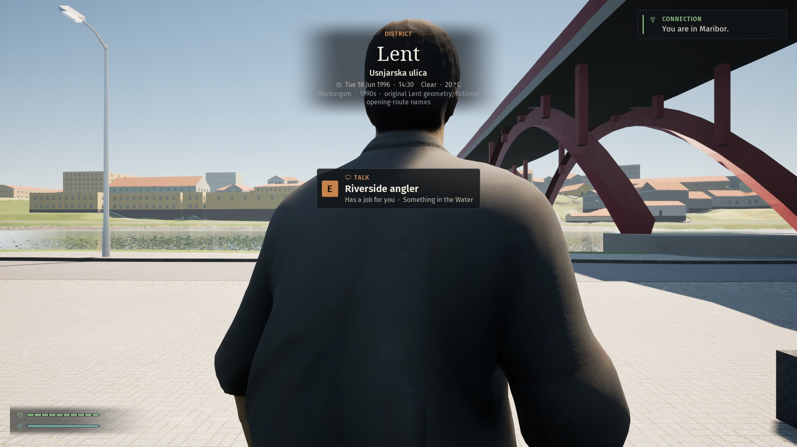
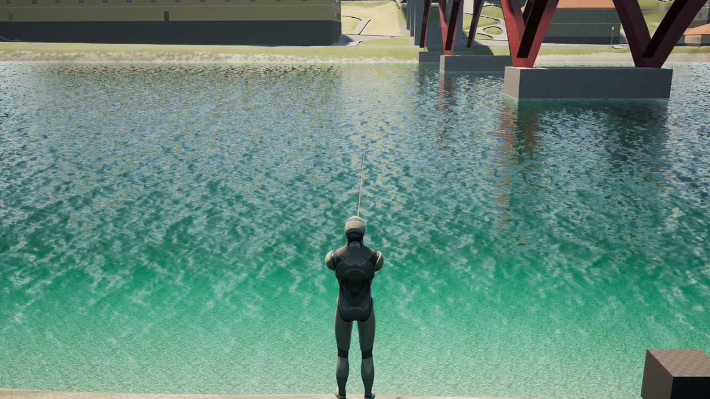
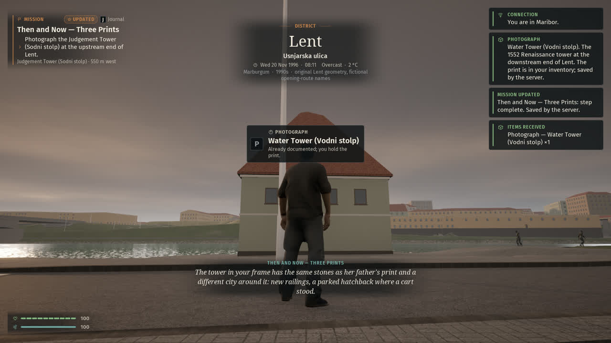
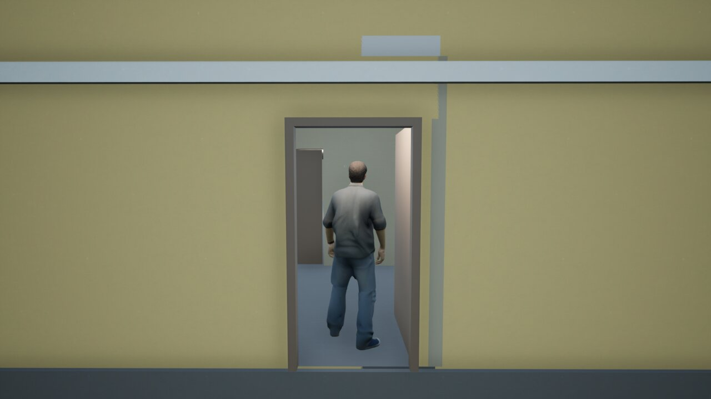
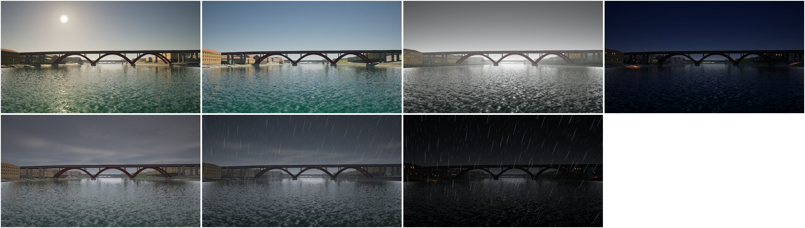
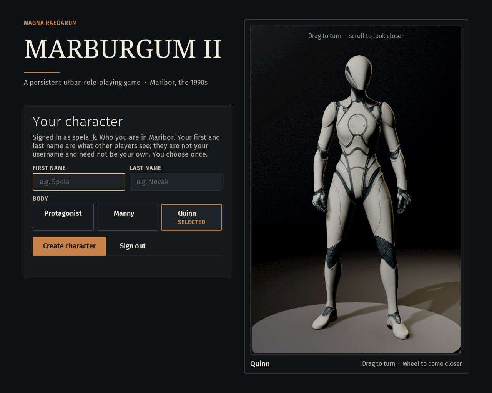
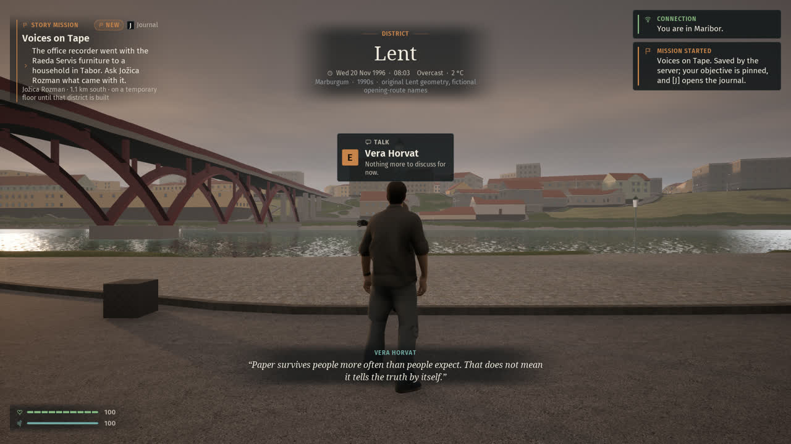

<div align="center">
  <h1>MAGNA RAEDARUM<br>MARBURGUM II</h1>
  <p><strong>A living city. A shared world. A second beginning.</strong></p>
  <p><em>A server-authoritative urban MMORPG in a fictionalized 1990s Maribor, Slovenia.</em></p>
  <p>
    
    
    
    
  </p>
  <p>
    <a href="#the-world">The world</a> ·
    <a href="#recent-development">Recent development</a> ·
    <a href="#development-progress">Progress</a> ·
    <a href="#building-from-source">Build</a> ·
    <a href="Docs/ROADMAP.md">Roadmap</a> ·
    <a href="Docs/GRAPHICS_ROADMAP.md">Graphics</a>
  </p>
  
  <p><sub>Actual Unreal client development capture · November 2026 · Work in progress; owner acceptance pending.</sub></p>
</div>

---

## The world

**Marburgum II** rebuilds the original *Magna Raedarum: Marburgum* as an MMORPG-first game using **Unreal Engine 5.8.3**. Walk the Drava riverfront, encounter people with their own routines, investigate urban mysteries, fish, photograph places, learn skills, shop, drive and share a persistent fictionalized 1990s Maribor with other players.

Its current world covers **1,536 × 1,536 metres** across nine original map windows centred on Lent, including streets, bridges, urban blocks and the Drava. It remains **one always-loaded development level**, not a finished city or a proven 250-player shard. Game rules and persistent state belong to an authoritative dedicated server; solo-friendly play and cooperation use that architecture.

## Recent development

*19–20 November 2026 · [Full engineering review](Docs/DEVELOPMENT_REVIEW_2026-11-20_EVENING.md)*

The latest development has made the city more playable and recognizable. Mission contacts now use animated character models; the riverside angler holds a rod, and players visibly cast and reel. The new **Chapter IV — Voices on Tape**, its outcome-dependent follow-up, two side missions and **Photography** integrate story, pictures, discovery and skill progression. First building interiors, a substantial bilingual UI redesign and more robust multiplayer security have also arrived.

<div align="center">
<table>
<tr>
<td width="33%"><br><sub>Fishing on the Drava</sub></td>
<td width="33%"><br><sub>Photography gameplay</sub></td>
<td width="33%"><br><sub>First enterable interiors</sub></td>
</tr>
</table>
<sub>Development screenshots from specific test revisions, not a single release candidate.</sub>
</div>

**Chapter VI, *The Negative*** (ADR-084, on `main`, awaiting the owner's playtest). Nika Vidmar dates the torn photograph from the Drava cashbox, Foto Vidmar's order book names the roll, and Stefan Zupan's contact sheet in a Block 13 storage cage shows a 37th frame on a 36-exposure roll. In the companion side story *Thirty-Six Exposures* the player reasons out that the frame's yard, not its person, can be checked, then finds and photographs the Melje date board. Vera reads it as a chronology: a Kainach truck delivered on 16 February 1990, two months after the file says the arrangement closed. The Glas photo desk's uncropped print puts Albin Rojko at the gate, and how he answers depends on how Kiosk 67 ended. [How to play it](Docs/STORY_EXPANSION.md#109-owner-playtest-how-to-play-chapter-vi) · [what was tested](Docs/STORY_EXPANSION.md#107-tests-and-evidence-chapter-vi).

**What's been demonstrated:** packaged tests of the two selected interiors, staged Chapter IV/Photography and Slovene mission content, and a staged account-enabled connection using **AES-256-GCM**. In the earlier packaged pedestrian test, an opposite-bank scene reached only 11/28; its **test fixture** was later corrected and passed **28/28 in the editor**, with a post-correction packaged rerun still outstanding. A full latest-source all-systems test and the project owner's personal playtest are not yet recorded.

## Development progress

| System | Existing implementation and recorded evidence | Open work |
| --- | --- | --- |
| **Multiplayer and identity** | Dedicated Linux Client/Server, development accounts and three-model character creation; server-bound tickets and **AES-256-GCM signed-in sessions** in the latest security package | End-to-end current-head integration, security/reconnect audit, owner acceptance and eventual larger-scale operations |
| **The living city** | Nine windows, weather/daylight/street lighting, mapped destinations and district crowds, bidirectional editor Stari most walking | Current packaged crowd day/night matrix, period-correct art and measured streaming/scale |
| **Exploration and interiors** | Deterministic floor data for **586** eligible buildings; **five** actually have cut enterable shells; two staged multi-client interiors pass | **581** eligible shells unopened, **346** exceptions, authentic furnishing and owner walkthrough |
| **Story and activities** | Original missions, *Voices on Tape*, outcome branches, two side stories, working Photography/prints/XP, fishing and Kiosk 67; packaged story evidence. ADR-084: **Chapter VI *The Negative*** and side story ***Frame 37***, with Albin Rojko's route set by your Kiosk 67 outcome, a deduction, evidence classed original/print/copy/testimony/information/inference and open questions in the Journal; staged English and Slovene smokes and the staged regression (story, missions, crowd, doors) pass on the merged package `72071db` | Owner playtest of Chapter VI, later chapters, deeper jobs and named routines, Slovene editorial review and full owner acceptance |
| **Presentation** | UI design system v2, unified Character/Skills/Inventory/Journal, working **Settings**, English/Slovene UI including **657 strings**, and editor 37/37 automation | Current packaged controller, focus, 720p–4K/accessibility, localization and owner visual approval |
| **Graphics and research** | Rendering audit and packaged baseline; 246 historical art-reference records, six imagery leads, Rust archival validation and passing source/archive CI | Historical source rights, authored visual assets, uncontended GPU benchmarks; hardware Lumen selected for study but **not yet enabled** |

**Status: pre-alpha.** The repository is a real development project and contains verified playable slices, yet it is not a finished or owner-approved public game.

### Development gallery

| City light and weather | English and Slovene interface | Investigation and character presentation |
| :---: | :---: | :---: |
|  |  |  |

<sub>All gallery material comes from the in-repository development captures; offline graphics and editor tests are not portrayed as release performance.</sub>


## Building from source

**Requirements:** Unreal Engine **5.8.3 exactly**, supported Linux C++ compiler/toolchain, Git LFS, .NET **10** SDK and stable Rust. Unreal Engine and some licensed/local assets are **not** distributed with this repository. Linux is the primary tested development environment; Windows parity has not been established.

```bash
git clone https://github.com/simon-gros/MarburgumII.git
cd MarburgumII
git lfs install
git lfs pull

export UE_ROOT=/absolute/path/to/UnrealEngine-5.8.3
./scripts/check-engine-version.sh "$UE_ROOT"

./scripts/build-linux.sh MarburgumIIEditor
./scripts/build-linux.sh MarburgumIIServer
./scripts/build-linux.sh MarburgumIIClient
```

For actual staged binaries and existing smoke suites:

```bash
./scripts/package-linux.sh
./scripts/net-smoke-linux.sh
./scripts/chat-smoke-linux.sh
./scripts/interaction-smoke-linux.sh
./scripts/combat-smoke-linux.sh
./scripts/vehicle-smoke-linux.sh
```

District/venue behaviors have editor-mode evidence. A separate clean `c967c46` Linux Development package recorded the **older** opposite-bank timeout. ADR-079 later corrected the editor fixture, which now passes; its fixed scene needs a new staged package. To reproduce the focused checks:

```bash
./scripts/street-hours-smoke-linux.sh editor
./scripts/street-district-smoke-linux.sh editor
./scripts/street-places-smoke-linux.sh editor
./scripts/street-smoke-linux.sh editor
./scripts/mission-smoke-linux.sh editor
./scripts/account-smoke-linux.sh editor
./scripts/bridge-cross-linux.sh editor
./scripts/street-multiplayer-smoke-linux.sh editor night
./scripts/street-multiplayer-smoke-linux.sh staged night
./scripts/street-multiplayer-smoke-linux.sh staged # must requalify fixed ADR-079 on newly packaged binaries
```

Independent source and data checks:

```bash
dotnet run --project tools/MarburgumII.Tools -- verify
./scripts/mb2.sh validate all
cargo test --manifest-path tools/mb2/Cargo.toml
cargo test --manifest-path native/marburgum-sim-core/Cargo.toml
```

These commands are **instructions, not tests run by this documentation update**. A genuine acceptance candidate needs freshly built and cooked Linux Client/Server artifacts from the **same clean SHA and sealed current asset set**, negative/restart cases, logs and the owner's explicit in-game decision. Read the [development guide](Docs/DEVELOPMENT.md) and [playtest freshness policy](Docs/PLAYTEST_FRESHNESS.md) before launching.

**Development controls:** WASD + mouse (move/look), Shift (run), E (interact/vehicle), F/R/G (jab/heavy/guard), C (Character), I (Inventory), J (Journal), K (Skills), Enter (chat). At the Drava fishing point, E is used for fishing actions. See [manual playthrough and environment setup](Docs/DEVELOPMENT.md#playing-the-lent-slice-by-hand). The actual default level is `/Game/World/lent`; the older `/Game/Maps/Lent` is a testing fixture, not current world acceptance.

## How it is built

```text
                     Unreal Engine 5.8.3 / C++
                    ┌─────────────────────────┐
                    │  MarburgumII (runtime)  │
                    │  Shared gameplay types  │
                    └────────────┬────────────┘
                 ┌───────────────┴────────────────┐
          ┌──────▼────────┐               ┌───────▼───────┐
          │ ClientOnly    │   requests    │ ServerOnly    │
          │ UI, input,    │ ───────────▶  │ authority,   │
          │ presentation  │ ◀───────────  │ world store  │
          └───────────────┘   replication └───────────────┘

          Rust: validation / tooling, account HTTPS service
          .NET 10: manifest verification and build support
          Experimental Rust C ABI: not linked to game runtime
```

The server owns meaningful gameplay mutations, NPC destinations, combat resolution, durable transactions and admission. The client presents confirmed outcomes. There is currently no Unreal Behavior Tree, StateTree, EQS, MassEntity or NavMesh-based pedestrian system; the street uses the project's own walk graph and shared rules. For boundaries and evidence, see [Architecture](Docs/ARCHITECTURE.md), [Network](Docs/NETWORK_ARCHITECTURE.md) and [Gameplay AI](Docs/AI_GAMEPLAY.md).

## 3D asset production

**Microsoft TRELLIS is the project-standard image-to-3D generator (ADR-071).** New image-conditioned props, accessories, selected character and ecological visuals should follow the [TRELLIS workflow](Docs/ASSET_GENERATION_TRELLIS.md), with rights/provenance, retopology, material, period and owner acceptance checks. Hunyuan3D-2.1 has been superseded; generative tools do not replace surveyed city geometry.

## What's next

**First complete the latest integrated test.** Package one clean UE 5.8.3 Linux Client+Server including encrypted admission, localizations, Chapter IV, Photography, floor/door data and the corrected ADR-079 crowds. Run strict day/night 2–3-client population, staged interiors, mission/vehicle/chat regressions, and record source/asset hashes, actual failures and the owner's personal decision.

**Then deepen lived-in Maribor.** Furnish the already opened rooms, make a small named NPC routine, add analog 1990s city life and a Photography album, and implement historically verified street details. All are gated in the [research-backed additions roadmap](Docs/GAMEPLAY_RESEARCH_ROADMAP_2026-11-20.md), separate from the existing [milestones](Docs/ROADMAP.md) and [graphics plan](Docs/GRAPHICS_ROADMAP.md). Microsoft TRELLIS remains the project's selected image-to-3D workflow; generated visuals still require rights and quality review.

## Documentation

| Area | Documents |
| --- | --- |
| **Game design** | [Vision](Docs/VISION.md) · [Ontology](Docs/ONTOLOGY.md) · [Original-game parity](Docs/LEGACY_PARITY.md) |
| **Roadmaps and status** | [Milestones](Docs/ROADMAP.md) · [UI/HUD](Docs/UI_HUD_ROADMAP.md) · [Graphics](Docs/GRAPHICS_ROADMAP.md) · [24-hour review](Docs/DEVELOPMENT_REVIEW_2026-11-20_EVENING.md) · [Research proposals](Docs/GAMEPLAY_RESEARCH_ROADMAP_2026-11-20.md) |
| **Engineering** | [Development](Docs/DEVELOPMENT.md) · [Architecture](Docs/ARCHITECTURE.md) · [Networking/security](Docs/NETWORK_ARCHITECTURE.md) · [P0 packaged evidence](Docs/P0_PACKAGED_EVIDENCE_2026-11-20.md) · [Playtest freshness](Docs/PLAYTEST_FRESHNESS.md) |
| **Player experience** | [First launch](Docs/FIRST_LAUNCH_ONTOLOGY.md) · [UI/HUD design](Docs/UI_HUD_DESIGN.md) · [UI captures/evidence](Docs/UI_OVERHAUL_EVIDENCE.md) · [Story and Photography](Docs/STORY_EXPANSION.md) · [Chat](Docs/CHAT.md) |
| **Art and world** | [Visual backlog](Docs/VISUAL_QUALITY_BACKLOG.md) · [Interiors](Docs/INTERIORS.md) · [Historical archives](Docs/HISTORICAL_ARCHIVES.md) · [TRELLIS](Docs/ASSET_GENERATION_TRELLIS.md) · [GFX baseline](Docs/GFX00_BASELINE.md) |
| **Test evidence** | [Districts](Docs/STAGE1_STREET_DISTRICTS_EVIDENCE.md) · [Destinations](Docs/STAGE1_STREET_PLACES_EVIDENCE.md) · [Street incidents](Docs/STAGE1_STREET_EVIDENCE.md) · [Mission play](Docs/STAGE1_LENT_EVIDENCE.md) · [Driving](Docs/STAGE1_VEHICLE_EVIDENCE.md) |

Gameplay and ontology data live under `Data/`. Native game code is in `Source/`, tooling in `tools/` and `native/`, and scripts in `scripts/`. Rust/.NET CI **does not substitute for an Unreal package or a visual gameplay test**.

## Source licensing and asset provenance

**There is no project-wide source-code license yet.** A public GitHub repository is not, by itself, a grant of redistribution or commercial reuse rights.

**3D-generation policy (ADR-071): Microsoft TRELLIS is the selected image-to-3D workflow for all new Marburgum II assets; Hunyuan3D-2.1 is superseded and is not a fallback.** The protagonist already uses TRELLIS. Third-party rasterizer/export dependencies, checkpoint licenses, input images and generated content still require independent rights review. The planned third-party city model is **not purchased or imported**; its commercial source and derivatives cannot enter public Git or public build artifacts without rights approval. Epic mannequin content follows its own terms. Optional proprietary NVIDIA components are installed locally and are not redistributed.

All imported/generated assets require provenance, rights clearance, technical review and owner approval. See [map adoption](Docs/WORLD_MAP_ADOPTION.md), [Microsoft TRELLIS asset generation](Docs/ASSET_GENERATION_TRELLIS.md) and [rendering compatibility](Docs/RENDERING_NVIDIA.md).
