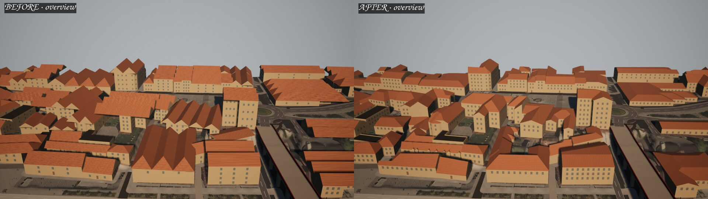
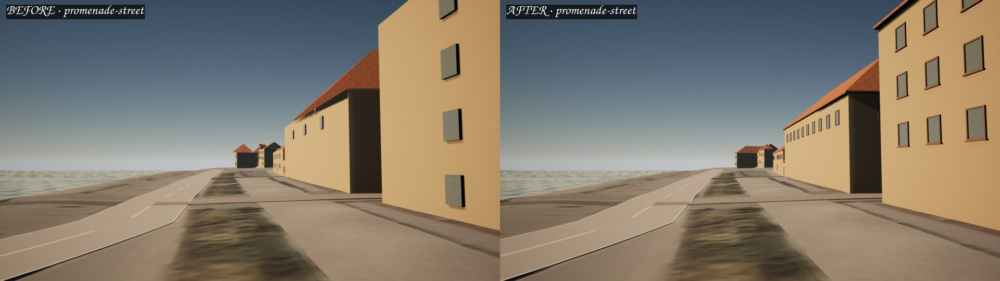
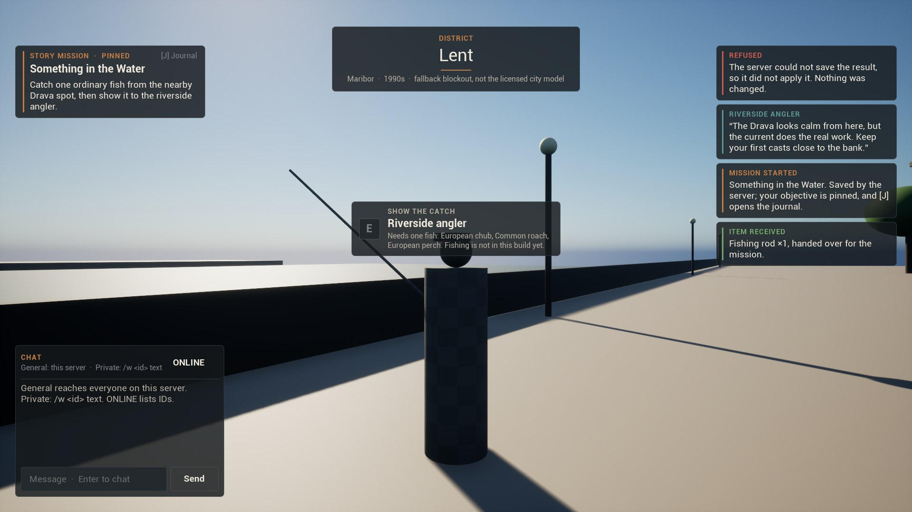
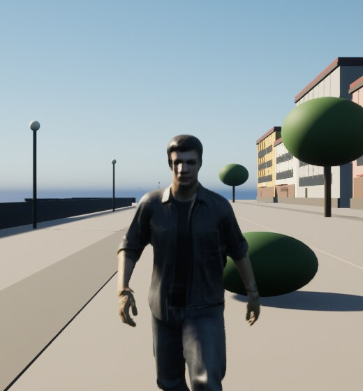

# Magna Raedarum: Marburgum II

<p align="center">
  <strong>A persistent world in a fictionalized 1990s Maribor, Slovenia.</strong><br>
  A clean-room Unreal Engine rebuild of <em>Magna Raedarum: Marburgum</em>, grounded in the original game's world, systems and stories.
</p>

<p align="center">
  <code>Unreal Engine 5.8.3</code> · <code>C++</code> · <code>.NET 10</code> · <code>Rust</code><br>
  <strong>Pre-alpha development · Linux test builds · Owner playtest pending</strong>
</p>

<p align="center">
  <a href="#the-game">The game</a> ·
  <a href="#development-status">Development status</a> ·
  <a href="#getting-started">Getting started</a> ·
  <a href="#architecture">Architecture</a> ·
  <a href="#roadmap">Roadmap</a> ·
  <a href="#documentation">Documentation</a>
</p>

<p align="center">
  
</p>
<p align="center"><sub>The work-in-progress Lent district, with rebuilt building geometry. In-engine development capture; not final art.</sub></p>

---

## The game

**Marburgum II** is an MMORPG-first urban role-playing game about living in, exploring and changing a shared city. Its design preserves the original Marburgum's identity: everyday interactions, missions, professions, skills, trade, vehicles, social relationships, investigations, wildlife and life along the Drava. Narrative and systemic progression take precedence over repetitive combat; combat remains a design possibility, subject to deliberate scope and testing.

The game is built for an **authoritative dedicated server** from its first playable milestone. Solo-friendly play and small-group cooperation (especially 2–5 players) are important experiences, while support for a large population must be demonstrated through future capacity testing. Skills replace the former generated talent system; urban stories are described as **missions**, not fantasy quests.

The playable world is currently a development slice of **Lent**, the historic riverside district. The ultimate geographic foundation is intended to be a separately licensed [Maribor 3D city model](Docs/WORLD_MAP_ADOPTION.md), once purchased, evaluated and approved. That model is **not** part of this repository or the current level.

## Development status

**As of 10 November 2026:** the Unreal Editor, dedicated Server and Client targets have been built on **Linux with UE 5.8.3**. A series of packaged-server and multiplayer-client tests has established the first network, UI and gameplay slices. **These are engineering qualifications, not a released game or personally approved gameplay.** Tests cover specific recorded source revisions; later art and level changes still need fresh packaging and regression testing before owner acceptance.

| Area | Present development implementation | Evidence / next boundary |
| --- | --- | --- |
| **Networking** | Dedicated authoritative server, replicated state, connection/reconnection, refusal of unauthorized mutations | [Stage 0 tests](Docs/STAGE0_EVIDENCE.md) · Windows qualification outstanding |
| **Interface & chat** | Styled UMG connection shell and component gallery; live HUD modules; general server chat and one-to-one private messaging | [UI captures](Docs/STAGE0C_UI_EVIDENCE.md) · [three-client chat test](Docs/STAGE0C_CHAT_EVIDENCE.md) |
| **Character** | Third-person protagonist, retopologized and textured, rigged to the UE5 mannequin skeleton; walking and running animations | [Character pipeline](Docs/CHARACTER_PROTAGONIST.md) · owner visual approval pending |
| **World** | Original Unreal Lent level at `/Game/World/lent`, now the default; authored opening route, detailed façades and watertight building shells with footprint-fitted roofs | [World decisions](Docs/DECISIONS.md) (ADR-024–027, ADR-034) · latest geometry requires fresh owner testing |
| **Interactions & story** | Server-validated supply-crate transactions, persisted inventory, riverside angler, opening of **“Something in the Water”**, journal and objective tracking | [Interaction](Docs/STAGE1_GATE1_EVIDENCE.md) · [Lent mission](Docs/STAGE1_LENT_EVIDENCE.md) |
| **Movement & condition** | Server-bounded movement time; stamina, running and winded state; swimming, submersion, drowning and recovery, including persisted condition | [Movement](Docs/STAGE1_MOVEMENT_TIME_EVIDENCE.md) · [condition](Docs/STAGE1_CONDITION_EVIDENCE.md) · [swimming](Docs/STAGE1_SWIM_EVIDENCE.md) |
| **Rendering** | Optional, client-side NVIDIA feature detection and fallbacks; Unreal TSR is the baseline renderer | [Rendering and platform limits](Docs/RENDERING_NVIDIA.md) |

<details>
<summary><strong>What is not implemented yet?</strong></summary>

Production account registration, email verification and login; first-time character creation and account-bound admission; a production database; fishing and the remainder of the first mission; the purchased city map; large-scale server operations; and the full mission, economy, skills, vehicle and population systems. Current persistence is a **development file store** and characters use **development-only test identities**. The refined graphics, current level and major gameplay slices all still require the owner's personal playtest and explicit approval.

</details>

### In-game development captures

| Lent and its streets | Early mission interface | Character in the world |
| :---: | :---: | :---: |
|  |  |  |

These screenshots show development milestones from different revisions, not a single final release build.

## Getting started

The **exact Unreal Engine patch is 5.8.3**, as specified in [`.unreal-engine-version`](.unreal-engine-version). The project's `EngineAssociation` value (`5.8`) is not a substitute for verifying `Engine/Build/Build.version`.

**Prerequisites:** Unreal Engine 5.8.3 with the supported Linux C++ toolchain, Git LFS, .NET 10 SDK and stable Rust. Unreal Engine itself is not distributed here. Linux is the validated development platform; [Windows setup](Docs/DEVELOPMENT.md#windows) is documented but has not yet passed the equivalent project build/test matrix.

```bash
git clone https://github.com/simon-gros/MarburgumII.git
cd MarburgumII
git lfs install
git lfs pull

export UE_ROOT=/absolute/path/to/UnrealEngine-5.8.3
./scripts/check-engine-version.sh "$UE_ROOT"

./scripts/build-linux.sh MarburgumIIEditor
./scripts/build-linux.sh MarburgumIIServer
./scripts/build-linux.sh MarburgumIIClient
```

Build and stage the distinct Linux server and client executables, then run the existing smoke suites:

```bash
./scripts/package-linux.sh
./scripts/net-smoke-linux.sh
./scripts/chat-smoke-linux.sh
./scripts/interaction-smoke-linux.sh
./scripts/lent-smoke-linux.sh
./scripts/condition-smoke-linux.sh
./scripts/swim-smoke-linux.sh
```

To enter the **current default Lent world** manually with development credentials, start the server and client in separate terminals after packaging:

```bash
# Terminal 1 — dedicated server
Saved/StagedBuilds/LinuxServer/MarburgumIIServer.sh /Game/World/lent -port=7777 -log

# Terminal 2 — development client (not a production login)
Saved/StagedBuilds/LinuxClient/MarburgumIIClient.sh -MB2Character=localtester
```

**Controls:** WASD + mouse to move/look · **Shift** run · **E** interact · **C** character · **I** inventory · **J** journal · **Enter** chat. The angler can start the opening mission, but fishing is not available yet. See the [full playthrough instructions](Docs/DEVELOPMENT.md#playing-the-lent-slice-by-hand) for map distinctions, world-store paths, test switches and troubleshooting.

The network and mission tests use dedicated development fixtures, including the older `/Game/Maps/Lent` blockout. The actual default game, server and editor map is **`/Game/World/lent`**. Do not confuse success on an older smoke fixture with approval of the latest world content.

Independent code and data checks:

```bash
dotnet run --project tools/MarburgumII.Tools -- verify
./scripts/mb2.sh validate all
cargo test --manifest-path tools/mb2/Cargo.toml
cargo test --manifest-path native/marburgum-sim-core/Cargo.toml
```

Before any owner sign-off, rebuild and recook from the intended source and asset snapshot, then validate the resulting packaged artifacts. The [playtest freshness guard](Docs/PLAYTEST_FRESHNESS.md) exists for this purpose, but its generic local launch profile still requires actual end-to-end qualification.

## Architecture

| Layer | Technology and role |
| --- | --- |
| **Game runtime** | Unreal Engine **5.8.3** / C++; shared gameplay, networked character, replicated state and interaction entry points |
| **Client** | `MarburgumIIClient`; UMG presentation, input, session flow, chat interface and optional rendering controls |
| **Server** | `MarburgumIIServer`; authoritative interaction and mission handling, admission checks and development persistence |
| **Shared contracts** | `MarburgumIIShared`; cross-boundary network and gameplay types |
| **Editor tools** | `MarburgumIIEditorTools`; C++ content commandlets, including map and geometry production |
| **Independent tools** | **C# / .NET 10** manifest verifier; **Rust** `tools/mb2` validation, test helpers and build/asset freshness checks |
| **Experimental native core** | Rust `native/marburgum-sim-core` with a versioned C ABI; tested independently, **not linked into the Unreal runtime** |

C# is not the gameplay scripting language, and Rust is not yet part of the running game. Repository tooling no longer depends on Python (ADR-018). For module dependencies, trust boundaries and future persistence, see [Architecture](Docs/ARCHITECTURE.md) and [Network architecture](Docs/NETWORK_ARCHITECTURE.md).

**Rendering:** Unreal TSR is the cross-platform fallback. NVIDIA DLSS Super Resolution / DLAA, Frame Generation and Reflex are optional where supported; NVIDIA's official Unreal plugins are installed **locally, outside Git** and are currently Windows/D3D12-only. Linux/Vulkan does not use those plugins, though NVIDIA Smooth Motion has a separate launcher. The included unofficial DLSS 5 integration is **not operable without a separately licensed runtime**, which is deliberately not shipped. [Full compatibility and licensing notes](Docs/RENDERING_NVIDIA.md).

## Roadmap

The project advances through independently tested, owner-approved slices:

1. **Foundation — implemented, acceptance pending:** Linux UE targets, authoritative networking, connection UI and basic chat.
2. **First-play onboarding — planned:** email verification, secure login, first name, last name and character-model selection, followed by server-gated world entry. A new account must not spawn in the world before its character has been saved. [First-launch ontology](Docs/FIRST_LAUNCH_ONTOLOGY.md).
3. **Playable Lent — in development:** third-person movement, first interactions, introductory mission, condition, swimming, early HUD and persistent development state. Build a visually coherent, manually approved district.
4. **Deeper city life — planned:** fishing, ecology, skills, missions, economy, professions, transport and more extensive interaction systems.
5. **City and operations — planned:** licensed geometry intake, larger-world streaming, population systems, production identities/storage and measured multiplayer scalability.

The [full milestone roadmap](Docs/ROADMAP.md) and [UI/HUD roadmap](Docs/UI_HUD_ROADMAP.md) specify the actual delivery gates. **A major playable feature is not accepted until the owner has tested it in-game and explicitly approved it.** Every acceptance run must use a fresh build and current assets.

## Documentation

| Topic | Read |
| --- | --- |
| **Design & continuity** | [Vision](Docs/VISION.md) · [Game ontology](Docs/ONTOLOGY.md) · [Original-game parity register](Docs/LEGACY_PARITY.md) |
| **Engineering** | [Development guide](Docs/DEVELOPMENT.md) · [Architecture](Docs/ARCHITECTURE.md) · [Network contract](Docs/NETWORK_ARCHITECTURE.md) · [Engineering decisions](Docs/DECISIONS.md) |
| **Player experience** | [First launch](Docs/FIRST_LAUNCH_ONTOLOGY.md) · [UI/HUD design](Docs/UI_HUD_DESIGN.md) · [UI ontology](Docs/UI_HUD_ONTOLOGY.md) · [UI roadmap](Docs/UI_HUD_ROADMAP.md) · [Chat](Docs/CHAT.md) |
| **World & assets** | [Map adoption](Docs/WORLD_MAP_ADOPTION.md) · [Protagonist](Docs/CHARACTER_PROTAGONIST.md) · [Conditional Hunyuan3D pipeline](Docs/ASSET_GENERATION_HUNYUAN3D.md) · [NVIDIA rendering](Docs/RENDERING_NVIDIA.md) |
| **Verification** | [Main roadmap and gates](Docs/ROADMAP.md) · [Playtest freshness](Docs/PLAYTEST_FRESHNESS.md) · [Stage 0](Docs/STAGE0_EVIDENCE.md) · [Lent](Docs/STAGE1_LENT_EVIDENCE.md) · [Swimming](Docs/STAGE1_SWIM_EVIDENCE.md) |

Machine-readable design contracts are under `Data/`; implementation, scripts and tests are under `Source/`, `scripts/`, `tools/` and `native/`. The GitHub workflow validates Rust and C# components; **CI does not replace a real Unreal Editor, client/server build or multiplayer test**.

## Licensing and asset provenance

**No project-wide source-code license has been chosen.** Public visibility on GitHub does not by itself permit reuse.

- **Commercial city model:** planned purchase only. Licensed geometry, textures and extractable derivatives must remain outside the public repository and public CI/LFS artifacts; consult [map adoption](Docs/WORLD_MAP_ADOPTION.md).
- **Epic content:** the included UE5 mannequin resources are governed by the Unreal Engine EULA and are not automatically relicensed with this project.
- **Third-party generation tools:** Hunyuan3D-2.1 is a possible offline asset-production tool, **not an engine dependency**. Its published community license excludes EU territory; production use requires rights clearance. The current protagonist's retopology and texture bake use a separate, documented pipeline.
- **NVIDIA components:** locally installed proprietary plugins and unavailable/unlicensed neural-rendering binaries are not redistributed here.

Every imported or generated game asset requires documented provenance, appropriate use rights, technical review and owner approval.
