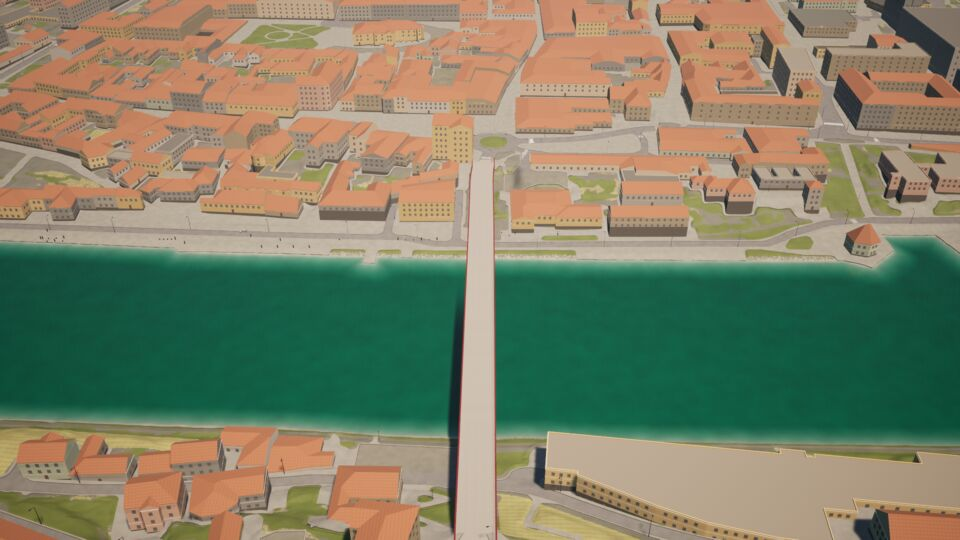
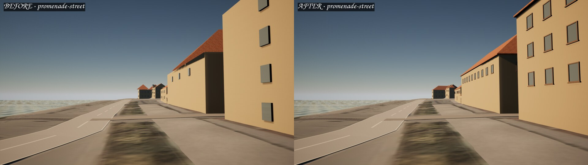
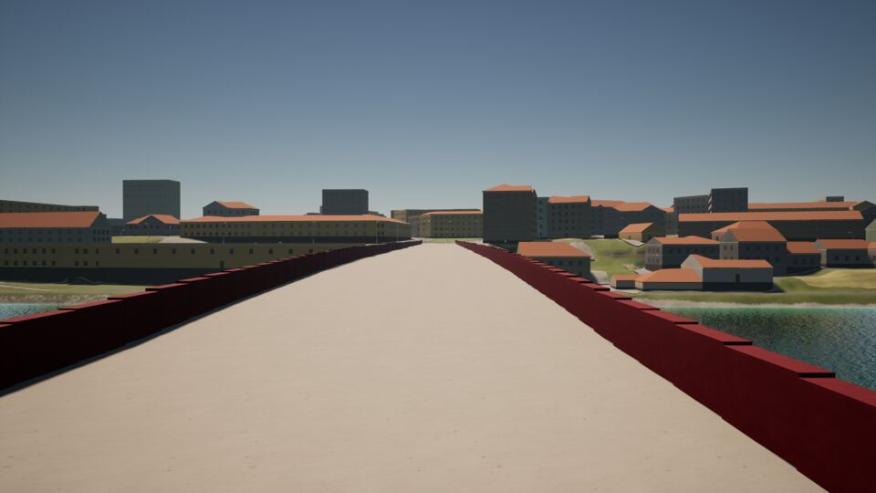

<div align="center">
  <h1>MAGNA RAEDARUM<br>MARBURGUM II</h1>
  <p><strong>A living city. A shared world. A new beginning.</strong></p>
  <p><em>A persistent urban role-playing world in a fictionalized 1990s Maribor, Slovenia.</em></p>
  <p>
    
    
    
    
  </p>
  <p>
    <a href="#the-world"><strong>Explore the world</strong></a> ·
    <a href="#development-progress"><strong>Development progress</strong></a> ·
    <a href="#building-from-source"><strong>Build the game</strong></a> ·
    <a href="Docs/ROADMAP.md"><strong>Roadmap</strong></a> ·
    <a href="Docs/GRAPHICS_ROADMAP.md"><strong>Graphics</strong></a>
  </p>
  
  <p><sub>In-engine nine-window visual survey · November 2026 · Development capture, not final game art.</sub></p>
</div>

---

## The world

**Marburgum II** rebuilds the original *Magna Raedarum: Marburgum* as an MMORPG-first game in **Unreal Engine 5.8.3**. Explore streets along the Drava, follow urban stories, meet other players, learn skills, fish, trade, drive and participate in the ordinary and extraordinary life of a city with its own routines.

The experience emphasizes exploration, character growth, missions, social interaction and systemic city life. Combat exists as a deliberately bounded, evolving part of the design. Solo-friendly play and small-group cooperation share the same **dedicated, authoritative server** architecture; long-term population targets are ambitions, not achieved benchmarks.

The current world is a **1,536 × 1,536 m nine-window development map** centered on Lent, with surveyed ground, buildings, roads and bridges, the Drava, a walkable street graph and a growing network of interactive locations. It is **one always-loaded level**—not a finished, streamed recreation of all of Maribor. The separately licensed candidate city model remains a future procurement and acceptance decision.

## Latest development · 20 November 2026

**Story: Chapter VI, *The Negative* (ADR-083, branch `feat/story-chapter-vi`, awaiting the owner's playtest).** Nika Vidmar dates the torn photograph from the Drava cashbox; Foto Vidmar's order book names the roll; Stefan Zupan's contact sheet in a Block 13 storage cage shows a 37th frame on a 36-exposure roll; the companion side story *Thirty-Six Exposures* has the player reason out that the frame's yard, not its person, can be checked, and find and photograph the Melje yard's date board. Vera reads it as a chronology (a Kainach truck delivered on 16 February 1990, two months after the file says the arrangement closed), the Glas photo desk's uncropped print puts Albin Rojko at the gate, and how he answers depends on how Kiosk 67 ended. The places have recognisable furniture (the counter, the light table, the cage, the date board, the Kainach lorries), the Journal separates open questions from what is established, and everything is in English and Slovene. [How to play it](Docs/STORY_EXPANSION.md#109-owner-playtest-how-to-play-chapter-vi) · [what was tested](Docs/STORY_EXPANSION.md#107-tests-and-evidence-chapter-vi).

The overnight development push brought together a broad **quality-assurance audit** and improvements through **ADR-076**. Accounts, persistence, input, scrolling screens, notifications and packaged-build verification were hardened; pedestrian crowds now follow each player's district, share local budgets and navigate a repaired bridge graph.

A real editor pedestrian traversed **283 metres across Stari most and back**. The new multi-client crowd matrix shows **18 pedestrians shared by two players** on a shopping street (not 36), a nighttime pair sharing **2**, and three old-town players reaching the **48-person cap**.

**The packaged daytime matrix is not fully passing.** The opposite-bank scenario timed out at **11 of the expected 28 pedestrians** in a clean Linux Development package. The majority of rejected spawn probes found no eligible pavement node. This is the immediate stabilization priority, rather than release readiness.

<div align="center"><table>
<tr>
<td width="50%"><br><sub>Lent streetscape</sub></td>
<td width="50%"><br><sub>Bridge-deck inspection</sub></td>
</tr>
</table><sub>Actual in-engine development captures. Not final release art.</sub></div>

[20 November review](Docs/DEVELOPMENT_REVIEW_2026-11-20.md) · [QA audit](Docs/QA_AUDIT_2026-11-19.md) · [Visual backlog](Docs/VISUAL_QUALITY_BACKLOG.md) · [AI evidence](Docs/AI_GAMEPLAY.md)

The merged **UI/HUD redesign** now includes a consolidated Character/Skills/Inventory/Journal shell, functioning Settings, revised HUD/creator/Escape/chat screens, **657 English/Slovene interface strings**, 5:4/150% creator-fit and contrast checks (**37/37 editor automation**). Packaged localization/fonts, full live resolution/controller input checks and personal owner approval are still open. **ADR-076 interiors** provide 586 eligible deterministic ground floors, but only **five shells have actual cut doors** and editor walking evidence; **581 remain sealed**. A Client/Server package compiled after data staging fixes, yet no staged multi-client door acceptance is recorded.

The new [graphics roadmap](Docs/GRAPHICS_ROADMAP.md) is a **proposal** for measured visual improvements, not implemented rendering upgrades. Source-validation CI failed after the historical research tools were imported, because their Python validators and workflow contradicted the binding Python-free ADR-018. [ADR-077](Docs/DECISIONS.md) ports them to Rust `mb2`; source and archive validation now run on every revision. See the [morning review](Docs/DEVELOPMENT_REVIEW_2026-11-20_MORNING.md) for corrective priorities.

## Historical research and art references

Marburgum II now carries the historical **246-record art-reference catalogue** (236 original + 10 newly researched), **five evidence-derived art/world-state rules**, and **six historical imagery/cartography leads** (three original + three new). Source provenance, permissions and uncertainty remain explicit; the source images and rasters themselves were **not imported**. These catalogues are design evidence, not a claim that period-specific scenery is already implemented.

[Browse the art-reference catalogue](art_reference/README.md) · [Historical archives and rights policy](Docs/HISTORICAL_ARCHIVES.md) · [Source directory](art_reference/SOURCES.md)

## Development progress

The table distinguishes **recorded engineering implementation** from **release acceptance**. A feature may work in a scoped editor test and still require current packaged multiplayer testing, graphical review and a personal owner playtest.

| System | What exists today | What remains open |
| --- | --- | --- |
| **Online foundation** | Authoritative Linux Client/Server, chat, QA fixes for RPC trust, persistence and packaged-build traceability | Full current regression, Windows parity, production operations and scaling |
| **Identity and creation** | Development HTTPS registration/recovery, First/Last/model creator, rotating 3D preview and account-service hardening | Server-bound tickets (AR1), production email, complete UI matrix and owner approval |
| **World and atmosphere** | Nine-window Lent, weather/day-night and lights; ADR-072 visual audit and targeted placement/signage corrections | Period-correct landmarks, vegetation, furniture, frame-time/streaming and art sign-off |
| **Living streets** | Server-owned district/hour visitors and 239 places; shared crowds, bridge repairs and real 2–3-client packaged scenarios | **Opposite-bank crowd timeout: 11/28 staged**; complete settled matrix, incident regression and owner test |
| **Life and progression** | Fishing (a visible rod and cast/wait/reel for the player and the angler), Photography (camera, twelve documented subjects including documents on a counter and a light table, server-judged photographs), persistent 0–1990 skills, Inventory, Journal, Skills, Kiosk 67, all eight original mission flows plus **Chapter IV *Voices on Tape***, Maja's folder, two photography side missions and, on branch `feat/story-chapter-vi`, **Chapter VI *The Negative*** with the side story ***Frame 37***: Albin Rojko's testimony takes a different route for each Kiosk 67 outcome, a deduction at the light table, evidence classed as original, print, copy, testimony, information or inference, and open questions in the Journal | Owner playtest of Chapters IV and VI; Chapters V and VII–XI; the 1990–92 and 1997–99 variants; further professions; authored remote terrain |
| **People** | Every mission contact is an animated, tinted mannequin that turns to whoever talks to it; the riverside angler fishes from the bank with a period spinning rod | Bespoke character models and faces, walking daily routines for named residents |
| **Movement and vehicles** | Third-person character, persisted condition, swimming, unarmed combat, five-car catalogue and authoritative vehicle seats/driving | Owner retest of the previously reported long-drive defect; current packaged passenger/combat regressions |
| **Presentation and chat** | Merged UI v2, HUD/management/Settings/chat/creator, 657 localized interface strings, creator-fit and contrast editor checks | Fresh packaged UI/ICU/fonts, 720p–4K/80–200% and controller/focus, gameplay translation, owner acceptance |
| **Interiors** | 586 eligible procedural ground floors, five physical shell door openings with editor three-client proof | Full staged door smoke, 581 remaining sealed candidates, 346 exceptions, furnishing and owner acceptance |

**Current status: pre-alpha.** The clean packaged multi-client crowd test is **partially passing**; the daytime matrix exits nonzero. No release build, full-city completion, production-scale MMO capacity or personal owner acceptance is claimed.

### Development gallery

| The city | Missions and player interface | The protagonist |
| :---: | :---: | :---: |
|  |  |  |

<sub>Images document different editor-era development milestones, rather than one release-candidate build.</sub>

## Building from source

**Requirements:** Unreal Engine **5.8.3 exactly**, supported Linux C++ compiler/toolchain, Git LFS, .NET **10** SDK and stable Rust. Unreal Engine and some licensed/local assets are **not** distributed with this repository. Linux is the primary tested development environment; Windows parity has not been established.

```bash
git clone https://github.com/simon-gros/MarburgumII.git
cd MarburgumII
git lfs install
git lfs pull

export UE_ROOT=/absolute/path/to/UnrealEngine-5.8.3
./scripts/check-engine-version.sh "$UE_ROOT"

./scripts/build-linux.sh MarburgumIIEditor
./scripts/build-linux.sh MarburgumIIServer
./scripts/build-linux.sh MarburgumIIClient
```

For actual staged binaries and existing smoke suites:

```bash
./scripts/package-linux.sh
./scripts/net-smoke-linux.sh
./scripts/chat-smoke-linux.sh
./scripts/interaction-smoke-linux.sh
./scripts/combat-smoke-linux.sh
./scripts/vehicle-smoke-linux.sh
```

District/venue behaviors have editor-mode evidence. A separate clean `c967c46` Linux Development package ran real two/three-client crowd scenarios, including the failing opposite-bank case. To reproduce:

```bash
./scripts/street-hours-smoke-linux.sh editor
./scripts/street-district-smoke-linux.sh editor
./scripts/street-places-smoke-linux.sh editor
./scripts/street-smoke-linux.sh editor
./scripts/mission-smoke-linux.sh editor
./scripts/account-smoke-linux.sh editor
./scripts/bridge-cross-linux.sh editor
./scripts/street-multiplayer-smoke-linux.sh editor night
./scripts/street-multiplayer-smoke-linux.sh staged night
./scripts/street-multiplayer-smoke-linux.sh staged # current opposite-bank timeout, exit 1
```

Independent source and data checks:

```bash
dotnet run --project tools/MarburgumII.Tools -- verify
./scripts/mb2.sh validate all
cargo test --manifest-path tools/mb2/Cargo.toml
cargo test --manifest-path native/marburgum-sim-core/Cargo.toml
```

These commands are **instructions, not tests run by this documentation update**. A genuine acceptance candidate needs freshly built and cooked Linux Client/Server artifacts from the **same clean SHA and sealed current asset set**, negative/restart cases, logs and the owner's explicit in-game decision. Read the [development guide](Docs/DEVELOPMENT.md) and [playtest freshness policy](Docs/PLAYTEST_FRESHNESS.md) before launching.

**Development controls:** WASD + mouse (move/look), Shift (run), E (interact/vehicle), F/R/G (jab/heavy/guard), C (Character), I (Inventory), J (Journal), K (Skills), Enter (chat). At the Drava fishing point, E is used for fishing actions. See [manual playthrough and environment setup](Docs/DEVELOPMENT.md#playing-the-lent-slice-by-hand). The actual default level is `/Game/World/lent`; the older `/Game/Maps/Lent` is a testing fixture, not current world acceptance.

## How it is built

```text
                     Unreal Engine 5.8.3 / C++
                    ┌─────────────────────────┐
                    │  MarburgumII (runtime)  │
                    │  Shared gameplay types  │
                    └────────────┬────────────┘
                 ┌───────────────┴────────────────┐
          ┌──────▼────────┐               ┌───────▼───────┐
          │ ClientOnly    │   requests    │ ServerOnly    │
          │ UI, input,    │ ───────────▶  │ authority,   │
          │ presentation  │ ◀───────────  │ world store  │
          └───────────────┘   replication └───────────────┘

          Rust: validation / tooling, account HTTPS service
          .NET 10: manifest verification and build support
          Experimental Rust C ABI: not linked to game runtime
```

The server owns meaningful gameplay mutations, NPC destinations, combat resolution, durable transactions and admission. The client presents confirmed outcomes. There is currently no Unreal Behavior Tree, StateTree, EQS, MassEntity or NavMesh-based pedestrian system; the street uses the project's own walk graph and shared rules. For boundaries and evidence, see [Architecture](Docs/ARCHITECTURE.md), [Network](Docs/NETWORK_ARCHITECTURE.md) and [Gameplay AI](Docs/AI_GAMEPLAY.md).

## 3D asset production

**Microsoft TRELLIS is the project-standard image-to-3D generator (ADR-071).** New image-conditioned props, accessories, selected character and ecological visuals should follow the [TRELLIS workflow](Docs/ASSET_GENERATION_TRELLIS.md), with rights/provenance, retopology, material, period and owner acceptance checks. Hunyuan3D-2.1 has been superseded; generative tools do not replace surveyed city geometry.

## What's next

**P0:** Restore passing whole-repository CI and resolve the Python-free archival tooling conflict; fix the strict opposite-bank crowd timeout; stage and verify the five working interiors and merged UI in current matched Client/Server packages. Close full mission/account/vehicle regressions and ticket audience/privacy gaps before owner playtesting.

**P1:** Qualify audited batches of the 581 remaining sealed interior shells, rights/date/place-check the 246 references and six map leads, and measure a real packaged visual baseline. Follow the [graphics and rendering roadmap](Docs/GRAPHICS_ROADMAP.md) and [visual-quality backlog](Docs/VISUAL_QUALITY_BACKLOG.md) for original Marburgum trees, street furniture, period signage, mission props and landmark art. **Microsoft TRELLIS remains the selected image-to-3D workflow (ADR-071), not Hunyuan3D.**

[Full roadmap](Docs/ROADMAP.md) · [20 November review](Docs/DEVELOPMENT_REVIEW_2026-11-20.md) · [AI backlog](Docs/AI_GAMEPLAY.md)

## Documentation

| Area | Documents |
| --- | --- |
| **Game design** | [Vision](Docs/VISION.md) · [Ontology](Docs/ONTOLOGY.md) · [Original-game parity](Docs/LEGACY_PARITY.md) |
| **Roadmaps and status** | [Milestones](Docs/ROADMAP.md) · [Graphics](Docs/GRAPHICS_ROADMAP.md) · [UI/HUD](Docs/UI_HUD_ROADMAP.md) · [20 November review](Docs/DEVELOPMENT_REVIEW_2026-11-20.md) · [AI backlog](Docs/AI_GAMEPLAY.md) |
| **Engineering** | [QA audit](Docs/QA_AUDIT_2026-11-19.md) · [Development](Docs/DEVELOPMENT.md) · [Architecture](Docs/ARCHITECTURE.md) · [Networking](Docs/NETWORK_ARCHITECTURE.md) · [Decision log](Docs/DECISIONS.md) · [Fresh owner playtests](Docs/PLAYTEST_FRESHNESS.md) |
| **Player experience** | [First launch](Docs/FIRST_LAUNCH_ONTOLOGY.md) · [UI/HUD design](Docs/UI_HUD_DESIGN.md) · [UI ontology](Docs/UI_HUD_ONTOLOGY.md) · [Chat](Docs/CHAT.md) |
| **Art and world** | [Graphics roadmap](Docs/GRAPHICS_ROADMAP.md) · [Visual backlog](Docs/VISUAL_QUALITY_BACKLOG.md) · [Map and licensing strategy](Docs/WORLD_MAP_ADOPTION.md) · [Character](Docs/CHARACTER_PROTAGONIST.md) · [Microsoft TRELLIS image-to-3D workflow](Docs/ASSET_GENERATION_TRELLIS.md) · [Rendering](Docs/RENDERING_NVIDIA.md) |
| **Test evidence** | [Districts](Docs/STAGE1_STREET_DISTRICTS_EVIDENCE.md) · [Destinations](Docs/STAGE1_STREET_PLACES_EVIDENCE.md) · [Street incidents](Docs/STAGE1_STREET_EVIDENCE.md) · [Mission play](Docs/STAGE1_LENT_EVIDENCE.md) · [Driving](Docs/STAGE1_VEHICLE_EVIDENCE.md) |

Gameplay and ontology data live under `Data/`. Native game code is in `Source/`, tooling in `tools/` and `native/`, and scripts in `scripts/`. Rust/.NET CI **does not substitute for an Unreal package or a visual gameplay test**.

## Source licensing and asset provenance

**There is no project-wide source-code license yet.** A public GitHub repository is not, by itself, a grant of redistribution or commercial reuse rights.

**3D-generation policy (ADR-071): Microsoft TRELLIS is the selected image-to-3D workflow for all new Marburgum II assets; Hunyuan3D-2.1 is superseded and is not a fallback.** The protagonist already uses TRELLIS. Third-party rasterizer/export dependencies, checkpoint licenses, input images and generated content still require independent rights review. The planned third-party city model is **not purchased or imported**; its commercial source and derivatives cannot enter public Git or public build artifacts without rights approval. Epic mannequin content follows its own terms. Optional proprietary NVIDIA components are installed locally and are not redistributed.

All imported/generated assets require provenance, rights clearance, technical review and owner approval. See [map adoption](Docs/WORLD_MAP_ADOPTION.md), [Microsoft TRELLIS asset generation](Docs/ASSET_GENERATION_TRELLIS.md) and [rendering compatibility](Docs/RENDERING_NVIDIA.md).
