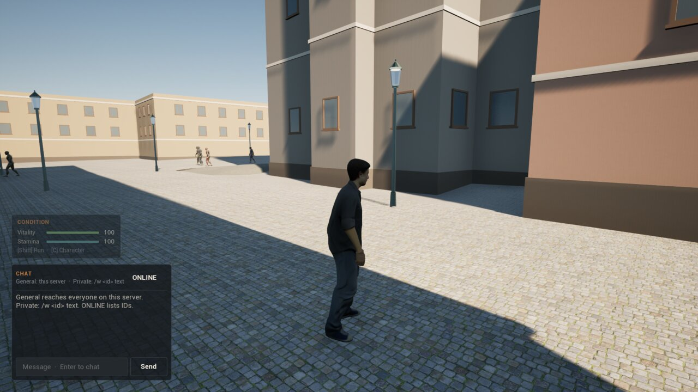
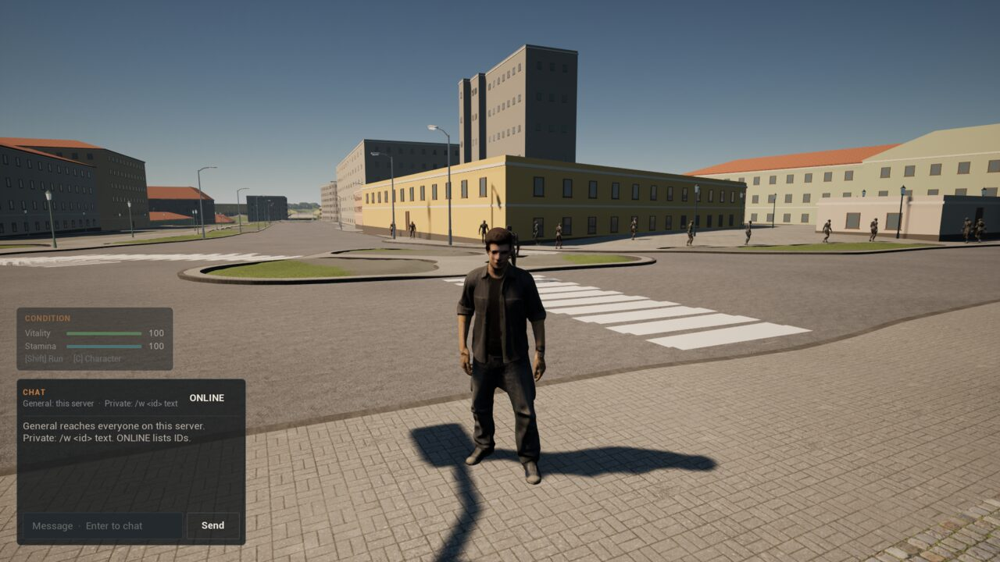
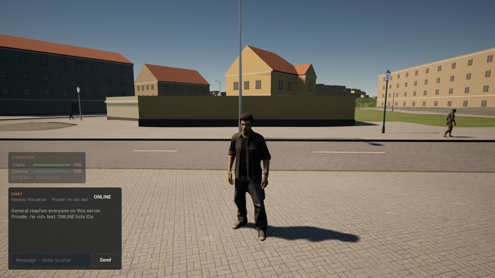
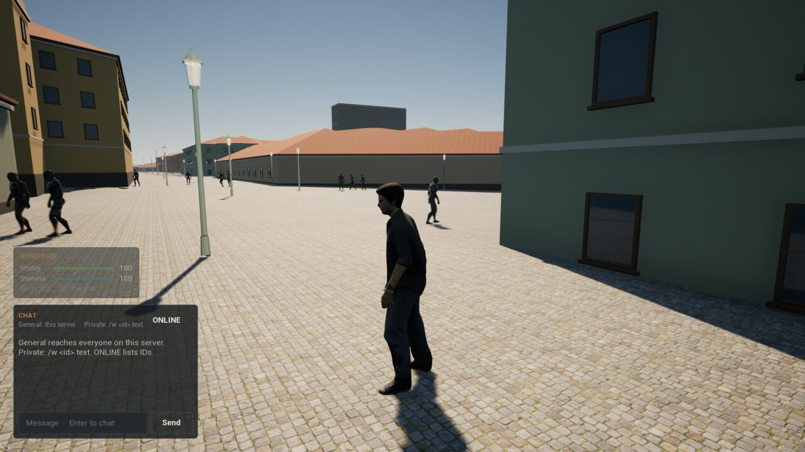
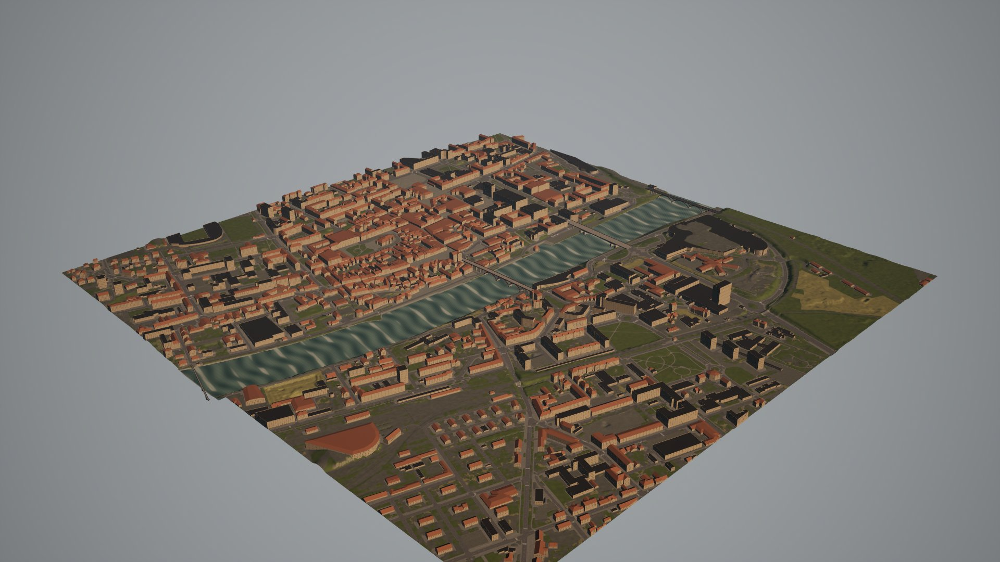
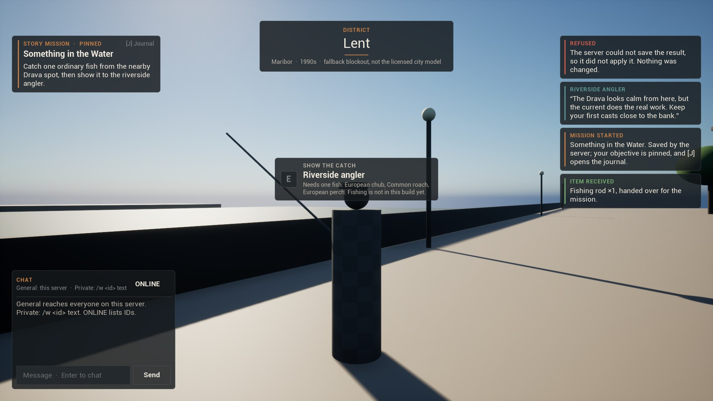
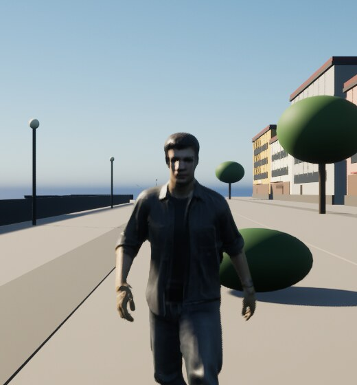

<div align="center">
  <h1>MAGNA RAEDARUM<br>MARBURGUM II</h1>
  <p><strong>A living city. A shared world. A new beginning.</strong></p>
  <p><em>A persistent urban role-playing world in a fictionalized 1990s Maribor, Slovenia.</em></p>
  <p>
    
    
    
    
  </p>
  <p>
    <a href="#the-world"><strong>Explore the world</strong></a> ·
    <a href="#development-progress"><strong>Development progress</strong></a> ·
    <a href="#building-from-source"><strong>Build the game</strong></a> ·
    <a href="Docs/ROADMAP.md"><strong>Roadmap</strong></a>
  </p>
  
  <p><sub>In-engine development capture · Lent street-places verification, 19 November 2026 · Work in progress, not final release art.</sub></p>
</div>

---

## The world

**Marburgum II** rebuilds the original *Magna Raedarum: Marburgum* as an MMORPG-first game in **Unreal Engine 5.8.3**. Explore streets along the Drava, follow urban stories, meet other players, learn skills, fish, trade, drive and participate in the ordinary and extraordinary life of a city with its own routines.

The experience emphasizes exploration, character growth, missions, social interaction and systemic city life. Combat exists as a deliberately bounded, evolving part of the design. Solo-friendly play and small-group cooperation share the same **dedicated, authoritative server** architecture; long-term population targets are ambitions, not achieved benchmarks.

The current world is a **1,536 × 1,536 m nine-window development map** centered on Lent, with surveyed ground, buildings, roads and bridges, the Drava, a walkable street graph and a growing network of interactive locations. It is **one always-loaded level**—not a finished, streamed recreation of all of Maribor. The separately licensed candidate city model remains a future procurement and acceptance decision.

## Recent development: streets that feel inhabited

The six commits reviewed between **18 and 19 November 2026** extend the existing street simulation in three directions:

| District identity | Places and routines | AI reliability |
| :--- | :--- | :--- |
| **ADR-068**: population composition now follows the district and street activity, with distinct day, evening, night and weekend behavior. | **ADR-069**: 239 mapped bus stops, cafés, restaurants, bars, fast-food venues, shops and sights now influence where pedestrians go, wait and enter or exit. | **ADR-070**: blocked hostile pursuit gives up, blocked pedestrian edges stop reversing repeatedly, and lane separation improves passing. The editor rule tests passed on 19 November 2026; a rendered or packaged smoke of that change has not. |

A separate change corrected a **clean-checkout compilation regression**. District and destination features have recorded **one-client editor-mode** smoke results; these are not evidence of a newly packaged, multi-client, owner-approved build.

<div align="center">
<table>
<tr>
<td width="33%"><br><sub>Commercial district</sub></td>
<td width="33%"><br><sub>Street destinations</sub></td>
<td width="33%"><br><sub>Local landmarks</sub></td>
</tr>
</table>
<sub>Automated editor-mode captures; scenes and systems are under development.</sub>
</div>

[**Read the 19 November engineering review**](Docs/DEVELOPMENT_REVIEW_2026-11-19.md) · [**Gameplay AI backlog**](Docs/AI_GAMEPLAY.md) · [**Street places evidence**](Docs/STAGE1_STREET_PLACES_EVIDENCE.md)

## Development progress

The table distinguishes **recorded engineering implementation** from **release acceptance**. A feature may work in a scoped editor test and still require current packaged multiplayer testing, graphical review and a personal owner playtest.

| System | What exists today | What remains open |
| --- | --- | --- |
| **Online foundation** | Native UE 5.8.3 dedicated server/client targets, authoritative gameplay state, connection/reconnection and earlier packaged multiplayer evidence | Requalify the latest combined source/assets; Windows and scale testing |
| **Identity and creation** | Development HTTPS registration/verification flow, password recovery, one character/account, First/Last/model selection, rotating/zooming 3D creator and one-use server tickets | Actual mail delivery and production operations, packaged/login matrix, owner approval |
| **World and atmosphere** | Nine-window Lent map, Drava, ground/roads, landmarks, day/night, weather, street lamps and lit windows | World Partition, map-wide performance, period correction and art sign-off |
| **Living streets** | Server-owned pedestrians, district/time/weather distribution, visits to mapped destinations, incident and car reactions; ADR-070 navigation fixes in source | Execute ADR-070 tests, packaged two/three-client crowd/AI verification, navigation detours and performance profiling |
| **Life and progression** | Fishing, persistent 0–1990 skill progression, Inventory, Journal, Skills, Kiosk 67 and all eight original mission flows | Integrated packaged mission/trade contention and restart cases, additional professions and authored remote terrain |
| **Movement and vehicles** | Third-person character, persisted condition, swimming, unarmed combat, five-car catalogue and authoritative vehicle seats/driving | Owner retest of the previously reported long-drive defect; current packaged passenger/combat regressions |
| **Presentation and chat** | UMG session/chat, server-backed HUD, Character/Inventory/Journal/Skills, basic combat/vehicle/mission feedback; earlier three-client private-chat isolation | Settings, focus/controller, localization, accessibility and resolution matrix, visual owner acceptance |

**Current status: pre-alpha.** No release build, large-scale MMORPG capacity, complete city environment or latest-build personal owner approval is claimed.

### Development gallery

| The city | Missions and player interface | The protagonist |
| :---: | :---: | :---: |
|  |  |  |

<sub>Images document different editor-era development milestones, rather than one release-candidate build.</sub>

## Building from source

**Requirements:** Unreal Engine **5.8.3 exactly**, supported Linux C++ compiler/toolchain, Git LFS, .NET **10** SDK and stable Rust. Unreal Engine and some licensed/local assets are **not** distributed with this repository. Linux is the primary tested development environment; Windows parity has not been established.

```bash
git clone https://github.com/simon-gros/MarburgumII.git
cd MarburgumII
git lfs install
git lfs pull

export UE_ROOT=/absolute/path/to/UnrealEngine-5.8.3
./scripts/check-engine-version.sh "$UE_ROOT"

./scripts/build-linux.sh MarburgumIIEditor
./scripts/build-linux.sh MarburgumIIServer
./scripts/build-linux.sh MarburgumIIClient
```

For actual staged binaries and existing smoke suites:

```bash
./scripts/package-linux.sh
./scripts/net-smoke-linux.sh
./scripts/chat-smoke-linux.sh
./scripts/interaction-smoke-linux.sh
./scripts/combat-smoke-linux.sh
./scripts/vehicle-smoke-linux.sh
```

The newest district/venue evidence was recorded with **editor-mode** tooling, not the packaged commands above. To reproduce these focused cases:

```bash
./scripts/street-hours-smoke-linux.sh editor
./scripts/street-district-smoke-linux.sh editor
./scripts/street-places-smoke-linux.sh editor
./scripts/street-smoke-linux.sh editor
./scripts/mission-smoke-linux.sh editor
./scripts/account-smoke-linux.sh editor
```

Independent source and data checks:

```bash
dotnet run --project tools/MarburgumII.Tools -- verify
./scripts/mb2.sh validate all
cargo test --manifest-path tools/mb2/Cargo.toml
cargo test --manifest-path native/marburgum-sim-core/Cargo.toml
```

These commands are **instructions, not tests run by this documentation update**. A genuine acceptance candidate needs freshly built and cooked Linux Client/Server artifacts from the **same clean SHA and sealed current asset set**, negative/restart cases, logs and the owner's explicit in-game decision. Read the [development guide](Docs/DEVELOPMENT.md) and [playtest freshness policy](Docs/PLAYTEST_FRESHNESS.md) before launching.

**Development controls:** WASD + mouse (move/look), Shift (run), E (interact/vehicle), F/R/G (jab/heavy/guard), C (Character), I (Inventory), J (Journal), K (Skills), Enter (chat). At the Drava fishing point, E is used for fishing actions. See [manual playthrough and environment setup](Docs/DEVELOPMENT.md#playing-the-lent-slice-by-hand). The actual default level is `/Game/World/lent`; the older `/Game/Maps/Lent` is a testing fixture, not current world acceptance.

## How it is built

```text
                     Unreal Engine 5.8.3 / C++
                    ┌─────────────────────────┐
                    │  MarburgumII (runtime)  │
                    │  Shared gameplay types  │
                    └────────────┬────────────┘
                 ┌───────────────┴────────────────┐
          ┌──────▼────────┐               ┌───────▼───────┐
          │ ClientOnly    │   requests    │ ServerOnly    │
          │ UI, input,    │ ───────────▶  │ authority,   │
          │ presentation  │ ◀───────────  │ world store  │
          └───────────────┘   replication └───────────────┘

          Rust: validation / tooling, account HTTPS service
          .NET 10: manifest verification and build support
          Experimental Rust C ABI: not linked to game runtime
```

The server owns meaningful gameplay mutations, NPC destinations, combat resolution, durable transactions and admission. The client presents confirmed outcomes. There is currently no Unreal Behavior Tree, StateTree, EQS, MassEntity or NavMesh-based pedestrian system; the street uses the project's own walk graph and shared rules. For boundaries and evidence, see [Architecture](Docs/ARCHITECTURE.md), [Network](Docs/NETWORK_ARCHITECTURE.md) and [Gameplay AI](Docs/AI_GAMEPLAY.md).

## 3D asset production

**Microsoft TRELLIS is the project-standard image-to-3D generator (ADR-071).** New image-conditioned props, accessories, selected character and ecological visuals should follow the [TRELLIS workflow](Docs/ASSET_GENERATION_TRELLIS.md), with rights/provenance, retopology, material, period and owner acceptance checks. Hunyuan3D-2.1 has been superseded; generative tools do not replace surveyed city geometry.

## What's next

**Priority 0:** run the new ADR-070 regression assertions; qualify the **complete current street/district/venues/combat/mission slice** in a freshly cooked two-client dedicated-server build; reproduce blocked-path cases, third-client separation and prior vehicle issues; record performance and negative cases.

Then close first-launch packaging and UI/Settings/focus/localization gates, secure a **personal owner playtest**, and continue the map, ecology, traffic and profession work behind individual acceptance decisions. A wider streamed city and 250-player ambitions require independent proof.

[**Full milestone roadmap**](Docs/ROADMAP.md) · [**UI/HUD roadmap**](Docs/UI_HUD_ROADMAP.md) · [**Latest review**](Docs/DEVELOPMENT_REVIEW_2026-11-19.md)

## Documentation

| Area | Documents |
| --- | --- |
| **Game design** | [Vision](Docs/VISION.md) · [Ontology](Docs/ONTOLOGY.md) · [Original-game parity](Docs/LEGACY_PARITY.md) |
| **Roadmaps and status** | [Milestones](Docs/ROADMAP.md) · [UI/HUD](Docs/UI_HUD_ROADMAP.md) · [19 November review](Docs/DEVELOPMENT_REVIEW_2026-11-19.md) · [AI backlog](Docs/AI_GAMEPLAY.md) |
| **Engineering** | [Development](Docs/DEVELOPMENT.md) · [Architecture](Docs/ARCHITECTURE.md) · [Networking](Docs/NETWORK_ARCHITECTURE.md) · [Decision log](Docs/DECISIONS.md) · [Fresh owner playtests](Docs/PLAYTEST_FRESHNESS.md) |
| **Player experience** | [First launch](Docs/FIRST_LAUNCH_ONTOLOGY.md) · [UI/HUD design](Docs/UI_HUD_DESIGN.md) · [UI ontology](Docs/UI_HUD_ONTOLOGY.md) · [Chat](Docs/CHAT.md) |
| **Art and world** | [Map and licensing strategy](Docs/WORLD_MAP_ADOPTION.md) · [Character](Docs/CHARACTER_PROTAGONIST.md) · [Microsoft TRELLIS image-to-3D workflow](Docs/ASSET_GENERATION_TRELLIS.md) · [Rendering](Docs/RENDERING_NVIDIA.md) |
| **Test evidence** | [Districts](Docs/STAGE1_STREET_DISTRICTS_EVIDENCE.md) · [Destinations](Docs/STAGE1_STREET_PLACES_EVIDENCE.md) · [Street incidents](Docs/STAGE1_STREET_EVIDENCE.md) · [Mission play](Docs/STAGE1_LENT_EVIDENCE.md) · [Driving](Docs/STAGE1_VEHICLE_EVIDENCE.md) |

Gameplay and ontology data live under `Data/`. Native game code is in `Source/`, tooling in `tools/` and `native/`, and scripts in `scripts/`. Rust/.NET CI **does not substitute for an Unreal package or a visual gameplay test**.

## Source licensing and asset provenance

**There is no project-wide source-code license yet.** A public GitHub repository is not, by itself, a grant of redistribution or commercial reuse rights.

**3D-generation policy (ADR-071): Microsoft TRELLIS is the selected image-to-3D workflow for all new Marburgum II assets; Hunyuan3D-2.1 is superseded and is not a fallback.** The protagonist already uses TRELLIS. Third-party rasterizer/export dependencies, checkpoint licenses, input images and generated content still require independent rights review. The planned third-party city model is **not purchased or imported**; its commercial source and derivatives cannot enter public Git or public build artifacts without rights approval. Epic mannequin content follows its own terms. Optional proprietary NVIDIA components are installed locally and are not redistributed.

All imported/generated assets require provenance, rights clearance, technical review and owner approval. See [map adoption](Docs/WORLD_MAP_ADOPTION.md), [Microsoft TRELLIS asset generation](Docs/ASSET_GENERATION_TRELLIS.md) and [rendering compatibility](Docs/RENDERING_NVIDIA.md).
